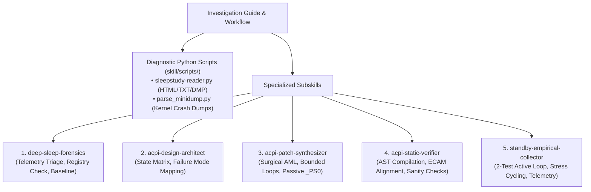
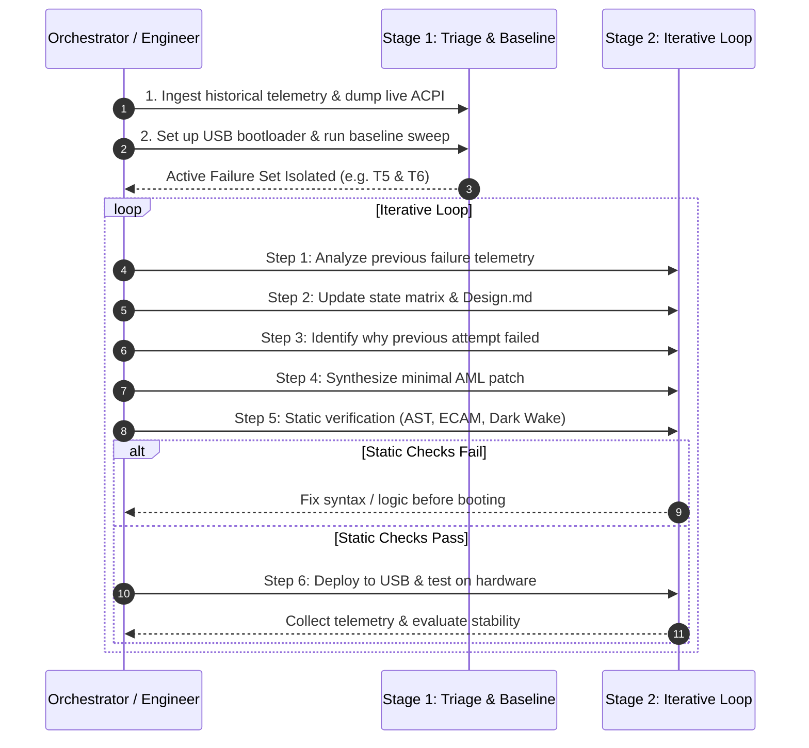

# Deep Sleep & Modern Standby (S0ix) Investigation Guide

## Overview

This guide provides a structured debugging process for diagnosing and fixing laptop sleep, wake, and standby failures—such as Modern Standby (S0ix / Low Power S0 Idle) hangs, unexpected reboots, discrete GPU power-transition crashes, and battery drain.

Instead of unguided trial-and-error patching directly on hardware, it organizes the work into two stages:
1. **Stage 1: Setup & Initial Triage:** Extract crash telemetry, dump live ACPI tables, set up a non-invasive USB bootloader, and establish an unmodified baseline.
2. **Stage 2: Iterative Debugging Loop:** Analyze failure symptoms $\to$ write down state transitions $\to$ check why prior patch failed $\to$ synthesize minimal AML $\to$ verify statically $\to$ test on hardware.



---

## Core Engineering Invariants

Keep these practical rules in mind before touching firmware bytecode:

1. **Test Stock Baseline First:** Never test a patch without first knowing how the clean factory firmware behaves across basic sleep/wake scenarios. Otherwise, you end up "fixing" functional vendor code and chasing imaginary bugs.
2. **Respect the S0 vs S0ix Boundary:**
   * **`Video Idle Timeout` (Display Off):** The OS is **running actively in S0**. User apps and audio services are in D0. Never cut power rails or assert hardware reset (`PERST#`) during display turn-off.
   * **`Screen Off Request / System Sleep`:** The OS coordinates **system-wide quiescence** into S0ix. Devices transition together via ACPI Power Resources (`_PR3`).
3. **Separation of Concerns (`_PRx` vs `_PSx`):**
   * **Power Resources (`_PR0..3`):** Manage physical shared power rails, clocks, reset lines, and OSPM reference counting.
   * **Device States (`_PS0..3`):** Must remain **passive status stubs** (`_PSC = Zero`). Putting active rail wake calls inside `_PS0` causes display-off background maintenance queries (Dark Wakes) to power up hardware without updating OSPM reference counts, crashing the system upon re-sleep.
4. **Audit Target Hardware & OS Drivers:** Do not assume endpoint behavior. Check whether devices have secondary functions sharing the same link, whether hardware straps clear across power-down, and whether drivers use MSI or legacy line interrupts (`MSISupported : 0`).
5. **The PCIe Bus Error Model:**
   * Reading registers (`0xFFFF`) over an unpowered or training link returns Master Abort without exceptions $\rightarrow$ causes **infinite hangs** if polled in unbounded while-loops.
   * Writing to unpowered endpoints or unaligned Host Bridge registers triggers Completer Aborts $\rightarrow$ causes **immediate hardware resets (MCA reboots)**.
6. **Minimal Blast Radius:** Fix only the broken loop or register restore. Avoid bulk block copies across configuration space, which write uninitialized zeroes or corrupt read-only capabilities.
7. **Model Before Patching:** Write down the state transitions across operational scenarios and verify them before rebooting hardware to test.

---

## Specialized Subagent Subskills

This guide coordinates five focused subskills:

| Subskill | Location | Role |
|:---|:---|:---|
| **[`deep-sleep-forensics`](./deep-sleep-forensics/SKILL.md)** | `./deep-sleep-forensics/SKILL.md` | Ingests SleepStudy, WinEvents, and Minidumps; checks OS registry flags (`MSISupported`); dumps live ACPI tables (`acpidump -b`); runs baseline sweep to find the active failure set. |
| **[`acpi-design-architect`](./acpi-design-architect/SKILL.md)** | `./acpi-design-architect/SKILL.md` | Maps failure telemetry to hardware primitives; invalidates prior attempts; authors the operational state matrix (`Design.md`). |
| **[`acpi-patch-synthesizer`](./acpi-patch-synthesizer/SKILL.md)** | `./acpi-patch-synthesizer/SKILL.md` | Translates design into surgical ASL/AML patches complying with bounded loops, $T_\text{PVPERL}$ delays, passive `_PS0`, and ECAM alignment; generates OpenCore renames. |
| **[`acpi-static-verifier`](./acpi-static-verifier/SKILL.md)** | `./acpi-static-verifier/SKILL.md` | Catches syntax errors, undefined externals, ECAM misalignment, and Dark Wake passivity violations before hardware testing. |
| **[`standby-empirical-collector`](./standby-empirical-collector/SKILL.md)** | `./standby-empirical-collector/SKILL.md` | Executes the 2-test active loop; checks audio/volume responsiveness; runs 50-cycle automated stress; verifies S0i3 residency. |

---

## Tooling Suite: `skill/scripts/`

The diagnostic scripts live in [`scripts/`](./scripts/):

### 1. Unified Forensic Reader ([`sleepstudy-reader.py`](./scripts/sleepstudy-reader.py))
Handles multiple power telemetry formats:
* **SleepStudy HTML:** Parses modern Windows 11 `ScenarioInstances` and legacy HTML tables; extracts abnormal shutdown sessions and blocker devices.
* **WinEvents TXT:** Auto-detects UTF-16LE and UTF-8 PowerShell exports; filters Event IDs `41, 42, 107, 109, 506, 507, 1001, 6006, 6008`.
* **Kernel Crash Dumps:** Dissects Windows minidumps and triage dumps (`*.dmp`).
* **Directory Scan Mode:** Point to any folder (e.g. `reports/`) to summarize all artifacts in one sweep.

```bash
# Examples:
python3 skill/scripts/sleepstudy-reader.py sleepstudy-report.html
python3 skill/scripts/sleepstudy-reader.py winevents.txt
python3 skill/scripts/sleepstudy-reader.py crash.dmp
python3 skill/scripts/sleepstudy-reader.py reports/
```

### 2. Kernel Minidump Parser ([`parse_minidump.py`](./scripts/parse_minidump.py))
Pure Python 64-bit Windows crash dump analyzer:
* Decodes common power BugCheck codes: `0x19C (0x50)` (display driver wake timeout), `0x9F (0x3)` (pending power IRP), `0xA0`, `0x15F`, `0x133`, `0x50`, `0x7E`.
* Scans memory for loaded driver modules (`.sys`) and triage dump signatures.

```bash
python3 skill/scripts/parse_minidump.py minidump.dmp
```

---

## Debugging Workflow Summary



For installation and deployment to internal storage once verified, refer to [`Install.md`](./Install.md).
