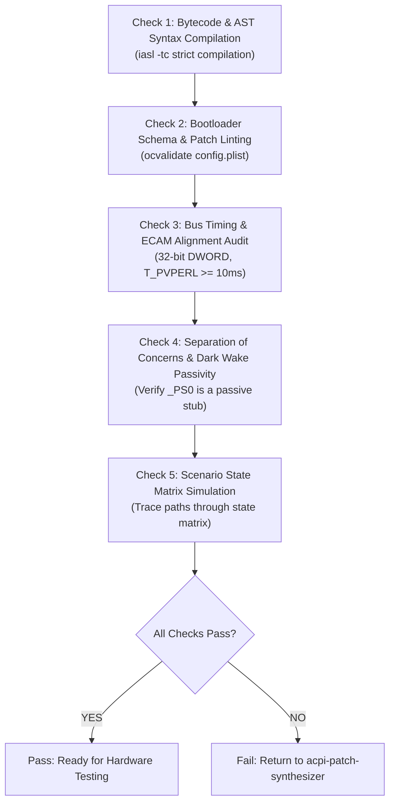

# ACPI Static Verifier Subskill

## Overview

This subskill covers **Step 5 (Static Sanity Checks)** in the iterative debugging loop.

It runs automated checks on the synthesized AML bytecode and bootloader config before rebooting to test on hardware, catching syntax errors, unaligned accesses, and logic bugs early.

> [!NOTE]
> **Check Before Booting:** Catching errors statically on your development machine saves you from suffering slow, frustrating reboot-and-hang cycles.

---

## 1. Verification Pipeline

The verification pipeline runs five checks:



---

## 2. The 5 Static Verification Checks

### Check 1: AML Compilation & Syntax
Compile the replacement SSDT with the ACPICA compiler:
```bash
iasl -tc SSDT-SLEEPFIX.dsl
```
* **Checklist:**
  * **0 Compilation Errors:** Exit code must be 0.
  * **0 Unresolved External Symbols:** Every referenced external symbol (methods, devices, fields) must have an exact `External(...)` declaration matching its object type.
  * **0 Shadowed Identifiers:** No duplicate definitions of existing OEM methods or fields.

### Check 2: Bootloader Configuration Schema
Validate `config.plist` using the official validator:
```bash
ocvalidate config.plist
```
* **Checklist:**
  * **0 Schema Violations:** All keys match the bootloader specification.
  * **Exact Rename Length:** Source and target strings in `ACPI -> Patch` must have identical byte lengths.
  * **Target Table Matching:** Ensure table signatures (`SSDT`) and table IDs match the intended OEM table.

### Check 3: Bus Timing & ECAM Alignment Audit
Inspect the ASL source for hardware timing and alignment rules:
1. **$T_\text{PVPERL}$ Settling Latency:**
   * Verify that after releasing Fundamental Reset (`PERST#`), there is an explicit delay of $\ge 10\text{ms}$ (`DLYM(0x0A)` or `DLYM(0x14)`) before initiating link wake.
2. **SoC ECAM 32-bit DWORD Alignment:**
   * Confirm that reads and writes to PCIe extended configuration space are DWORD-aligned (offsets divisible by 4, access size = 32 bits).
   * Ensure no 8-bit byte-writes are issued to Root Complex registers.
3. **Absence of Unbounded Loops:**
   * Confirm that every while loop has a decrementing timeout counter and maximum iteration limit.
4. **Absence of Bulk Block Copies:**
   * Confirm that blind bulk copies across configuration space are not present.

### Check 4: Separation of Concerns & Dark Wake Passivity
Check that device evaluation methods remain passive:
1. Inspect the target device `_PS0`:
   ```asl
   Method (_PS0, 0, NotSerialized)
   {
       _PSC = Zero
   }
   ```
   * **Rule:** `_PS0` must contain **no invocations** of rail power-on routines or reset/link toggles.
   * **Reason:** Ensures that 0.15s display-off background maintenance queries do not power on hardware rails without OSPM reference counting.

### Check 5: Scenario State Matrix Simulation
Trace execution flow statically across the scenarios defined in `Design.md`:

| Scenario ID | Test Condition | Entry Path | Expected Rail State | Refcount | Validated? |
|:---:|:---|:---|:---:|:---:|:---:|
| **S01** | Forced Sleep, Desktop, AC | `_PR3._OFF` $\to$ Sleep | Rail Low, `PERST#` Low | 0 | [x] PASS |
| **S02** | Display Idle Timeout in S0 | `Device._PS3` (Guarded) | Rail High, `PERST#` High | 1 | [x] PASS |
| **S03** | Modern Standby Maintenance Window | `Device._PS0` (Passive) | Rail remains Low, `_PR0` untouched | 0 | [x] PASS |
| **S04** | User Wake from Deep Standby | `_PR0._ON` $\to$ Link Wake | Link L0, Strap unmasked, BARs restored | 1 | [x] PASS |
| *...* | *(Trace remaining scenarios)* | *...* | *...* | *...* | [x] PASS |

---

## 3. Static Validation Summary Format

Document the check results in `Validation-vXX.md`:

```markdown
# Static Verification Summary: Iteration XX

**Artifacts:** SSDT-SLEEPFIX.aml, config.plist  
**Date:** YYYY-MM-DD  

## Checklist
- [x] Check 1: Bytecode & AST Syntax (0 errors, 0 warnings)
- [x] Check 2: Bootloader Schema & Patch Linting (Clean)
- [x] Check 3: Bus Timing ($T_\text{PVPERL} \ge 10\text{ms}$) & 32-bit ECAM Alignment
- [x] Check 4: Dark Wake Passivity (Passive `_PS0` Verified)
- [x] Check 5: State Matrix Scenarios (All Verified)

## Result: PASS (Ready for Hardware Testing)
```

If any check fails:
```markdown
## Result: FAIL (Do Not Boot)
Reason: Check 4 Violation - Device _PS0 contains active call to rail power method.
Action: Return to acpi-patch-synthesizer to decouple _PS0 before testing on hardware.
```
