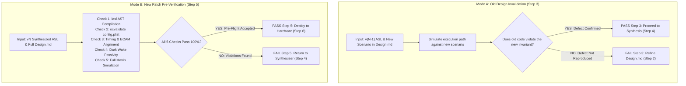

# ACPI Static Verifier Subskill

## Overview

This subskill operates in two critical stages of the iterative debugging loop:
* **Mode A: Old Design Invalidation (Step 3):** Evaluates the *previous* code version (`v(N-1)` or stock OEM ASL) against the *newly added/modified scenario* from `Design.md` to statically reproduce the failure (**Negative Proof**).
* **Mode B: New Patch Pre-Verification (Step 5):** Evaluates the *newly synthesized* patch (`vN`) across all checks and all scenarios in `Design.md` to ensure zero syntax errors, zero regressions, and full invariant compliance before rebooting (**Positive Proof**).



> [!IMPORTANT]
> **Why Mode A (Step 3) is Mandatory:**
> If the previous code *passes* your new static scenario check, your design hypothesis does not explain the real-world bug. Do not synthesize code based on an unverified guess—stop and refine the design model first.

---

## Mode A: Old Design Invalidation (Step 3)

### Purpose: Negative Proof (Defect Reproduction)
Before writing any new firmware code, you must statically prove why the previous version (`SSDT-v(N-1).dsl` or OEM ASL baseline) failed on hardware.

### Procedure:
1. **Extract the Target Scenario:** Read the newly added or updated scenario in `Design.md` produced by [`acpi-design-architect`](../acpi-design-architect/SKILL.md) in Step 2.
2. **Trace the Old Code Path:** Statically simulate how the previous version's ASL executes during that scenario:
   * **Dark Wake Maintenance:** Does `_PS0` in `v(N-1)` invoke rail power-on or reset methods without an OSPM `_PR0` reference count?
   * **Display Idle Runtime:** Did `v(N-1)` cut power rails or assert `PERST#` while secondary functions or audio streams were in D0?
   * **Interrupt Mode:** Did `v(N-1)` write Bit 10 into the Command register on an endpoint whose OS registry shows `MSISupported : 0`?
   * **ECAM Alignment:** Did `v(N-1)` perform non-DWORD (8-bit or 16-bit) writes to SoC Host Bridge extended configuration space?
   * **Bus Polling:** Does link training or ready-check use an unbounded while loop that hangs when reading `0xFFFFFFFF`?
3. **Formulate Invalidation Report:** Document the failing AST node, line number, and mechanism in `Invalidation-vXX.md`:

```markdown
# Invalidation Report: Version N-1 against Scenario Sxx

* **Target Artifact:** SSDT-v(N-1).dsl (or OEM DSDT)
* **Tested Scenario:** S03 (Modern Standby background maintenance / Dark Wake)
* **Static Evaluation:**
  - Method `\_SB.PCI0.GP17.VGA._PS0` line 42 calls `\_SB.PCI0.GP17.PWEN.ON()`.
  - In Scenario S03, the display is off and OSPM evaluates `_PS0` as a status query without evaluating `_PR0`.
  - As a result, physical power rails turn on without OSPM tracking, and `_PR3._OFF` is never called when the window ends.
* **Verdict:** DEFECT REPRODUCED. Version N-1 statically fails Scenario S03.
* **Next Action:** Hand off confirmed failure primitive to acpi-patch-synthesizer for Step 4.
```

If the old code does NOT violate the scenario, report:
```markdown
* **Verdict:** INCONCLUSIVE. Version N-1 does not violate Scenario Sxx.
* **Next Action:** Return to acpi-design-architect to refine the state matrix and invariants.
```

---

## Mode B: New Patch Pre-Verification (Step 5)

### Purpose: Positive Proof (Pre-Flight Acceptance)
Verify that the synthesized patch (`SSDT-vN.dsl` and `config.plist`) compiles cleanly, respects all hardware invariants, and passes all scenarios in `Design.md` without regressions.

### The 5 Pre-Flight Checks:

#### Check 1: AML Compilation & Syntax
Compile the replacement SSDT with the ACPICA compiler:
```bash
iasl -tc SSDT-SLEEPFIX.dsl
```
* **0 Compilation Errors:** Exit code must be 0.
* **0 Unresolved External Symbols:** Every referenced external symbol has an exact `External(...)` declaration matching its object type.
* **0 Shadowed Identifiers:** No duplicate definitions of existing OEM methods or fields.

#### Check 2: Bootloader Configuration Schema
Validate `config.plist` using the bootloader validator:
```bash
ocvalidate config.plist
```
* **0 Schema Violations:** All keys match specification.
* **Exact Rename Length:** Source and target strings in `ACPI -> Patch` have identical byte lengths.
* **Target Table Matching:** Ensure table signatures (`SSDT`) and table IDs match intended OEM tables.

#### Check 3: Bus Timing & ECAM Alignment Audit
Inspect the ASL source for hardware timing and alignment rules:
1. **$T_\text{PVPERL}$ Settling Latency:**
   * Verify that after releasing Fundamental Reset (`PERST#`), an explicit delay of $\ge 10\text{ms}$ (`DLYM(0x0A)` or `DLYM(0x14)`) is executed before initiating link wake.
2. **SoC ECAM 32-bit DWORD Alignment:**
   * Reads and writes to PCIe extended configuration space are DWORD-aligned (offsets divisible by 4, access size = 32 bits).
   * No 8-bit or 16-bit writes to Root Complex or Host Bridge registers.
3. **Absence of Unbounded Loops:**
   * Every while loop has a decrementing timeout counter and maximum iteration limit.
4. **Absence of Bulk Block Copies:**
   * No blind memory-to-config-space block copies.

#### Check 4: Separation of Concerns & Dark Wake Passivity
Verify device evaluation methods remain passive stubs:
```asl
Method (_PS0, 0, NotSerialized)
{
    _PSC = Zero
}
```
* `_PS0` must contain **no invocations** of rail power routines, link reset, or clock gates.
* Power rail control must remain strictly inside Power Resources (`_PR0..3`).

#### Check 5: Scenario State Matrix Simulation
Trace execution flow statically across all scenarios defined in `Design.md`:

| Scenario ID | Test Condition | Entry Path | Expected Rail State | Refcount | Validated? |
|:---:|:---|:---|:---:|:---:|:---:|
| **S01** | Forced Sleep, Desktop, AC | `_PR3._OFF` $\to$ Sleep | Rail Low, `PERST#` Low | 0 | [x] PASS |
| **S02** | Display Idle Timeout in S0 | `Device._PS3` (Guarded) | Rail High, `PERST#` High | 1 | [x] PASS |
| **S03** | Modern Standby Maintenance Window | `Device._PS0` (Passive) | Rail remains Low, `_PR0` untouched | 0 | [x] PASS |
| **S04** | User Wake from Deep Standby | `_PR0._ON` $\to$ Link Wake | Link L0, Strap unmasked, BARs restored | 1 | [x] PASS |
| **S05** | Audio Playback during Display Idle | Function 1 active in D0 | Link alive, interrupts unmasked | 1 | [x] PASS |

---

## Pre-Flight Verification Summary Template

Document Step 5 results in `Validation-vXX.md`:

```markdown
# Static Verification Summary: Iteration XX

**Artifacts:** SSDT-vXX.aml, config.plist  
**Date:** YYYY-MM-DD  

## Pre-Flight Checklist
- [x] Check 1: Bytecode & AST Syntax (0 errors, 0 warnings)
- [x] Check 2: Bootloader Schema & Patch Linting (Clean)
- [x] Check 3: Bus Timing ($T_\text{PVPERL} \ge 10\text{ms}$) & 32-bit ECAM Alignment
- [x] Check 4: Dark Wake Passivity (Passive `_PS0` Verified)
- [x] Check 5: State Matrix Scenarios (All N Scenarios PASS)

## Result: PASS (Ready for Hardware Testing)
```

If any check fails:
```markdown
## Result: FAIL (Do Not Boot)
Reason: Check 4 Violation - Device _PS0 contains active call to rail power method.
Action: Return to acpi-patch-synthesizer to decouple _PS0 before testing on hardware.
```
