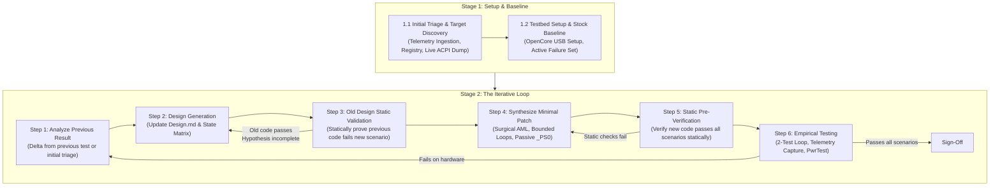
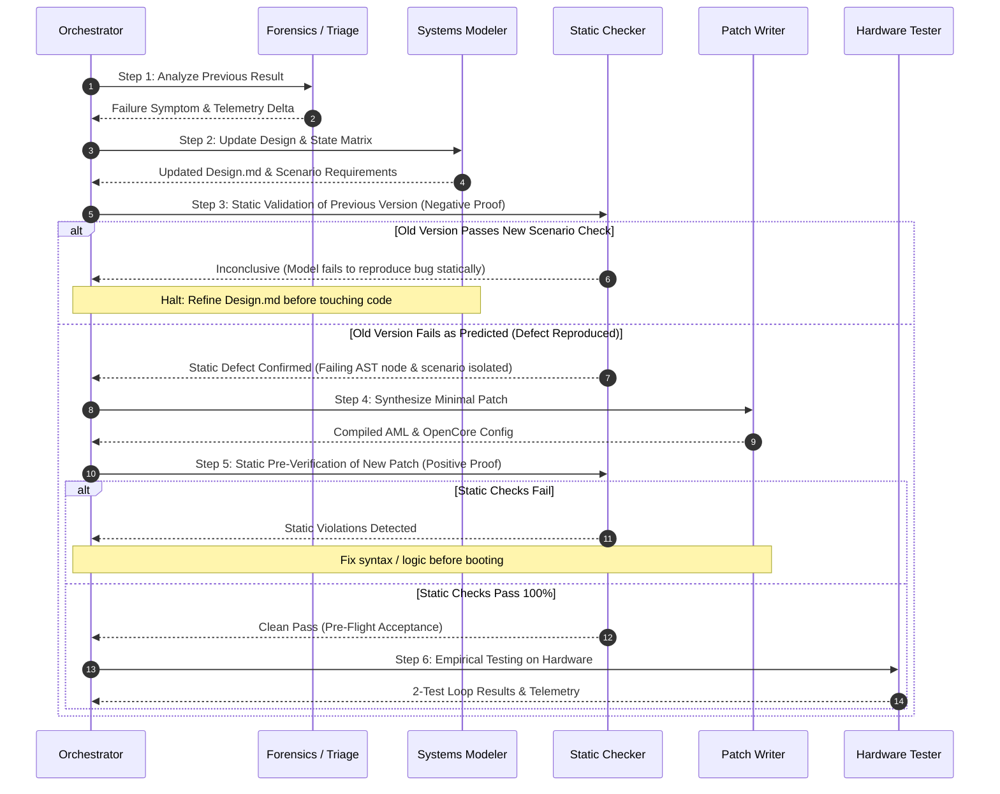

# Modern Standby (S0ix) Debugging Orchestrator

## Overview

This skill coordinates the process of diagnosing and fixing Modern Standby (S0ix / Low Power S0 Idle) and ACPI power-state bugs on laptops.

It organizes the debugging workflow into two stages to avoid spinning in unguided trial-and-error loops:
* **Stage 1:** Setup & Baseline (Ingest crash logs, audit OS/hardware setup, dump live ACPI, establish stock baseline).
* **Stage 2:** The Iterative Loop (Analyze previous result $\to$ write down state transitions $\to$ check why prior attempt failed $\to$ synthesize minimal AML $\to$ verify statically $\to$ test on hardware).



---

## Core Invariants

Before coordinating subagents or writing code, keep these rules in mind:

1. **Audit Target Hardware & Drivers:** Do not treat devices or drivers as generic black boxes. Check multi-function couplings (Function 0 GPU vs Function 1 Audio), hardware strap persistence across power cuts, and OS driver configuration (`MSISupported : 0` vs MSI).
2. **ACPI Separation of Concerns (`_PRx` vs `_PSx`):**
   * **Power Resources (`_PR0..3`):** Manage physical shared hardware power rails, clocks, reset lines (`PERST#`), and OSPM reference counting.
   * **Device States (`_PS0..3`):** Must remain **passive status stubs** (`_PSC = Zero`). Do not put active rail power-on calls in `_PS0` (doing so causes Modern Standby display-off maintenance queries to wake rails without updating OSPM reference counts, crashing upon re-sleep).
3. **Model Before Patching:** Write down expected state transitions across operational scenarios and check them statically before rebooting hardware to test.

---

## Stage 1: Setup & Baseline

### 1.1 Initial Triage & Target Discovery
* **Role / Subskill:** [`deep-sleep-forensics`](../deep-sleep-forensics/SKILL.md)
* **Actions:**
  1. Ingest historical crash artifacts using the diagnostic script:
     ```bash
     python3 skill/scripts/sleepstudy-reader.py <sleepstudy.html | winevents.txt | minidump.dmp | reports_dir>
     ```
  2. Identify the failing session and note the operational context (External Monitor, AC/DC, Entry Reason, Logon Context, Standby Duration, Lid State, BlockerGroups).
  3. Query OS Registry for driver interrupt configuration:
     ```powershell
     Get-ItemProperty -Path "HKLM:\SYSTEM\CurrentControlSet\Enum\PCI\*\*\Device Parameters\Interrupt Management\MessageSignaledInterruptProperties" -Name MSISupported
     ```
  4. Perform **Live ACPI Table Extraction** (via `acpidump -b`). Avoid unpacking unverified capsule ROMs when live tables from the running machine can be captured directly.
* **Exit Gate:** Target topology, interrupt mode, and crash trigger are noted.

### 1.2 Testbed Setup & Baseline Sweep
* **Role / Subskill:** [`deep-sleep-forensics`](../deep-sleep-forensics/SKILL.md)
* **Actions:**
  1. Set up an external FAT32 USB drive with OpenCore for safe testing:
     * Add `EFI/OC/.contentVisibility` with `Disabled` (suppresses bootloader self-entry).
     * Set `PlatformInfo -> Automatic = false` (preserves genuine SMBIOS, Windows activation, BitLocker PCRs).
     * Keep `ACPI -> Delete` empty (do not drop OEM tables with dynamic NVS memory).
  2. Configure 60s fast display timeout on clean factory firmware:
     ```cmd
     powercfg /change monitor-timeout-ac 1
     ```
  3. Run the 6-Scenario Baseline Sweep (T1–T6).
  4. Freeze passing dimensions and isolate the **Active Failure Set** (e.g. desktop deep sleep and desktop idle standby).
* **Exit Gate:** Baseline failure conditions identified on unmodified factory firmware.

---

## Stage 2: The Iterative Loop

Whenever a test fails or a patch needs refinement, follow this sequence:



### Step 1: Analyze Previous Result
* **Role / Subskill:** [`deep-sleep-forensics`](../deep-sleep-forensics/SKILL.md)
* Categorize the failure symptom:
  * **Silent Hang:** Unbounded bus polling loop or blocked power IRP.
  * **Instant Cold Reboot:** PCIe Completer Abort, unaligned Host Bridge ECAM write, or Surprise Down.
  * **30s Display Watchdog BugCheck (`0x19C 0x50`):** Unmapped MMIO aperture, zeroed BARs, or cleared Command MSE.
  * **Standby Maintenance Reboot:** Active `_PS0` waking rails during display-off maintenance query without OSPM `_PR0` refcount.
  * **Audio / Interrupt Glitch:** Bit 10 in Command register masking legacy line interrupts, or un-restored capability strap.

### Step 2: Design Generation
* **Role / Subskill:** [`acpi-design-architect`](../acpi-design-architect/SKILL.md)
* Update `Design.md`.
* Map expected hardware states across the operational scenarios (display on/off, audio idle/active, desktop/lock, AC/DC, shallow/deep/dark wake).
* Formulate the exact failure condition as a new/modified scenario test case.

### Step 3: Old Design Static Validation (Negative Proof)
* **Role / Subskill:** [`acpi-static-verifier`](../acpi-static-verifier/SKILL.md)
* **Objective:** Statically evaluate the *previous* version's source (`SSDT-v(N-1).dsl` or OEM ASL baseline) against the *newly added scenario* in `Design.md`.
* **Execution:** Trace the control paths and AST nodes of the old patch to verify if it violates the new scenario.
* **Gate Requirement:**
  * **Pass Condition (Defect Confirmed):** The previous version **must fail** the scenario check statically, isolating the exact line, register write, or method call that caused the failure (e.g. `_PS0` turns on power rail without `_PR0`, or Bit 10 masks INTx). This confirms the design hypothesis accurately models the defect.
  * **Fail Condition (Inconclusive Hypothesis):** If the previous version *passes* the scenario check, our hypothesis does not explain the empirical failure. Do not synthesize code yet—return to Step 2 to refine `Design.md`.

### Step 4: Synthesize Minimal Patch
* **Role / Subskill:** [`acpi-patch-synthesizer`](../acpi-patch-synthesizer/SKILL.md)
* Implement the minimal replacement ASL:
  * Bounded while-loops with decrementing counter (`Local0 = 500`) and active retry.
  * Settling delays complying with PCI Express Base Spec $T_\text{PVPERL}$ ($\ge 10\text{ms}$).
  * Surgical register restoration (restore specific BARs, Command, unmask secondary straps).
  * Keep `_PS0` as a passive stub (`_PSC = Zero`); let native `_PR0`/`_PR3` manage physical rails.
  * Avoid bulk configuration space block copies.
  * 32-bit DWORD ECAM operations for SoC Host Bridges.
* Compile bytecode with `iasl -tc` and configure in-memory 4-byte ASCII method renames in OpenCore `config.plist`.

### Step 5: Static Pre-Verification (Positive Proof)
* **Role / Subskill:** [`acpi-static-verifier`](../acpi-static-verifier/SKILL.md)
* Run the pre-boot verification pipeline on the newly synthesized patch:
  * Check 1: AST syntax & external scope resolution (0 errors, 0 unresolved symbols).
  * Check 2: Bootloader schema & patch linting (`ocvalidate config.plist`).
  * Check 3: Bus timing ($T_\text{PVPERL} \ge 10\text{ms}$) & 32-bit ECAM DWORD alignment check.
  * Check 4: Dark Wake passivity check (verify `_PS0` has no active rail calls).
  * Check 5: Scenario State Matrix simulation (verify 100% PASS across all defined scenarios in `Design.md`).
* **Gate Requirement:** Only proceed to hardware deployment (Step 6) if all static checks pass cleanly with 0 regressions. If static checks fail, return to Step 4 to fix the patch before touching hardware.

### Step 6: Empirical Testing
* **Role / Subskill:** [`standby-empirical-collector`](../standby-empirical-collector/SKILL.md)
* Copy verified patch to USB testbed.
* Run the 2-test active loop (`T5` and `T6`).
* Collect telemetry (`sleepstudy-reader.py`).
* Check audio playback and volume flyout responsiveness.
* If all tests pass:
  * Run 50 continuous Modern Standby cycles (`PwrTest /cs /c:50 /d:30 /p:15`).
  * Verify long-duration (>30m) S0i3 DRIPS residency (>90%).
* If an edge-case or failure occurs, feed telemetry back into **Step 1**.

---

## Subagent Dispatch Table

| Subagent Role | Iteration Steps | TypeName | Subskill Instruction Reference |
|:---|:---|:---|:---|
| `Forensics / Triage` | Stage 1, Step 1 | `research` or `self` | [`deep-sleep-forensics`](../deep-sleep-forensics/SKILL.md) |
| `State Machine Modeler` | Step 2 | `self` | [`acpi-design-architect`](../acpi-design-architect/SKILL.md) |
| `Static Checker (Negative Proof)` | Step 3 | `research` or `self` | [`acpi-static-verifier`](../acpi-static-verifier/SKILL.md) |
| `AML Patch Writer` | Step 4 | `self` | [`acpi-patch-synthesizer`](../acpi-patch-synthesizer/SKILL.md) |
| `Static Checker (Positive Proof)` | Step 5 | `research` or `self` | [`acpi-static-verifier`](../acpi-static-verifier/SKILL.md) |
| `Hardware Tester` | Step 6 | `self` | [`standby-empirical-collector`](../standby-empirical-collector/SKILL.md) |
