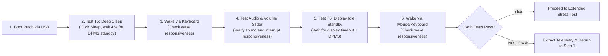

# Standby Empirical Collector & Testing Subskill

## Overview

This subskill covers **Step 6 (Empirical Testing)** in the iterative debugging loop.

After an experimental patch passes basic static checks in [`acpi-static-verifier`](../acpi-static-verifier/SKILL.md), this subskill guides testing on the hardware, collecting telemetry, and auditing stability.

---

## 1. Testbed Setup & Deployment

1. **Copy Files to USB Test Drive:**
   * Copy the compiled `SSDT-SLEEPFIX.aml` to `EFI/OC/ACPI/SSDT-SLEEPFIX.aml`.
   * Copy the updated `config.plist` to `EFI/OC/config.plist`.
   * Ensure `EFI/OC/.contentVisibility` exists with `Disabled` (suppresses the bootloader from showing an entry for itself).
2. **Boot via USB:**
   * Select the USB drive in the BIOS boot menu.
   * Boot Windows. Confirm normal system startup.

---

## 2. The 2-Test Iteration Loop

To avoid wasting 15 minutes on every patch, test **only the active failure set** (typically deep sleep and display idle timeout):



### Test T5 (Forced Deep Sleep):
1. Connect external display (if the failure involves external displays).
2. Click **Start $\rightarrow$ Power $\rightarrow$ Sleep** (or press Sleep key).
3. Wait **45 seconds** until the display enters DPMS standby (e.g. orange LED).
4. Tap a keyboard key to wake.
   * **Check:** Displays turn on promptly without hanging, fan runaway, or delay.

### Audio & Interrupt Check:
1. Immediately after waking from deep sleep, play a sound over the display audio or internal speakers.
2. Adjust the volume slider back and forth.
   * **Check:** Volume slider moves smoothly without lag; sound plays cleanly without distortion; CPU is not spinning on un-serviced interrupts.

### Test T6 (Display Idle Standby):
1. Set a short display timeout (e.g. 1 minute): `powercfg /change monitor-timeout-ac 1`.
2. Leave the system untouched for **70 seconds**.
3. Observe display turning off, followed by DPMS standby.
4. Move the mouse or tap a key to wake.
   * **Check:** Clean wake without hanging or delayed watchdog reboots.

---

## 3. Extracting Telemetry

Immediately after waking (or after recovering from a crash), collect telemetry:

```cmd
:: 1. Generate SleepStudy:
powercfg /sleepstudy

:: 2. Export power & shutdown events:
powershell -Command "Get-WinEvent -FilterHashtable @{LogName='System'; Id=@(41, 42, 107, 109, 506, 507, 1001, 6006, 6008)} -MaxEvents 50 | Format-Table TimeCreated, Id, Message -Wrap | Out-File -Encoding utf8 winevents.txt"

:: 3. Parse telemetry:
python3 skill/scripts/sleepstudy-reader.py sleepstudy-report.html winevents.txt
```

If a blue screen or crash occurred:
```bash
# Parse the generated minidump:
python3 skill/scripts/parse_minidump.py C:\Windows\Minidump\*.dmp
```

---

## 4. Extended Stability Verification

Once the 2-test active loop passes cleanly, run extended checks before calling the issue fixed:

### 4.1 Automated Modern Standby Cycling (`PwrTest`)
Using the Windows Driver Kit `PwrTest` utility:
```cmd
:: Run 50 continuous modern standby cycles (30s sleep, 15s wake pause):
PwrTest /cs /c:50 /d:30 /p:15
```
* **Pass Criterion:** All cycles complete with **0 Abnormal Shutdowns (Type 9)** and **0 BugChecks (Type 10)**.

### 4.2 Extended Standby DRIPS Residency
1. Let the system sleep for **$\ge 30$ minutes** on AC and battery.
2. Check `sleepstudy-report.html`:
   * **Pass Criterion:** Hardware S0i3 DRIPS residency should be high (>90%).
   * **Maintenance Resilience:** Verify that periodic background maintenance windows (Dark Wakes) woke and returned to sleep without rebooting the machine.
