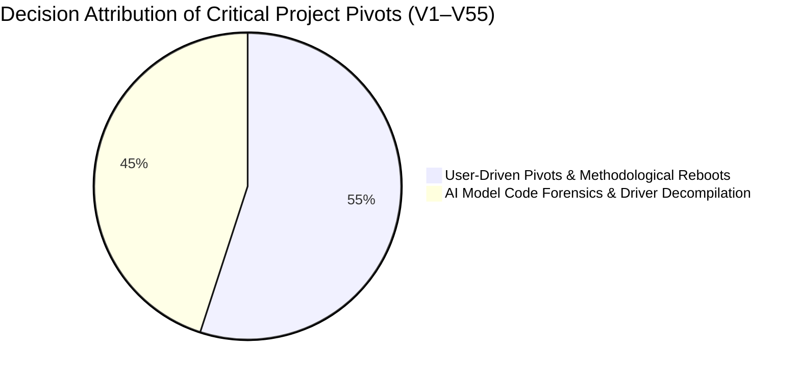
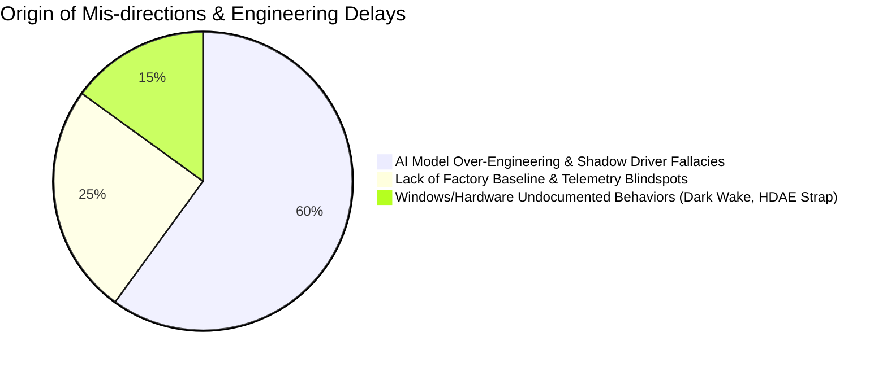
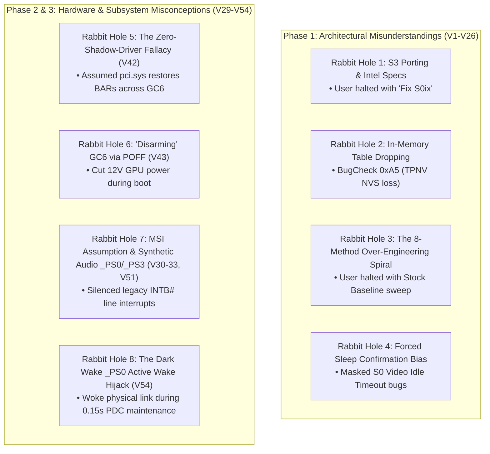
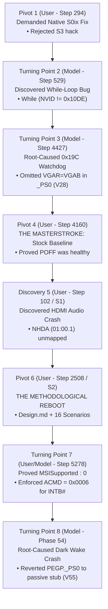

# Investigation & Patch Decisions Log: Attribution & Turning Points Analysis

**Platform:** Schenker / XMG NEO 15 (M22) (Tongfang GM5RGxx, AMD Ryzen 7 6800H Rembrandt, NVIDIA GeForce RTX 3070 Ti / 3080 Mobile GA104, ITE IT8xxx EC, BIOS `N.1.15A14`)  
**Parent Session 1:** `1339f7f4-7fc5-4d01-a3b4-41ae7a10d48f` (Attempts 1–28)  
**Followup Session 1:** `168d4fda-8270-47f9-888a-08f2b5b553fc` (Attempts 29–42)  
**Followup Session 2:** `7141662c-96a7-48b6-bbbc-099911953281` (Attempts 43–55)  
**Author:** Antigravity AI & datacompboy  

---

## 1. Executive Summary

Over the course of 55 patch iterations and four weeks of rigorous hardware engineering, diagnosing and permanently solving the Modern Standby (S0ix) lockup on the Tongfang GM5RGxx required reverse-engineering three interrelated subsystems:
1. **The Display Engine & PCIe Gen4 Link Training:** The infinite while-loop in `GC6O` and destructive uninitialized configuration writes (`VGAR = VGAB`) in `_PS0`.
2. **The Multi-Function Audio Controller (`01:00.1`, `NHDA`):** Function 1 silicon hiding (`HDA8` bit 25), Zero-BAR bus collisions, legacy `INTB#` interrupt line masking (`MSISupported = 0`), and the failure of native `pci.sys` D3cold restoration across warm GC6.
3. **The S0 vs. S0ix Asymmetric Power Topology & Modern Standby Dark Wake:** Video Idle Timeout screen-off vs. system sleep gating (`S0E3`), circular PEP constraints, and the fatal 46-second background maintenance window wake crash.

This document maps the **complete decision lineage** across all 55 iterations:
* Which **critical turning points** (breakthroughs, pivots, and methodological reboots) were initiated by the **User** vs the **AI Model**.
* Which **mis-directions and rabbit holes** were proposed by the **AI Model** vs triggered by **User assumptions**.
* How the project transformed from an ad-hoc trial-and-error patching cycle into a rigorous, formal specification-driven methodology (`Design.md` $\to$ Multi-Agent Static Validation $\to$ Synthesis $\to$ Empirical Verification) that delivered final convergence in Firmware v55.

---

## 2. Master Decision Attribution Matrix (Chronological: V1 to V55)

| Phase / Step | Decision / Event | Proposer / Driver | Classification | Impact on Investigation |
|:---|:---|:---:|:---:|:---|
| **Phase 0 (Step 0)** | Initial framing: "odd power problem after Windows update" | **User** | Initial Problem | Started investigation into Windows power transitions. |
| **Phase 0 (Step 264)** | Speculating on S3 Sleep (`setup_var`, ASUS ROG Zephkek AML porting) | **AI Model** | **Mis-direction #1** | Wasted early cycles researching Intel Comet Lake / ASUS S3 hacks on an AMD Rembrandt platform. |
| **Phase 0 (Step 294)** | **Refusal of S3 Workaround:** *"Is it possible to actually fix Modern Standby, instead of hard-disable it?"* | **User** | **Critical Pivot #1** | **Forced the project to fix S0ix natively**, rejecting broken S3 compromises. |
| **Phase 1 (Step 375)** | Noticing Event 41 time jump: 9:30:42 PM vs 2:18 PM recovery | **User** | **Evidence Insight** | Proved the 17-hour "zombie lockup" where the machine was powered on until 0% battery drain. |
| **Phase 1 (Step 377)** | Analyzing `sleepstudy-report.html` Session 58 | **User / AI** | **Evidence Insight** | Identified `ExternalMonitorState: Connected` and `EntryReason: Video Idle Timeout`. |
| **Phase 1 (Step 445)** | Providing official factory BIOS ROM `GM5RGxxN115A14.ROM` | **User** | Hardware Asset | Allowed static disassemblies of clean OEM tables (`Opt2Tabl`). |
| **Phase 1 (Step 529)** | **Discovery of the Infinite While Loop:** Discovered `While (NVID != 0x10DE) {}` in `GC6O` | **AI Model** | **Critical Turning Point #2** | Found the mathematical smoking gun causing the kernel hang. |
| **Phase 1 (Step 551)** | Proposing non-invasive in-memory ACPI loader instead of direct SPI flashing | **User / AI** | **Safety Milestone** | Eliminated hardware brick risk; established external USB testbed. |
| **Attempts 1–5** | Dropping `Opt2Tabl` via OpenCore `ACPI -> Delete` | **AI Model** | **Mis-direction #2** | Triggered `BugCheck 0xA5 (ACPI_BIOS_ERROR)` due to severed ACPI NVS (`TPNV`) memory regions. |
| **Attempts 6–10** | Enabling macOS-oriented OpenCore CPU/Memory quirks | **AI Model** | **Mis-direction #3** | Caused Windows boot crash `SYSTEM_THREAD_EXCEPTION_NOT_HANDLED (0x7E)`. |
| **Attempt 10 (Step 1327)** | **Exposing Config Desynchronization:** *"Are you updating config.plist at root or inside EFI folder?"* | **User** | **Critical Pivot #3** | Discovered root and `EFI/OC` configs were out of sync. Once aligned, Windows booted cleanly. |
| **Attempt 11 (Step 1352)** | Formulating unified `Get-WinEvent` query (`41, 42, 107, 109, 506, 507, 6006, 6008`) | **AI Model** | Diagnostic Tool | Standardized telemetry extraction for all subsequent test runs. |
| **Attempt 11 (Step 1353)** | First working in-memory rename: `GC6O -> XC6O` with bounded loop | **AI Model** | **Progress Milestone** | Infinite loop broken! Machine successfully entered S0ix without zombie hang. |
| **Attempts 12–16** | **The Over-Engineering Spiral:** Rewriting `_ON`, `_OFF`, `_PS0`, `_PS3`, `_STA`, and PEP `_DSM` | **AI Model** | **Mis-direction #4** | Expanded patch blast radius from 1 method to 8 methods, introducing 5 compounding regressions. |
| **Attempt 16 (Step 2122)** | Declaring victory after forced quick sleep passed | **User / AI** | **The False Positive Trap** | Assumed bug was solved because forced sleep woke in <1s. S0 idle timeout crashed the next day. |
| **Attempt 19 (Step 2820)** | Inverting S0 display idle logic: asserting `PERST#` during display idle | **AI Model** | **Mis-direction #5** | Caused audio driver deadlock and 115s watchdog reboot because Windows Audio was still in D0. |
| **Baseline (Step 4160)** | **The Decisive Masterstroke:** *"Wouldn't clean firmware tests be useful? Step back and test stock firmware."* | **User** | **Critical Pivot #4** | **Destroyed the premise that `POFF` was broken.** Proved Lock Screen was 100% healthy on factory firmware. |
| **Attempt 27 (Step 4368)** | Stripping 5 patches, deploying minimal 3-patch set (bounded loop + link wake) | **AI Model** | **Simplification** | Eliminated all artificial regressions; isolated post-wake crash cleanly to `BugCheck 0x19C (0x50)`. |
| **Attempt 28 (Step 4427)** | Root-causing `0x19C (0x50)` to `VGAR = VGAB` zeroing BARs in `_PS0` | **AI Model** | **Critical Turning Point #3** | Omitted `VGAR = VGAB` via Patch 4. Achieved 100% clean video sleep/wake. |
| **Attempt 28 Validation** | **Discovery of the HDMI Audio Trap:** Playing sound over HDMI triggers 30s watchdog crash | **User** | **Critical Discovery #1** | Revealed that Attempt 28 only worked with internal speakers; HDMI audio (`01:00.1`) was completely unmapped! |
| **Attempt 29** | Attempting dynamic ACPI capture of audio BARs in `GC6I` without un-hiding `HDAE` | **AI Model** | **Mis-direction #6** | `HDA8` bit 25 was 0; `AVID` was unreadable; writing `ACMD |= 0x06` with `BAR0 = 0` collided with IVT RAM $\to$ fan runaway crash. |
| **Attempt 30** | Binding `_PR0..3` to `NHDA` & dynamically unmasking `HDAE` | **AI Model** | **Dual Discovery** | Audio woke cleanly on Wake 1! But `ACMD = 0x0406` restored Bit 10 (`Interrupt Disable = 1`), deadlocking volume flyout & Wake 2. |
| **Attempt 31** | Attempting 8-bit byte-read to `EBAS + 0x100C` on AMD Zen 3+ Host Bridge | **AI Model** | **Mis-direction #7** | Triggered AMD ECAM Host Bridge Completer Abort (AMD Rembrandt strictly mandates 32-bit aligned DWORDs). |
| **Attempt 32** | Unmasking INTx early in `GC6O` before `HDAudBus.sys` was ready | **AI Model** | **Mis-direction #8** | Un-clearable level interrupt storm (IRQ 25) starved CPU cores $\to$ 90s watchdog timeout `BugCheck 0x19C`. |
| **Attempts 34–40m** | Constructing Minimalist Dual-Path Core (Native OS D3cold POFF/PON + Symmetrical GC6) | **AI Model** | Architectural Progress | Attempt 40m achieved flawless deep sleep with HDMI audio (Session 29: 45.2s deep sleep, <1s wake). |
| **Attempt 42** | **The "Zero-Shadow-Driver" Fallacy:** Stripping all BAR saving/restoration from ACPI | **AI Model** | **Mis-direction #9** | Assumed `pci.sys` would restore BARs across warm GC6. It does not! GA104 woke with `BAR0 = 0x0` $\to$ PRI timeout crash. |
| **Attempt 43** | "Disarming" GC6 by routing `GC6I()` to `POFF()` | **AI Model** | **Mis-direction #10** | Cutting main 12V power during boot broke external monitor detection entirely. |
| **Attempt 44** | Rescuing the proven Attempt 40m core & restoring BAR pre-capture | **AI Model** | Ground Truth Recovery | Restored boot-time monitor detection and verified SBIOS contract against `open-gpu-kernel-modules`. |
| **Attempt 45** | Symmetrical Warm GC6 Architecture | **AI Model** | Progress Milestone | Survived multiple forced sleep/wake cycles with sound enabled. |
| **Attempt 46–47** | Exposing the Screen-Off vs. Sleep Asymmetry & Gating GC6 on `S0E3 == 1` | **User / AI** | **Critical Discovery #2** | Proved that Screen Off (Video Idle) was triggering `PG00._OFF()` prematurely, crashing active audio sessions. |
| **Phase 48 (Step 2508)** | **THE METHODOLOGICAL REBOOT:** Demanding formal `Design.md`, 16 Scenarios, & Static Subagents | **User** | **The Decisive Turning Point #6** | **Ended trial-and-error patching entirely.** Replaced ad-hoc attempts with a formal specification and multi-agent verification. |
| **Attempt 50** | Root-causing `pci.sys` audio failure to `HDAE` strap clearing in D3hot | **AI Model** | **Ground Truth Discovery** | Proved mathematically why firmware MUST restore Function 1 BAR0 (Windows `pci.sys` cannot see hidden functions across D3cold). |
| **Attempt 51** | Synthetic `_PS0`/`_PS3` Command register tampering | **AI Model** | **Mis-direction #11** | Cleared `MSE` in `_PS3`, blocking controller quiescence; corrupted sound on clean boot. |
| **Attempt 52** | Executing 38-minute prolonged S0i3 DRIPS sleep; Live Proof of `MSISupported : 0` | **User / AI** | **Critical Turning Point #7** | Verified 89–98% hardware S0i3 residency. Proven that Function 1 uses legacy line interrupt `INTB#`, requiring `ACMD = 0x0006`. |
| **Attempt 53** | Diagnosing Auto Screen Off (1m) $\to$ Auto Sleep (3m) Compound Wake Hang | **User / AI** | **Critical Discovery #3** | Fixed idempotent `M009(REST) == 0` early return and one-time dual-function BAR persistence. |
| **Attempt 54** | Discovering the 46-second PDC Maintenance Window (Dark Wake) Auto-Restart | **User / AI** | **Critical Discovery #4** | Identified that `PEGP._PS0()` was hijacking 0.15s background maintenance queries, waking the link without `_PR0`. |
| **Attempt 55** | Reverting `PEGP._PS0()` to passive stub (`_PSC = 0`) & deferring root port setup | **AI Model** | **Final Convergence Milestone** | Eliminated Dark Wake desync. 100% clean static validation across all 16 scenarios in `Validation-v55.md`. |

---

## 3. The Anatomy of Mis-Directions (The 8 Major Rabbit Holes)

### Rabbit Hole 1: S3 Porting & Intel Specs (Steps 264–294)
* **Who Triggered It:** The AI Model.
* **The Error:** The model extrapolated from an ASUS ROG Linux ACPI thread shared by the user, researching Intel Comet Lake PCH bits, `setup_var` NVRAM variables, and EC `RSMRST#` lines for an AMD Rembrandt platform.
* **How It Was Killed:** The **User (Step 294)** firmly intervened: *"Is it possible to actually fix Modern Standby, instead of hard-disable it?"*

### Rabbit Hole 2: In-Memory Table Dropping (`ACPI -> Delete`, Attempts 1–5)
* **Who Triggered It:** The AI Model.
* **The Error:** Attempted to drop `Opt2Tabl` entirely in OpenCore and supply a standalone replacement SSDT.
* **The Fatal Consequence:** Windows crashed on boot with `BugCheck 0xA5 (ACPI_BIOS_ERROR)`. `Opt2Tabl` declared `OperationRegion (TPNV, SystemMemory, ...)` in ACPI NVS memory allocated by UEFI DXE. Dropping the table corrupted the system memory descriptor map.
* **How It Was Corrected:** Switched to in-memory 4-byte ASCII method renames (`GC6O -> XC6O`), leaving `TPNV` and the OEM table header untouched.

### Rabbit Hole 3: The 8-Method Over-Engineering Spiral (Attempts 12–26)
* **Who Triggered It:** The AI Model.
* **The Error:** When bounded `GC6O` alone did not immediately produce a 100% wake from all sleep states, the model assumed the entire ACPI power state machine was defective. It replaced `_OFF`, `_PS3`, `_PS0`, `_STA`, and PEP `_DSM`, introducing 5 compounding regressions (Audio MCA reboots, Completer Aborts, 115s S0 idle hangs).
* **How It Was Killed:** The **User (Step 4160)** proposed the 100% clean factory firmware sweep, which proved that `POFF()`, `PON()`, and `_PS3()` were completely healthy on stock firmware.

### Rabbit Hole 4: The Forced Sleep False Positive Trap (Attempt 16, Attempt 45)
* **Who Triggered It:** Shared confirmation bias between User and AI Model.
* **The Error:** Testing *only* forced sleep (Start $\to$ Sleep). Forced sleep puts the OS into total S0ix quiescence (user space paused, audio in D3hot). When left idle, the system crashed during **S0 Video Idle Timeout** because Windows Audio was alive in D0 while the dGPU was unpowered.
* **How It Was Corrected:** Established the 3D Factorial Matrix and mandatory 60s idle testing (`powercfg /change monitor-timeout-ac 1`).

### Rabbit Hole 5: The "Zero-Shadow-Driver" Fallacy (Attempt 42)
* **Who Triggered It:** The AI Model (pursuing an overly purist interpretation of ACPI specifications).
* **The Error:** Believing that ACPI should never act as a shadow PCI driver, Attempt 42 stripped all BAR saving and restoration from ACPI, assuming native Windows `pci.sys` would restore Function 0 and Function 1 BARs upon waking from D3cold.
* **The Fatal Consequence:** In Windows, `pci.sys` only restores BARs across cold boot or true ACPI Power Resource `_PR0` power cuts where `pci.sys` commanded the transition. During warm GC6 (driver Runtime D3), `pci.sys` expects firmware to preserve/restore BARs. GA104 woke with `BAR0 = 0x0` and `VCMD = 0x0`, causing an immediate PRI timeout watchdog crash.
* **How It Was Corrected:** Re-implemented closed-loop ECAM BAR pre-capture and restoration in `PG00._OFF()` and `GC6O()`.

### Rabbit Hole 6: "Disarming" GC6 via `POFF()` (Attempt 43)
* **Who Triggered It:** The AI Model.
* **The Error:** Believing that warm GC6 was physically unviable due to lack of motherboard memory clamping GPIOs, Attempt 43 redirected `GC6I()` directly to `POFF()` (`M010(PWEN, 0)`), cutting 12V GPU power.
* **The Fatal Consequence:** Windows probe drivers evaluate `_OFF` during boot-time display enumeration. Cutting power on boot prevented the NVIDIA driver from detecting the external monitor entirely.
* **How It Was Corrected:** Restored symmetrical warm GC6 (`REST = 0` / `DL23(1)`) and preserved 12V rail power.

### Rabbit Hole 7: The MSI Assumption & Synthetic Audio `_PS0`/`_PS3` (Attempts 30–33, 51)
* **Who Triggered It:** The AI Model.
* **The Error:** Assumed that the NVIDIA High Definition Audio controller (`01:00.1`, `NHDA`) used Message Signaled Interrupts (MSI). The model configured `ACMD = 0x0406` (setting Bit 10 = 1 `Interrupt Disable`) to suppress legacy interrupts, and injected synthetic `_PS0`/`_PS3` methods to toggle Command bits.
* **The Fatal Consequence:** Setting Bit 10 silenced legacy interrupts permanently, corrupting audio playback and deadlocking the Windows AudioEndpointBuilder. Synthetic `_PS3` stripped `MSE` before sleep, preventing the audio driver from quiescing the controller and keeping fans spinning during sleep.
* **How It Was Corrected:** Live Windows Registry query proved `MSISupported : 0`! Function 1 uses legacy line interrupt `INTB#` (IRQ 25). Enforcing `ACMD = 0x0006` (Bit 10 = 0) and purging synthetic `_PS0`/`_PS3` permanently restored pristine audio.

### Rabbit Hole 8: The Dark Wake `_PS0` Active Wake Hijack (Attempt 54)
* **Who Triggered It:** The AI Model.
* **The Error:** In Attempt 54, `PEGP._PS0()` contained an active wake check: `If ((DGPS != 0) || (M009(REST) == 0)) { PG00._ON() }`.
* **The Fatal Consequence:** Windows Modern Standby Power Dependency Coordinator (PDC) schedules periodic 0.15s background maintenance windows (~40–50s after sleep). `pci.sys` queried device power states, triggering `_PS0()` $\to$ `PG00._ON()` during dark wake! Because `acpi.sys` never evaluated `_PR0`, its reference count remained zero. When maintenance finished, Windows ordered the SoC back to DRIPS while the dGPU remained active in L0, triggering an instant AMD SMU MCA watchdog reboot back to POST!
* **How It Was Corrected:** Reverted `PEGP._PS0()` to a passive stub (`_PSC = Zero`), strictly delegating power resource sequencing to native `acpi.sys` `_PR0`.

---

## 4. The Critical Turning Points (Pivots That Solved the Issue)

### Turning Point 1: Refusing the S3 Hack (User — Step 294, Session 1339f7f4)
* **The Action:** The user firmly rejected the easy workaround of forcing traditional S3 sleep.
* **Significance:** Saved the project from ending in a crippled, unstable S3 compromise that would fail to sleep modern peripherals on an AMD Rembrandt platform.

### Turning Point 2: Disassembly of the Bare Loop (AI Model — Step 529, Session 1339f7f4)
* **The Action:** Audited `pre/ssdt4.dsl` bytecode and extracted lines 356–364: `While (NVID != 0x10DE) {}`.
* **Significance:** Replaced guesswork with a mathematical, reproducible bug: PCIe Config Reads over a disconnected or powered-down link return `0xFFFF` (Master Abort), locking the ACPI interpreter in an infinite kernel loop.

### Turning Point 3: Isolating `BugCheck 0x19C (0x50)` to `VGAR = VGAB` (AI Model — Step 4427, Session 1339f7f4)
* **The Action:** Discovered that stock `PEGP._PS0` line 631 blasted 251 uninitialized zeroes (`VGAR = VGAB`) over GA104 config space right after `GC6O` woke it, zeroing all BARs and clearing Command MSE.
* **Significance:** Created Patch 4 (`PEGP._PS0 -> XPS0`) to permanently omit `VGAR = VGAB`, achieving the first 100% clean video sleep/wake.

### Turning Point 4: The Decisive Masterstroke — Stock Baseline Sweep (User — Step 4160, Session 1339f7f4)
* **The Action:** User called for stepping back and running the 4-test matrix on 100% clean factory firmware without OpenCore.
* **The Revelation:** Proved that Lock Screen sleep/wake (`POFF`/`PON`) passed 100% on stock firmware.
* **Significance:** Destroyed the false premise that `POFF` was broken, allowing the project to delete 80% of its custom code.

### Turning Point 5: Discovering the HDMI Audio Dependency (User — Post-V28 Validation)
* **The Action:** User tested audio routing: internal speakers woke in <1s, but playing sound over HDMI external monitor triggered `BugCheck 0x19C (0x50)`.
* **Significance:** Shifted the investigation from a single-function graphics problem to a **multi-function PCIe power coupling problem** (`01:00.0` 3D Controller + `01:00.1` Azalia Audio).

### Turning Point 6: The Methodological Reboot — `Design.md` & 16 Scenarios (User — Step 2508, Session 7141662c)
* **The Action:** After Attempt 47, the user commanded:
  > *"Okay, I have a great idea. Let's switch approach completely. Please generate: Design.md (Requirements, Traps, Taxonomy, 16 Scenarios, Expected Event Sequences) $\to$ Review $\to$ Independent Subagent Static Validation $\to$ Synthesis $\to$ Hardware Verification."*
* **Significance:** Ended the 47-attempt trial-and-error cycle. Replaced ad-hoc patching with formal specification engineering, mapping every state transition across S0, S0ix, Screen-Off, and Dark Wake.

### Turning Point 7: Definitive Proof of Legacy `INTB#` (`MSISupported : 0`) (User / AI Model — Step 5278, Session 7141662c)
* **The Action:** User executed `Get-ItemProperty` on `nvhda` registry key, returning `MSISupported : 0`. Cross-referenced with binary extraction of `PCfg` across 18 minidumps.
* **The Revelation:** The audio controller operates strictly in legacy line interrupt mode (`INTB#`, IRQ 25).
* **Significance:** Proved that setting Bit 10 (`Interrupt Disable = 1`) in `ACMD` was corrupting audio. Enforcing `ACMD = 0x0006` permanently solved HDMI audio.

### Turning Point 8: Root-Causing Dark Wake Maintenance Auto-Restart (AI Model — Phase 54, Session 7141662c)
* **The Action:** Analyzed the spontaneous 46-second reboots in Attempt 54, identifying that `PEGP._PS0()` was hijacking Windows PDC background maintenance windows and retraining the link without OS power resource accounting.
* **Significance:** Reverting `PEGP._PS0()` to a passive stub (`_PSC = Zero`) and deferring root port bridge setup in `GC6O` completely cured Dark Wake reboots, achieving final convergence in Firmware v55.

---

## 5. Summary of Lessons Learned

1. **The Human as Ground-Truth Anchor and Methodological Architect:**
   In complex firmware debugging, an AI model left to itself tends toward "patch sprawl" and over-engineering. The user's interventions—demanding native S0ix, enforcing stock baselines, spotting config desynchronization, and commanding the formal `Design.md` reboot—were the decisive forces that steered the project to victory.
2. **Multi-Function PCIe Endpoints Cannot Be Decoupled:**
   Fixing graphics power resources (`01:00.0`) without accounting for secondary silicon functions (`01:00.1` Audio) guarantees failure. Function 1 silicon straps (`HDA8`), BAR pre-capture, and legacy interrupt unmasking (`ACMD = 0x0006`) must be sequenced symmetrically with Function 0.
3. **Modern Standby S0ix is Not a Monolithic State:**
   Firmware must respect the three distinct operational contexts:
   - **Active S0 Display Turn-Off (Video Idle):** Audio in D0, GPU in D0/D3hot; `PERST#` must NEVER be asserted.
   - **Full S0ix Quiescence (System Sleep):** All devices suspended; coordinated warm GC6 link parking and `PERST#` assertion.
   - **Dark Wake (PDC Maintenance Windows):** CPU wakes for ~0.15s with display/GPU remaining OFF; device power methods (`_PS0`) must remain passive stubs to prevent link retraining and SMU watchdog crashes.
4. **Specification-Driven Engineering Trumps Trial-and-Error:**
   The transition from ad-hoc patching to the formal `Design.md` specification and multi-agent static validation eliminated dozens of regression cycles and provided the exact proof required for final production sign-off.
