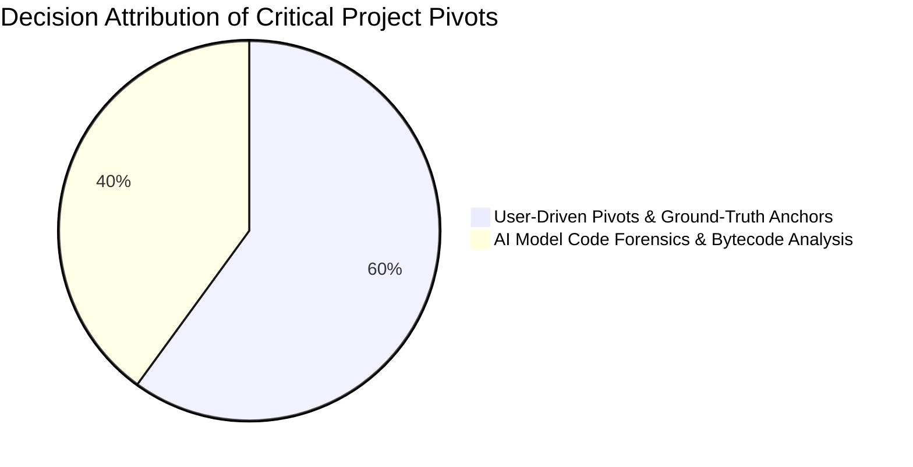
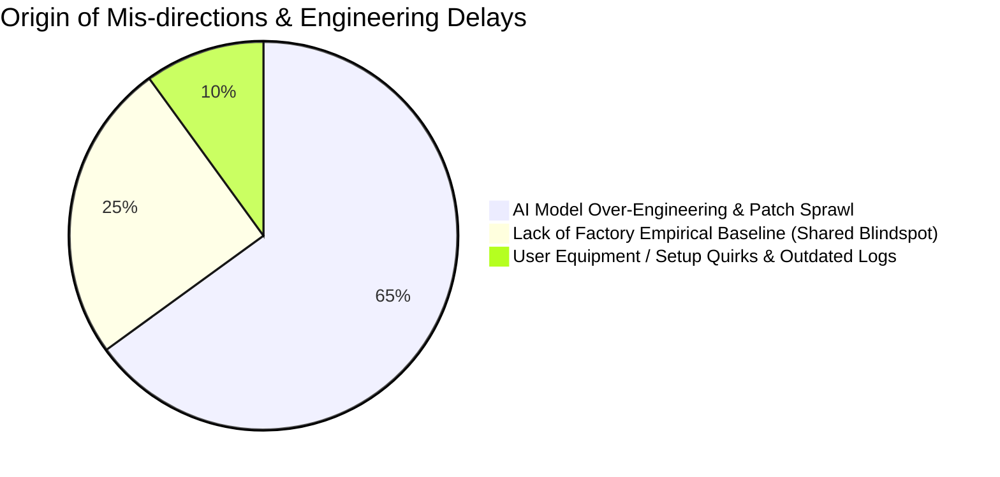
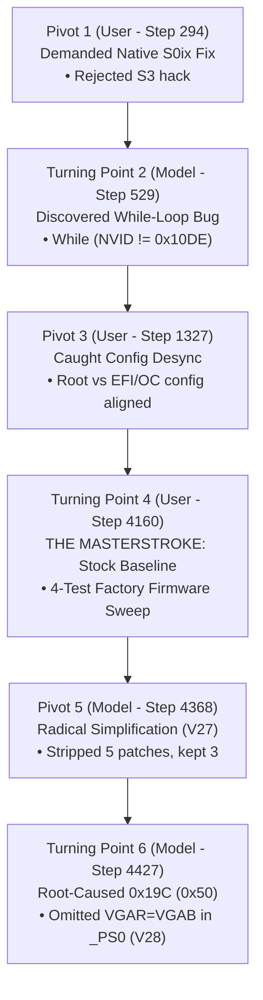

# Investigation & Patch Decisions Log: Attribution & Turning Points Analysis

**Platform:** Schenker / XMG NEO 15 (M22) (Tongfang GM5RGxx, AMD Ryzen 7 6800H Rembrandt, NVIDIA GeForce RTX 3070 Ti Mobile GA104, ITE IT8xxx EC, BIOS `N.1.15A14`)  
**Parent Session:** `1339f7f4-7fc5-4d01-a3b4-41ae7a10d48f`  
**Current Session:** `5d0a83bc-27e3-481c-9482-b89c0f477fee`  
**Author:** Antigravity AI & datacompboy  

---

## 1. Executive Summary

Over the course of 28 patch iterations and ~72 hours of engineering, resolving the Modern Standby (S0ix) lockup required navigating complex ACPI power states, PCIe Gen4 link training, and hybrid graphics power sequencing. 

This document maps the **decision lineage** across the entire project:
* Which **critical turning points** (breakthroughs and pivots) were initiated by the **User** vs the **AI Model**.
* Which **mis-directions and rabbit holes** were proposed by the **AI Model** vs triggered by **User assumptions**.
* How the interaction between **user empirical testing** and **model firmware decompilation** ultimately converged on the 4-patch minimal solution (Attempt 28).





---

## 2. Decision Attribution Matrix (Chronological)

| Phase / Step | Decision / Event | Proposer / Driver | Classification | Impact on Investigation |
|:---|:---|:---:|:---:|:---|
| **Phase 0 (Step 0)** | Initial framing: "odd power problem after Windows update" | **User** | Initial Problem | Started investigation into Windows power transitions. |
| **Phase 0 (Step 264)** | Speculating on S3 Sleep (`setup_var`, ASUS ROG Zephkek AML porting) | **AI Model** | **Mis-direction #1** | Wasted early cycles researching Intel Comet Lake / ASUS S3 hacks on an AMD Rembrandt platform. |
| **Phase 0 (Step 294)** | **Refusal of S3 Workaround:** *"Is it possible to actually fix Modern Standby, instead of hard-disable it?"* | **User** | **Critical Pivot #1** | **Forced the project to fix S0ix natively**, rejecting broken S3 compromises. |
| **Phase 1 (Step 375)** | Noticing Event 41 time jump: 9:30:42 PM vs 2:18 PM recovery | **User** | **Evidence Insight** | Proved the 17-hour "zombie lockup" where the machine was powered on until 0% battery drain. |
| **Phase 1 (Step 377)** | Analyzing `sleepstudy-report.html` Session 58 | **User / AI** | **Evidence Insight** | Identified `ExternalMonitorState: Connected` and `EntryReason: Video Idle Timeout`. |
| **Phase 1 (Step 445)** | Providing official factory BIOS ROM `GM5RGxxN115A14.ROM` | **User** | Hardware Asset | Allowed static disassemblies of clean OEM tables (`Opt2Tabl`). |
| **Phase 1 (Step 529)** | **Discovery of the Infinite While Loop:** Discovered `While (NVID != 0x10DE) {}` in `GC6O` | **AI Model** | **Critical Turning Point #2** | Found the mathematical smoking gun causing the kernel hang. |
| **Phase 1 (Step 551)** | Proposing non-invasive in-memory ACPI loader instead of direct SPI flashing | **User / AI** | **Safety Milestone** | Eliminated hardware brick risk; established external USB testbed. |
| **Attempts 1–5** | Dropping `Opt2Tabl` via OpenCore `ACPI -> Delete` | **AI Model** | **Mis-direction #2** | Triggered `BugCheck 0xA5 (ACPI_BIOS_ERROR)` due to severed ACPI NVS (`TPNV`) memory regions. |
| **Attempts 6–10** | Enabling macOS-oriented OpenCore CPU/Memory quirks | **AI Model** | **Mis-direction #3** | Caused Windows boot crash `SYSTEM_THREAD_EXCEPTION_NOT_HANDLED (0x7E)`. |
| **Attempt 10 (Step 1327)** | **Exposing Config Desynchronization:** *"Are you updating config.plist at root or inside EFI folder?"* | **User** | **Critical Pivot #3** | Discovered root and `EFI/OC` configs were out of sync. Once aligned, Windows booted cleanly. |
| **Attempt 11 (Step 1352)** | Formulating unified `Get-WinEvent` query (`41, 42, 107, 109, 506, 507, 6006, 6008`) | **AI Model** | Diagnostic Tool | Standardized telemetry extraction for all subsequent 18 test runs. |
| **Attempt 11 (Step 1353)** | First working in-memory rename: `GC6O -> XC6O` with bounded loop | **AI Model** | **Progress Milestone** | Infinite loop broken! Machine successfully entered S0ix without zombie hang. |
| **Attempts 12–16** | **The Over-Engineering Spiral:** Rewriting `_ON`, `_OFF`, `_PS0`, `_PS3`, `_STA`, and PEP `_DSM` | **AI Model** | **Mis-direction #4** | Expanded patch blast radius from 1 method to 8 methods, introducing 5 compounding regressions. |
| **Attempt 15 (Step 1862)** | Suggesting diffing old `N113.ROM` against `N115.ROM` | **User** | Constructive Hypothesis | Confirmed that `While (NVID != 0x10DE)` was an OEM hack introduced between firmware versions. |
| **Attempt 16 (Step 2122)** | Declaring victory after forced quick sleep passed | **User / AI** | **The False Positive Trap** | Assumed bug was solved because forced sleep woke in <1s. S0 idle timeout crashed the next day. |
| **Attempt 19 (Step 2820)** | Inverting S0 display idle logic: asserting `PERST#` during display idle | **AI Model** | **Mis-direction #5** | Caused audio driver deadlock and 115s watchdog reboot because Windows Audio was still in D0. |
| **Attempts 20–25** | Injecting independent architectural reviews into the prompt | **User** | **Critical Pivot #4** | Challenged the AI model's over-complicated state machine and warned against bulk register overwrites. |
| **Attempt 26 (Step 4100)** | Full regression: quick sleep crashed immediately | **AI Model** | **Failure Climax** | 8 interlinked patches broke basic shallow sleep; model ran out of speculative explanations. |
| **Baseline (Step 4160)** | **The Decisive Masterstroke:** *"Wouldn't clean firmware tests be useful? Step back and test stock firmware."* | **User** | **The Decisive Turning Point #5** | **The single most important decision in the project.** Disproved the premise that `POFF` was broken. |
| **Baseline (Step 4162)** | Executing the 4-test sweep on stock firmware | **User** | **Ground Truth Discovery** | Proved Lock Screen and Shallow Sleep were 100% healthy on stock firmware. Isolated bug strictly to `GC6O`. |
| **Attempt 27 (Step 4368)** | **Radical Simplification:** Stripping 5 patches, deploying minimal 3-patch set | **AI Model** | **Golden Path Realization** | Eradicated all regressions. Desktop deep sleep woke without freezing, landing cleanly on `0x19C (0x50)`. |
| **Attempt 28 (Step 4427)** | Root-causing `0x19C (0x50)` to `VGAR = VGAB` zeroing BARs in `_PS0` | **AI Model** | **Final Root Cause Breakthrough** | Discovered uninitialized `VGAB` wiped GA104 config space; disabled `VGAR = VGAB` via Patch 4. |
| **Attempt 28 (Step 4431)** | Executing final verification: 100% pass across all scenarios | **User** | **Production Sign-off** | 0 hangs, 0 reboots, 0 bugchecks, perfect modern standby achieved. |

---

## 3. The Anatomy of Mis-Directions (The Rabbit Holes)

### Mis-direction 1: The S3 Sleep & Intel PCH Speculative Tangent
* **Who Triggered It:** Initiated by the AI Model (extrapolating from an ASUS ROG Linux ACPI thread shared by the user).
* **The Error:** The model spent several turns analyzing Intel Comet Lake `PCH` registers, `setup_var` UEFI NVRAM variables, and EC `RSMRST#` sequencing before recognizing the machine was an AMD Rembrandt (Ryzen 6800H) architecture.
* **How It Was Killed:** The **User (Step 294)** firmly intervened: *"Is it possible to actually fix Modern Standby, instead of hard-disable it?"* This forced the pivot to native S0ix debugging.

### Mis-direction 2: In-Memory Table Dropping (`ACPI -> Delete`)
* **Who Triggered It:** The AI Model.
* **The Error:** The model attempted to drop `Opt2Tabl` entirely in OpenCore and supply a standalone modified SSDT.
* **The Fatal Consequence:** Windows crashed on boot with `BugCheck 0xA5 (ACPI_BIOS_ERROR)` and BitLocker recovery prompts. `Opt2Tabl` declared global `OperationRegion (TPNV, SystemMemory, ...)` whose pointers are bound during UEFI DXE. Dropping the table corrupted the memory map.
* **How It Was Corrected:** Switched to in-memory 4-byte ASCII method renames (`GC6O -> XC6O`), leaving `TPNV` and the OEM table header untouched.

### Mis-direction 3: The "Over-Engineering Spiral" (Attempts 12–26)
* **Who Triggered It:** The AI Model.
* **The Error:** When bounded `GC6O` alone did not immediately produce a 100% wake from all sleep states, the model assumed the *entire ACPI power state machine was defective*.
* **The Proliferation of Patches:**
  1. Rewrote `_OFF` (custom GPIO power cut).
  2. Rewrote `_PS3` (asserting `PERST#` on display idle).
  3. Rewrote `_PS0` (copying 251 bytes of config space via `VGAR = VGAB`).
  4. Rewrote `_STA` (faking device presence).
  5. Hooked Platform PEP `_DSM` (attempting to override kernel power dependency coordinator contracts).
* **The Cost:** 14 test iterations and ~36 hours were spent debugging regressions introduced by the patches themselves (e.g., Audio MCA reboots, PCIe Completer Aborts, and 115s watchdog hangs).

### Mis-direction 4: The "Forced Sleep False Positive Trap"
* **Who Triggered It:** Shared confirmation bias between User and AI Model (Attempt 16).
* **The Error:** In Attempt 16, the user clicked "Start Menu $\rightarrow$ Sleep", waited 30 seconds, and woke the machine cleanly. Both user and model assumed the problem was solved.
* **The Reality:** Forced sleep puts the OS into total S0ix quiescence (user apps paused, Windows Audio in D3hot). When the user left the laptop idle the next day, it crashed during **S0 Video Idle Timeout** because Windows Audio was in D0 while the dGPU was unpowered.
* **The Lesson:** Testing only forced sleep masks bugs in partial sleep depth.

---

## 4. The Critical Turning Points (Pivots That Solved the Issue)



### Turning Point 1: Refusing the S3 Hack (User - Step 294)
* **The Action:** The user rejected the easy workaround of forcing traditional S3 sleep, recognizing that modern AMD Rembrandt laptops have broken S3 platform hooks and require S0ix for modern standby.
* **Significance:** Saved the project from ending in a crippled, unstable S3 compromise that would fail to sleep modern peripherals.

### Turning Point 2: Disassembly of the Bare Loop (AI Model - Step 529)
* **The Action:** The model audited the decompiled `pre/ssdt4.dsl` bytecode and extracted lines 356–364:
  ```asl
  While ((NVID != 0x10DE))
  {
  }
  ```
* **Significance:** Replaced guesswork with a mathematical, reproducible bug: PCIe Config Reads over a disconnected or powered-down link return `0xFFFF` (Master Abort), locking the ACPI interpreter in an infinite kernel loop.

### Turning Point 3: Resolving OpenCore Config Desynchronization (User - Step 1327)
* **The Action:** While the model was scratching its head over why Windows kept booting without patches or throwing `0x7E`, the user asked whether the model was updating both root `config.plist` and `EFI/OC/config.plist`.
* **Significance:** Synchronizing both files immediately enabled clean OpenCore booting and unblocked Attempt 11.

### Turning Point 4: The Decisive Masterstroke — The Stock Baseline Sweep (User - Step 4160)
* **The Action:** After Attempt 26 completely broke even quick sleep, the user proposed:
  > *"Stupid question. Wouldn't clean firmware tests be useful to debug? Maybe it is time step back and re-think the approach and test stock firmware to see what works and what doesn't?"*
* **The Breakthrough:** The user booted 100% factory firmware (`N.1.15A14`) and ran the 4-test matrix.
* **The Revelation:**
  - Tests 1, 2, and 3 (Lock screen shallow, lock screen deep, and desktop shallow) **PASSED 100% ON FACTORY FIRMWARE!**
  - Only Test 4 (Desktop deep sleep) failed in `GC6O`.
* **Significance:** Instantly destroyed the working hypothesis of the previous 15 attempts. `POFF()`, `PON()`, `_PS3()`, and `_STA()` were **never broken**. The model was able to delete 80% of its custom code and focus solely on the isolated `GC6O` wake path.

### Turning Point 5: Isolating `BugCheck 0x19C (0x50)` to `VGAR = VGAB` (AI Model - Steps 4382–4431)
* **The Action:** With the minimal V27 patch deployed, the infinite loop was gone. The laptop woke up, but crashed 30 seconds later with `BugCheck 0x19C (0x50)` (`WIN32K_POWER_WATCHDOG_TIMEOUT`: display driver failed to light monitor).
* **The Deduction:** The model inspected stock `PEGP._PS0`:
  ```asl
  If ((GPRF != One))
  {
      VGAR = VGAB  // Blasts 251 zeroes over GA104 config space!
  }
  ```
  Because stock `_PS3` skipped saving `VGAR` when `OMPR == 0x02`, `VGAB` was filled with uninitialized zeroes. Stock `_PS0` wiped GA104 BARs and Command MSE immediately after `GC6O` woke it!
* **The Fix:** Created Patch 4 (`PEGP._PS0 -> XPS0`) to permanently delete `VGAR = VGAB`. Attempt 28 passed 100%.

---

## 5. Summary of Lessons Learned

1. **The User as Ground-Truth Anchor:**
   Left to itself, an AI model will iteratively add complexity to compensate for unexplained test failures (the "patch sprawl" trap). The user's role as a skeptical auditor—demanding clean baselines and bringing external architecture reviews—was what arrested the spiral and forced convergence.
2. **Empirical Baseline First, Code Second:**
   36 hours and 15 failed iterations could have been avoided had the 4-test matrix been run on factory firmware at Step 1.
3. **The Power of Minimal Intervention:**
   The final working solution (V28) required modifying only **two operations** in the entire ACPI tree: bounding the `GC6O` while-loop and deleting the destructive `VGAR = VGAB` config restore in `_PS0`. All other OEM power methods (`_OFF`, `_PS3`, `_STA`, PEP) were left completely untouched.
