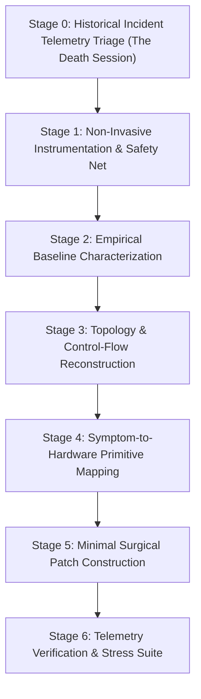
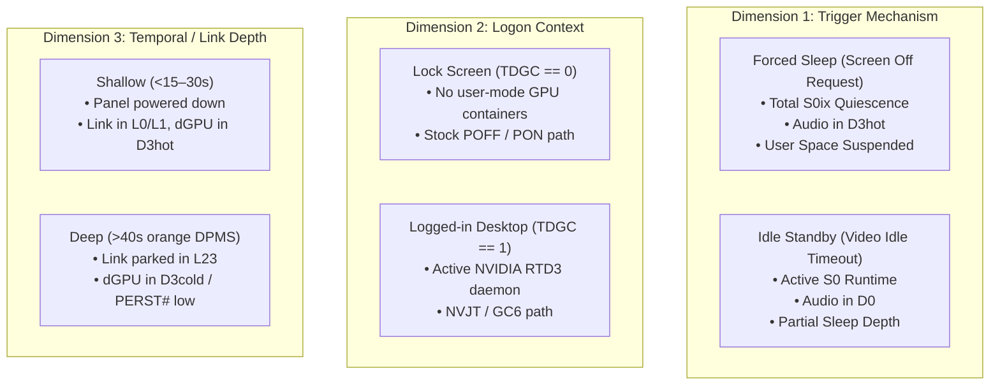
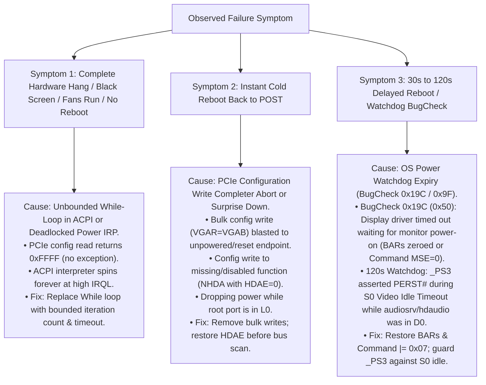

# Generic ACPI & Modern Standby (S0ix) Firmware Debugging Methodology

**Document:** `Learnings.md`  
**Purpose:** Universal, platform-agnostic framework and diagnostic algorithm for troubleshooting, reverse engineering, and fixing ACPI, Modern Standby (S0ix / Low Power S0 Idle), and discrete graphics (dGPU / Optimus / SmartAccess) power-transition failures on any modern laptop architecture (AMD, Intel, Qualcomm, NVIDIA).

---

## 1. Executive Principles of Firmware Debugging

Before touching a single line of ASL/AML or flipping a bootloader toggle, every firmware engineer should internalize five fundamental laws discovered through deep empirical hardware debugging:

### Law 1: Never Patch Before Baseline Characterization
* **The Failure Mode:** Jumping straight into disassembling code and guessing what looks "broken" leads to fixing non-existent problems and breaking functional OEM safeguards.
* **The Rule:** You cannot evaluate a patch unless you have an indisputable, byte-verified empirical baseline of how the **clean, unmodified stock firmware** behaves across an exhaustive power matrix.

### Law 2: Respect the Fundamental S0 vs S0ix Dichotomy
* **The Failure Mode:** Treating a display turning off (Video Idle Timeout) as equivalent to system sleep (Screen Off Request / S0ix).
* **The Rule:** 
  - **`Video Idle Timeout`:** The OS is **running actively in S0**. User-mode services, audio daemons (`audiosrv`), and background worker threads are fully alive. The GPU must remain accessible in D0 or shallow D3hot. Cutting power rails or asserting `PERST#` here will deadlock audio and display services.
  - **`Screen Off Request / System Sleep`:** The OS coordinates a **system-wide quiescence transition** into S0ix. Devices are suspended, audio streams are halted, and root ports are transitioned to D3cold via Power Resources (`_PR3`). Only here is hardware isolation and reset assertion valid.

### Law 3: The PCIe Error Model (Reads Float, Writes Explode)
* **The Failure Mode:** Assuming configuration space operations either all work or all fail identically.
* **The Rule:**
  - **Configuration Reads (`0xFFFF`):** Reading registers of an offline, training, or reset endpoint returns `0xFFFFFFFF` (Master Abort). Under the PCI Express Base Specification, reads do **not** trigger CPU hardware exceptions. If polled in a while-loop without a timeout, reads cause **infinite, silent hangs**.
  - **Configuration Writes (Completer Abort):** Writing to an offline or non-decoding endpoint generates an uncorrectable fatal PCIe error (Completer Abort / Unsupported Request). On modern x86/ARM Root Complexes, this triggers an immediate **Machine Check Architecture (MCA) Hardware Reset** (instant cold reboot back to POST).

### Law 4: Never Perform Blind Bulk Configuration Writes
* **The Failure Mode:** Saving hundreds of raw bytes from ECAM configuration space (`0x00..0x100`) and blasting them back on wake.
* **The Rule:** Raw bulk writes overwrite read-only capability pointers, link training controls, ASPM parameters, and interrupt registers. If the source buffer was uninitialized or partially zeroed, writing it zeroes the device's Base Address Registers (BARs) and Command registers, making MMIO completely unmapped and inducing `BugCheck 0x19C (0x50)` display driver watchdogs. **Always restore specific registers (BARs, Command, Device-Specific Enables) surgically.**

### Law 5: The Principle of Minimal Blast Radius
* **The Failure Mode:** Over-engineering custom ACPI state machines, replacing entire power resources (`_PR0.._PR3`), overriding device states (`_PS0`, `_PS3`), and hooking platform PEP engines.
* **The Rule:** 95% of OEM firmware code is functional and handles edge cases you have not yet encountered. Fix **only** the precise lines where hardware sequencing fails. Every additional method you replace expands your attack surface and introduces regressions.

---

## 2. Universal 7-Stage Diagnostic Algorithm

When faced with sleep/wake hangs, black screens, reboots, or excessive battery drain on a new laptop model, execute the following phased algorithm:



---

### Stage 0: Historical Incident Telemetry Triage (The "Death Session" Investigation)
**Goal:** Extract the exact environmental triggers, peripheral states, platform identity, and failing power plane from the historical crash before touching any hardware or firmware.

In real-world scenarios, users report vague symptoms: *"Sometimes my laptop goes to sleep, never wakes up, and drains the battery to 0%."* Modern Standby (S0ix) failures are almost always **environment- and peripheral-dependent** (e.g., external displays, Thunderbolt docks, USB audio interfaces, or power delivery state). Testing a naked laptop on battery will often fail to reproduce the bug.

1. **Extract the Historical Telemetry Log:**
   - Execute `powercfg /systempowerreport` (or `powercfg /sleepstudy`) on the target machine.
2. **Locate the "Death Session":**
   - Find the session directly preceding the `Type 9 Abnormal Shutdown` or `0 mWh` battery depletion.
3. **Audit the 7 Orthogonal Telemetry Dimensions:**
   - **Dimension 1: Peripheral State (`EventLog.ExternalMonitorState`):** Was an external display connected (`Connected`) or driving signal? If connected, this directly implicates discrete GPU power gating (Optimus / SmartAccess Graphics). If disconnected, the dGPU can be completely ruled out.
   - **Dimension 2: Power Source (`OnAc`):** Was the system plugged into the wall charger (`OnAc: True`) or running on battery (`OnAc: False`)? 
     - *Firmware Impact:* Power plans on DC enforce aggressive PCIe ASPM (L1.1/L1.2), drop dGPU RTD3 timers from 30s to 5s, and renegotiate Type-C PD. If `OnAc == True`, battery power states can be safely pruned from early testing.
   - **Dimension 3: Entry Trigger (`EntryReason`):** Was it an explicit user action (`Screen Off Request` / Sleep button) or display timeout (`Video Idle Timeout`)? This distinguishes S0 runtime display turn-off from S0ix system-wide quiescence.
   - **Dimension 4: User Session / Logon Context (`UserLogonState` / Prior Activity):** Was the user actively logged in prior to sleep (as evidenced by active sessions preceding the crash), or was the system at the pre-logon lock screen? This determines whether user-mode driver daemons (NVIDIA container services, AMD Adrenalin) are running (`TDGC == 1` vs `TDGC == 0`).
   - **Dimension 5: Standby Latency Milestone & Time-to-Fault (`Duration` / `PdcCheckpoint`):**
     - $0\text{s} \dots 5\text{s}$: Failure during initial display blanking & shallow D3hot entry.
     - $15\text{s} \dots 30\text{s}$: PDC Activator phase completion $\rightarrow$ Connected Standby entry.
     - $30\text{s} \dots 45\text{s}$: External monitor DPMS standby (orange LED) $\rightarrow$ deep D3cold / RTD3 / link parked in L23.
     - $\approx 115\text{s} \dots 120\text{s}$: Windows Kernel Power Watchdog timeout (a driver deadlocked on a pending power IRP).
     - $> 3\text{h}$: Adaptive Hibernate threshold (S0ix $\rightarrow$ S4 transition failure).
     - *Pruning Impact:* The duration of the dying session points directly to the failing subsystem (e.g. 118s = driver deadlock; 35s = D3cold link training; 3 hours = hibernation file writing).
   - **Dimension 6: Physical Chassis / Lid State (`EventLog.LidState`):** Was the lid open or closed? Closed lid disables the internal panel via EC Hall effect sensor, clamps thermal envelopes, and ignores internal I2C/PS2 keyboard/trackpad interrupts.
   - **Dimension 7: Subsystem Blockers & PEP Pre-Vetoes (`BlockerGroups` / `PDC Phases`):** Shows which device or driver failed to enter low power before the crash (`Audio Activity`, `FX Devices`, `Processors`, `SOC Subsystems`, `PEP Pre-Vetoes`). If a specific device is flagged, the rest of the motherboard is exonerated.
4. **Platform Identity Sanity Check (`SystemInformation`):**
   - Verify `SystemManufacturer`, `SystemProductName`, and current `BIOSVersion`. This prevents catastrophic mistakes such as flashing a ROM intended for an earlier generation of the chassis.
5. **Outcome of Stage 0 (Search Space Pruning):**
   - You now know the **exact physical setup required for reproduction** (e.g., *"Must connect an external monitor to HDMI 2.1 on AC power"*), eliminating weeks of chasing irreproducible "ghost" bugs.

---

### Stage 1: Non-Invasive Instrumentation & Safety Net
**Goal:** Establish an environment where crashes, deadlocks, and corrupted tables can be debugged with zero brick risk and zero impact on genuine platform identity.

1. **Motherboard SPI Flash Quarantine:**
   - Do **not** modify or flash unofficial ROMs to the motherboard SPI flash.
   - Maintain the latest signed OEM firmware as the baseline.
2. **In-Memory Bootloader Setup:**
   - Deploy an external USB drive formatted with FAT32 containing [Acidanthera OpenCore](https://github.com/acidanthera/OpenCorePkg).
   - Place an `EFI/OC/.contentVisibility` file containing `Disabled` to prevent OpenCore from enumerating itself in its own boot picker.
   - Configure `config.plist` for headless ACPI injection:
     - `PlatformInfo -> Automatic = false` (Preserves genuine SMBIOS, Windows activation, BitLocker PCRs, and OEM control software).
     - `ACPI -> Delete`: Do **not** drop OEM tables containing dynamic ACPI NVS (`OperationRegion`) memory.
     - `ACPI -> Patch`: Use in-memory 4-byte ASCII method renames (e.g., `_ON -> XON`, `GC6O -> XC6O`).
     - `Misc -> Debug -> Target = 0` (or `3` during active debugging; disable file logging for production).
     - `Misc -> Boot -> Timeout = 2` with `ShowPicker = true`.
3. **Emergency Ejection Protocol:**
   - If an experimental patch locks the machine, unplugging the USB thumb drive immediately restores 100% factory behavior on the next boot.

---

### Stage 2: Empirical Baseline Characterization (The 3D Factorial Matrix)
**Goal:** Map the exact conditions that succeed vs fail on unmodified factory firmware across all orthogonal power dimensions.

#### The "Forced Sleep False Positive" Trap
A catastrophic error in firmware debugging is to test **only forced sleep** (e.g., clicking Sleep or pressing the power button). 

Forced sleep forces total OS quiescence: user processes are suspended, Windows Audio (`audiosrv`) tears down streams, and all endpoints are put into D3hot before ACPI is called. This masks critical defects in partial sleep depth:
- In our project, **Attempt 19 passed forced quick sleep and forced deep sleep 100%**, but **crashed after 115 seconds during display idle timeout** because Windows Audio was still in D0 while the dGPU was held in reset.
- In **Attempt 25, forced quick sleep and forced deep sleep passed 100%**, but **crashed after 40 seconds on display idle** (`BugCheck 0x19C`).
- In the real world, the original crash (Session 58) was an **idle timeout**, not a forced sleep!

#### The 3-Dimensional Factorial Space
To prevent false positives, baseline characterization must sample a **$2 \times 2 \times 2$ factorial space**:



#### The Accelerated Baseline Protocol (Fast Idle Testing)
Waiting 10–15 minutes for default idle timeouts makes testing painfully slow. **Accelerate idle testing by configuring the display timeout to 1 minute:**
```cmd
:: Configure display idle timeout to 60s for rapid diagnosis:
powercfg /change monitor-timeout-ac 1
```

Now execute the complete 6-test baseline matrix in under 15 minutes:

| Test ID | Trigger Mode | Logon Context | Hold Duration | Hardware Depth | What it Validates |
|:---:|:---:|:---:|:---:|:---:|:---|
| **T1** | Forced Sleep | Lock Screen | 10–15 s | Shallow (D3hot) | Pre-logon shallow D3hot $\rightarrow$ D0 wake. |
| **T2** | Forced Sleep | Lock Screen | 40–60 s | Deep (D3cold / POFF) | Pre-logon full rail power-off / power-on (`POFF`/`PON`). |
| **T3** | Idle Standby | Lock Screen | 70 s (1m timeout) | S0 Display Idle | Pre-logon S0 display idle (verifies `_PS3` doesn't assert `PERST#`). |
| **T4** | Forced Sleep | Active Desktop | 10–15 s | Shallow (D3hot) | Active session shallow D3hot $\rightarrow$ D0 wake. |
| **T5** | Forced Sleep | Active Desktop | 40–60 s | Deep (D3cold / GC6) | **The Acid Test:** Active session deep GC6 wake (`GC6O` loop test). |
| **T6** | Idle Standby | Active Desktop | 70 s (1m timeout) | S0 Display Idle | Active session S0 display idle with external display attached. |

**Telemetry Capture:**
Immediately after running each test (or recovering from a hang), export:
1. `powercfg /systempowerreport` (or `powercfg /sleepstudy`)
2. Windows Event Viewer export: `Get-WinEvent -LogName System | Out-File winevents.txt`

#### Search Space Pruning: How to Collapse the Follow-up Re-Testing Matrix
The initial 6-test calibration sweep takes ~15 minutes to run once. Its purpose is **not** to be repeated after every minor patch, but to **collapse the search space**:

1. **The Invariant Freezing Rule:**
   - As soon as a dimension produces 100% clean passes across all tests on stock firmware, **freeze that dimension out of active iteration**.
   - *Example from our project:*
     - **T1, T2, T3 (Lock Screen):** All pass in <1s. $\rightarrow$ **Freeze Lock Screen.** You do not need to test lock screen on every single iteration.
     - **T4 (Desktop Shallow):** Passes in <1s. $\rightarrow$ **Freeze Shallow Sleep.**
     - **T5 (Desktop Deep Forced) & T6 (Desktop Deep Idle):** Both HANG. $\rightarrow$ **The Active Failure Set.**
2. **The Resulting 2-Test Re-Testing Loop:**
   - For all subsequent patch iterations, the engineer re-tests **ONLY the failing subset**:
     1. `T5`: Desktop Forced Deep Sleep (>40s orange DPMS)
     2. `T6`: Desktop Idle Standby (60s timeout, wait for orange DPMS)
   - Iteration time drops from 15 minutes to **under 3 minutes per patch**.
3. **The Final Sign-Off Sweep:**
   - Only when both `T5` and `T6` pass cleanly do you execute the full wide matrix (T1–T6) once for final regression verification.

---

### Stage 3: Topology & Control-Flow Reconstruction
**Goal:** Understand the physical wiring and trace the exact ACPI methods executed during transitions.

1. **Display Routing Discovery:**
   - Identify which GPU drives which port:
     - Check internal panel connection: Usually eDP to iGPU.
     - Check external HDMI / USB-C DP Alt-Mode lines: Check Windows Advanced Display Settings or `nvidia-smi` / `lspci` to see if external ports are wired directly to the dGPU or through a MUX.
2. **PCIe Hierarchy Mapping:**
   - Identify the Root Port path: e.g., `\_SB.PCI0.GPP0` (AMD) or `\_SB.PCI0.PEG0` (Intel).
   - Identify endpoints: Function 0 (3D Graphics `PEGP`), Function 1 (Audio `NHDA` / `HDAU`).
   - Identify governing Power Resources: `_PR0`, `_PR2`, `_PR3` (often pointing to `PG00`).
3. **Static ASL Disassembly & Audit:**
   - Extract raw tables using `iasl -d` or UEFITool.
   - Search for known dangerous patterns:
     - **Infinite Loops:** Grep for `While` loops checking Vendor IDs or hardware registers without timeout counters:
       ```asl
       While ((NVID != 0x10DE)) { ... }
       While ((PWOK != One)) { ... }
       ```
     - **Bulk Register Overwrites:** Grep for bulk field assignments across config space:
       ```asl
       VGAR = VGAB
       ```
     - **Power-Good Check Traps:** Search for `GSTA()` or `PWOK` checks in `_ON` routines that abort wake if power is already present.
     - **Audio Controller Enable Gates:** Look for offset `0x48B` / `0x488` bit 25 (`HDAE` / `HDA8`) controlling Function 1 audio visibility.

---

### Stage 4: Symptom-to-Hardware Primitive Mapping
**Goal:** Use the observed failure behavior to pinpoint the exact failure category:



---

### Stage 5: Minimal Surgical Patch Construction
**Goal:** Build the override SSDT following strict rules of idempotency and minimal intervention.

#### Architectural Checklist for the Replacement SSDT:
1. **Bounded Polling with Active Hardware Retry:**
   - Never allow any while-loop to execute without a decrementing iteration counter:
     ```asl
     Local0 = 500 // 50ms maximum timeout (500 * 100µs)
     While ((NVID != 0x10DE) && (Local0 > Zero))
     {
         DLYM (One)
         Local0--
     }
     ```
   - If the link fails to train within 20ms, provide an active hardware pulse on `PERST#` before attempting a second bounded poll.
2. **PCIe Reset & Settling Latency:**
   - Adhere strictly to the PCI Express Base Specification ($T_\text{PVPERL}$): Allow **10 to 20 ms** of settling delay after releasing Fundamental Reset (`M010(REST, 1)`) *before* issuing link wake (`L23D(1)`).
3. **Bridge & Endpoint Command Decoding:**
   - Unconditionally enable upstream bridge and endpoint memory/master decoding:
     ```asl
     \_SB.PCI0.GPP0.CMDR |= 0x07 // Bus Master | Memory Space | I/O Space
     VCMD |= 0x07
     ```
4. **Targeted Configuration Space Restoration:**
   - Save `BAR0..BAR5` in `GC6I` while the device is alive.
   - Restore `BAR0..BAR5` in `GC6O` after the link reaches L0.
   - Delete all bulk writes (`VGAR = VGAB`).
5. **Multi-Function Audio Persistence:**
   - If the dGPU contains an integrated audio controller, restore `HDAE` (offset `0x488`, bit 25) with a 32-bit aligned write in `GC6O` so Function 1 (`NHDA`) is immediately visible to `pci.sys`.
6. **Idempotency Guards:**
   - Every wake method must verify whether the device is already awake before executing:
     ```asl
     If ((DGPS == Zero) && (NVID == 0x10DE)) { Return (Zero) }
     ```

---

### Stage 6: Telemetry Verification & Stress Testing
**Goal:** Quantitatively prove that all low-power states and transitions comply with OS specifications.

1. **Verify All 5 Matrix Scenarios:**
   - Re-run Tests 1 through 5. Every single test must achieve clean wake in $<1.0$ second.
2. **SleepStudy Subsystem Audit:**
   - Confirm that `BlockerGroups` is empty across all sleep instances:
     - `PEP Pre-Vetoes`: None
     - `FX Devices`: None
     - `Processors`: None
     - `SOC Subsystems`: None
     - `Audio Activity`: None
3. **Automated Stress Cycling:**
   - Run 50 continuous modern standby cycles using `PwrTest`:
     ```cmd
     PwrTest /cs /c:50 /d:30 /p:15
     ```
   - Parse results with `sleepstudy-reader.py.txt` to confirm 0 Abnormal Shutdowns (Type 9) and 0 BugChecks (Type 10).
4. **Energy Efficiency Audit:**
   - Run `powercfg /energy` and ensure zero ACPI errors, zero unmapped device errors, and zero blocked driver IRPs.

---

## 3. Anti-Patterns to Avoid

| Anti-Pattern | Why It Is Dangerous | What To Do Instead |
|:---|:---|:---|
| **Dropping OEM ACPI Tables** | Erases global ACPI NVS (`TPNV`) memory pointers allocated by UEFI DXE, causing immediate `BugCheck 0xA5`. | Use surgical in-memory method renaming in OpenCore (`_ON -> XON`). |
| **Unconditional `_PS3` Power Gating** | Cuts dGPU power and asserts `PERST#` during S0 Video Idle Timeout while Windows Audio is active, causing a 115s watchdog crash. | Guard `_PS3` so it only powers off when the display is internal or when system enters true S0ix. |
| **Bulk `VGAR = VGAB` Config Restores** | Writes stale zeroes or unaligned registers over PCIe Link Control and BARs, causing fatal Completer Aborts or unmapped MMIO. | Save and restore only `BAR0..BAR5`, `VCMD |= 0x07`, and `HDAE`. |
| **Dynamic Command Register Saving (`SCMD=VCMD`)** | `pci.sys` clears Command to `0x0000` in D3hot before calling ACPI. Saving it records `0x0000`, which disables MMIO on wake (`BugCheck 0x19C`). | Never save the command register from D3hot; unconditionally enforce `VCMD |= 0x07` on wake. |
| **Hooking Platform PEP (`_DSM`)** | Violates OS Power Dependency Coordinator timing constraints, causing immediate desynchronization on quick sleep. | Rely on native ACPI Power Resource evaluation (`_PR3` / `_PR0`) for system sleep coordination. |
