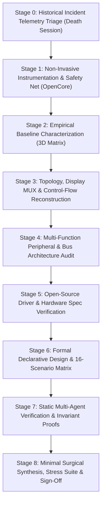
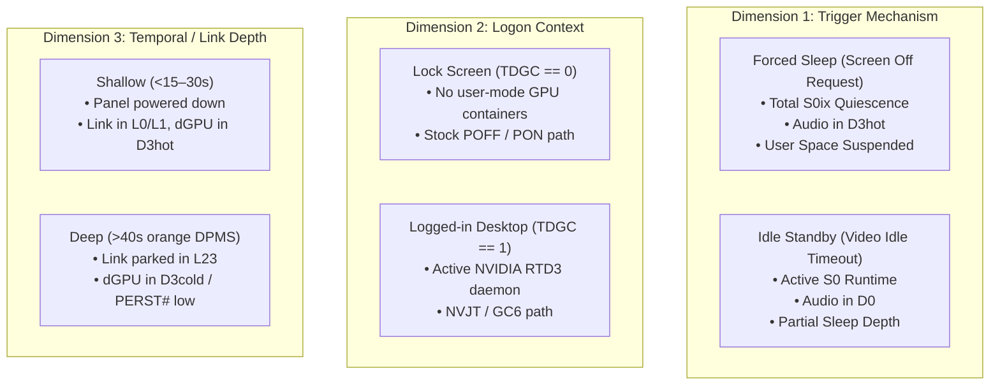
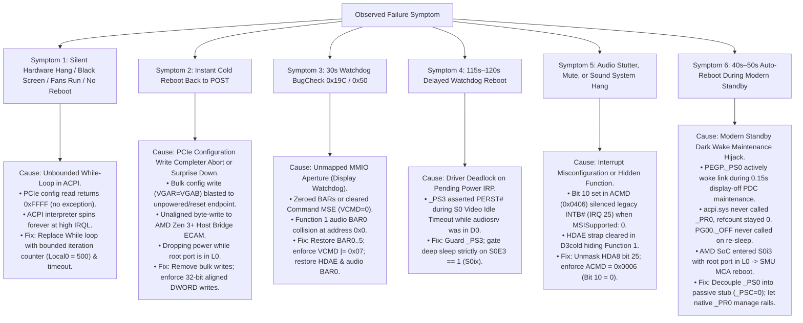

# Generic ACPI & Modern Standby (S0ix) Firmware Debugging Methodology

**Document:** [`retro/Learnings.md`](file:///home/datacompboy/fun/xmg/retro/Learnings.md)  
**Purpose:** Universal, platform-agnostic engineering framework, theoretical principles, and diagnostic algorithm for troubleshooting, reverse engineering, and fixing ACPI, Modern Standby (S0ix / Low Power S0 Idle), and discrete graphics (dGPU / Optimus / SmartAccess) power-transition failures on modern laptop architectures (AMD, Intel, Qualcomm, NVIDIA).

---

## 1. Executive Principles of Firmware Debugging

Through 55 rigorous bare-metal patch iterations and four weeks of low-level ACPI/PCIe reverse engineering, nine fundamental laws of firmware debugging emerged. Every firmware engineer and system architect should internalize these principles before modifying ACPI bytecode:

### Law 1: Never Patch Before Baseline Characterization
* **The Failure Mode:** Jumping straight into disassembling code and guessing what looks "broken" leads to fixing non-existent problems and breaking functional OEM safeguards. In early iterations, we assumed OEM `POFF()` was crashing the machine and spent weeks engineering custom state machines to bypass it, when in fact clean factory firmware's `POFF()` was 100% stable.
* **The Rule:** You cannot evaluate a patch unless you have an indisputable, byte-verified empirical baseline of how the **clean, unmodified stock firmware** behaves across an exhaustive power matrix.

### Law 2: Respect the Fundamental S0 vs S0ix Dichotomy
* **The Failure Mode:** Treating a display turning off (`Video Idle Timeout`) as equivalent to system sleep (`Screen Off Request` / S0ix).
* **The Rule:** 
  - **`Video Idle Timeout`:** The OS is **running actively in S0**. User-mode services, audio daemons (`audiosrv`), and background worker threads are fully alive. The GPU must remain accessible in D0 or shallow D3hot. Cutting power rails or asserting `PERST#` here will deadlock audio and display services.
  - **`Screen Off Request / System Sleep`:** The OS coordinates a **system-wide quiescence transition** into S0ix. Devices are suspended, audio streams are halted, and root ports are transitioned to D3cold via Power Resources (`_PR3`). Only here is hardware isolation and reset assertion valid.

### Law 3: The PCIe Error Model (Reads Float, Writes Explode)
* **The Failure Mode:** Assuming configuration space operations either all work or all fail identically.
* **The Rule:**
  - **Configuration Reads (`0xFFFF`):** Reading registers of an offline, training, or reset endpoint returns `0xFFFFFFFF` (Master Abort). Under the PCI Express Base Specification, reads do **not** trigger CPU hardware exceptions. If polled in a while-loop without a timeout, reads cause **infinite, silent hangs**.
  - **Configuration Writes (Completer Abort):** Writing to an offline or non-decoding endpoint generates an uncorrectable fatal PCIe error (Completer Abort / Unsupported Request). On modern x86/ARM Root Complexes, this triggers an immediate **Machine Check Architecture (MCA) Hardware Reset** (instant cold reboot back to POST).

### Law 4: Never Perform Blind Bulk Configuration Writes
* **The Failure Mode:** Saving hundreds of raw bytes from ECAM configuration space (`0x00..0x100`) and blasting them back on wake (`VGAR = VGAB`).
* **The Rule:** Raw bulk writes overwrite read-only capability pointers, link training controls, ASPM parameters, and interrupt registers. If the source buffer was uninitialized or partially zeroed, writing it zeroes the device's Base Address Registers (BARs) and Command registers, making MMIO completely unmapped and inducing `BugCheck 0x19C (0x50)` display driver watchdogs. **Always restore specific registers (BARs, Command, Device-Specific Enables) surgically.**

### Law 5: The Principle of Minimal Blast Radius
* **The Failure Mode:** Over-engineering custom ACPI state machines, replacing entire power resources (`_PR0.._PR3`), overriding device states (`_PS0`, `_PS3`), and hooking platform PEP engines.
* **The Rule:** 95% of OEM firmware code is functional and handles edge cases you have not yet encountered. Fix **only** the precise lines where hardware sequencing fails. Every additional method you replace expands your attack surface and introduces regressions.

### Law 6: Multi-Function PCIe Coupling & Hidden Functions (The Azalia HDAE Strap Invariant)
* **The Failure Mode:** Treating a multi-function PCIe endpoint (Function 0 = 3D GPU `01:00.0`, Function 1 = High Definition Audio `01:00.1`) as independent devices.
* **The Rule:**
  - Function 0 and Function 1 share the same physical PCIe link, power rails, and Fundamental Reset (`PERST#`).
  - When the dGPU enters D3cold or deep GC6, hardware clears the High Definition Audio Enable strap (`HDA8` offset `0x488` bit 25 = 0, `HDAE = 0`), **completely hiding Function 1 from PCIe configuration space enumeration**.
  - Because OEM ACPI often omits Power Resources (`_PR0..3`) on Function 1 (`NHDA`), Windows `pci.sys` does not track its power state across GC6 and assumes it remained in D0/D3hot. Consequently, **Windows `pci.sys` will NEVER re-enumerate or restore Function 1's BAR0/BAR1 across warm GC6 wake**!
  - **The Law:** Firmware MUST explicitly un-hide Function 1 (`HDA8 |= 0x02000000`) and restore its Base Address Registers (`BAR0`, `BAR1`) in ACPI wake before returning control to the operating system.

### Law 7: Interrupt Architecture Alignment (Never Mask Without Verifying MSI vs INTx)
* **The Failure Mode:** Assuming modern endpoints always use Message Signaled Interrupts (MSI / MSI-X) and setting PCI Command register Bit 10 (`Interrupt Disable = 1`, e.g., `ACMD = 0x0406`).
* **The Rule:**
  - OEM vendor INF drivers or endpoint firmware may explicitly disable MSI (`MSISupported : 0` in `HKLM\SYSTEM\CurrentControlSet\Enum\PCI\...\Device Parameters\Interrupt Management\MessageSignaledInterruptProperties`).
  - GA104 Function 1 audio relies on legacy pin interrupts (`INTB#`, IRQ 25).
  - Setting Bit 10 (`0x0400`) completely disables legacy pin interrupts, causing volume flyouts to hang, audio rendering threads to spin at 100% CPU, and triggering OS watchdog timeouts.
  - **The Law:** Always verify OS interrupt telemetry before touching the PCI Command register. Enforce `ACMD = 0x0006` (`Bus Master | Memory Space Enable`, Bit 10 = 0) to preserve legacy line interrupt routing.

### Law 8: Modern Standby Dark Wake & Maintenance Window Invariance (Decouple `_PS0` from Active Power)
* **The Failure Mode:** Embedding active power-rail sequencing logic inside device evaluation methods (`PEGP._PS0`).
* **The Rule:**
  - In Windows Modern Standby (S0ix), the Power Dependency Coordinator (PDC) periodically triggers **Dark Wakes (Maintenance Windows)** ~40–50 seconds after sleep for 100–200 milliseconds to perform background telemetry, network polling, or clock synchronization **without turning on the display**.
  - If `PEGP._PS0()` actively checks `If (DGPS != 0) { PG00._ON() }`, a passive power query by `pci.sys` during dark wake will force physical rail power-on and link training.
  - Because the screen is off, Windows ACPI never evaluates `_PR0`, leaving the Power Resource reference count at zero. When the 150ms maintenance window ends, Windows never calls `PG00._OFF()`.
  - The SoC attempts to enter hardware S0i3 with the PCIe root port held in L0, triggering an AMD SMU MCA watchdog hardware crash and cold reboot back to POST.
  - **The Law:** Device `_PS0` must remain a **passive status stub** (`_PSC = Zero`). Physical power rail transitions must be strictly decoupled and governed by native ACPI Power Resource evaluation (`_PR0` / `_PR3`).

### Law 9: The Specification-Driven Methodological Invariant
* **The Failure Mode:** Relying on ad-hoc, trial-and-error patching directly on bare metal.
* **The Rule:** Trial-and-error patching in complex asynchronous firmware creates compounding regressions where fixing one symptom breaks two others. 
  - True convergence requires a **formal declarative design document** ([`Design.md`](file:///home/datacompboy/fun/xmg/Bios-XMG-NEO_XNE15E20_XNE17E20_BIOS-N106v2/Design.md)), exhaustive multi-dimensional state enumeration (all 16 sleep/wake scenarios), and **multi-agent static verification** before booting test bytecode.

---

## 2. Universal 9-Stage Diagnostic Algorithm

When faced with sleep/wake hangs, black screens, reboots, or audio crashes on a modern laptop, execute this phased, deterministic engineering algorithm:



---

### Stage 0: Historical Incident Telemetry Triage (The "Death Session" Investigation)
**Goal:** Extract the exact environmental triggers, peripheral states, platform identity, and failing power plane from historical crashes before touching any hardware or firmware.

1. **Extract Historical Telemetry:**
   - Execute `powercfg /systempowerreport` and `powercfg /sleepstudy` on the target machine.
2. **Locate the "Death Session":**
   - Find the session directly preceding a `Type 9 Abnormal Shutdown` or `0 mWh` battery depletion.
3. **Audit the 7 Orthogonal Telemetry Dimensions:**
   - **Dimension 1: Peripheral State (`EventLog.ExternalMonitorState`):** Was an external display connected (`Connected`) or driving signal? If connected, this directly implicates discrete GPU power gating (Optimus / SmartAccess Graphics). If disconnected, dGPU can be completely ruled out.
   - **Dimension 2: Power Source (`OnAc`):** Was the system plugged into AC power or running on battery?
   - **Dimension 3: Entry Trigger (`EntryReason`):** Distinguish `Video Idle Timeout` (active S0 runtime) from `Screen Off Request` (S0ix quiescence).
   - **Dimension 4: User Session / Logon Context (`UserLogonState`):** Was the user logged into desktop (`TDGC == 1`) or at the pre-logon lock screen (`TDGC == 0`)?
   - **Dimension 5: Standby Latency Milestone & Time-to-Fault (`Duration` / `PdcCheckpoint`):**
     - $0\text{s} \dots 5\text{s}$: Shallow D3hot entry.
     - $15\text{s} \dots 30\text{s}$: PDC Activator phase completion $\rightarrow$ Connected Standby entry.
     - $30\text{s} \dots 45\text{s}$: External monitor DPMS standby (orange LED) $\rightarrow$ deep D3cold / RTD3 / link parked in L23.
     - $40\text{s} \dots 50\text{s}$: Modern Standby Dark Wake maintenance window query.
     - $\approx 115\text{s} \dots 120\text{s}$: Windows Kernel Power Watchdog timeout (driver deadlock on a pending power IRP).
     - $> 3\text{h}$: Adaptive Hibernate threshold (S0ix $\rightarrow$ S4 transition failure).
   - **Dimension 6: Physical Chassis / Lid State (`EventLog.LidState`):** Open vs closed.
   - **Dimension 7: Subsystem Blockers & PEP Pre-Vetoes (`BlockerGroups`):** Shows which device failed to enter low power.
4. **Platform Identity Sanity Check (`SystemInformation`):**
   - Verify `SystemManufacturer`, `SystemProductName`, and current `BIOSVersion`. (Prevents catastrophic mistakes such as flashing a ROM intended for an earlier generation of the chassis).

---

### Stage 1: Non-Invasive Instrumentation & Safety Net
**Goal:** Establish an environment where crashes, deadlocks, and corrupted tables can be debugged with zero brick risk and zero impact on genuine platform identity.

1. **Motherboard SPI Flash Quarantine:**
   - Do **not** modify or flash unofficial ROMs to the motherboard SPI flash. Maintain the latest signed OEM firmware as the baseline.
2. **In-Memory Bootloader Setup:**
   - Deploy an external USB drive formatted with FAT32 containing [Acidanthera OpenCore](https://github.com/acidanthera/OpenCorePkg).
   - Place an `EFI/OC/.contentVisibility` file containing `Disabled` to prevent OpenCore from enumerating itself in its own boot picker.
   - Configure `config.plist` for headless ACPI injection:
     - `PlatformInfo -> Automatic = false` (Preserves genuine SMBIOS, Windows activation, BitLocker PCRs, and OEM control software).
     - `ACPI -> Delete`: Do **not** drop OEM tables containing dynamic ACPI NVS (`OperationRegion`) memory.
     - `ACPI -> Patch`: Use in-memory 4-byte ASCII method renames (e.g., `_ON -> XON`, `GC6O -> XC6O`).
     - `Misc -> Debug -> Target = 0` (or `3` during active debugging).
     - `Misc -> Boot -> Timeout = 2` with `ShowPicker = true`.
3. **Emergency Ejection Protocol:**
   - Unplugging the USB thumb drive immediately restores 100% factory behavior on the next boot.

---

### Stage 2: Empirical Baseline Characterization (The 3D Factorial Matrix)
**Goal:** Map the exact conditions that succeed vs fail on unmodified factory firmware across all orthogonal power dimensions.

#### The 3-Dimensional Factorial Space:
Baseline characterization must sample a **$2 \times 2 \times 2$ factorial space**:



#### The Accelerated Baseline Protocol (Fast Idle Testing):
Configure display timeout to 1 minute to test idle paths rapidly:
```cmd
powercfg /change monitor-timeout-ac 1
```

Execute the complete 6-test baseline matrix in under 15 minutes:

| Test ID | Trigger Mode | Logon Context | Hold Duration | Hardware Depth | What it Validates |
|:---:|:---:|:---:|:---:|:---:|:---|
| **T1** | Forced Sleep | Lock Screen | 10–15 s | Shallow (D3hot) | Pre-logon shallow D3hot $\rightarrow$ D0 wake. |
| **T2** | Forced Sleep | Lock Screen | 40–60 s | Deep (D3cold / POFF) | Pre-logon full rail power-off / power-on (`POFF`/`PON`). |
| **T3** | Idle Standby | Lock Screen | 70 s (1m timeout) | S0 Display Idle | Pre-logon S0 display idle (verifies `_PS3` doesn't assert `PERST#`). |
| **T4** | Forced Sleep | Active Desktop | 10–15 s | Shallow (D3hot) | Active session shallow D3hot $\rightarrow$ D0 wake. |
| **T5** | Forced Sleep | Active Desktop | 40–60 s | Deep (D3cold / GC6) | **The Acid Test:** Active session deep GC6 wake (`GC6O` loop test). |
| **T6** | Idle Standby | Active Desktop | 70 s (1m timeout) | S0 Display Idle | Active session S0 display idle with external display attached. |

#### Search Space Pruning:
1. **The Invariant Freezing Rule:** As soon as a dimension produces 100% clean passes on stock firmware (e.g., Lock Screen T1–T3, Desktop Shallow T4), **freeze that dimension out of active iteration**.
2. **The 2-Test Active Loop:** Re-test only the failing subset (`T5` and `T6`), reducing cycle time from 15 minutes to **under 3 minutes per patch**.

---

### Stage 3: Topology, Display MUX & Control-Flow Reconstruction
**Goal:** Understand the physical wiring and trace the exact ACPI methods executed during transitions.

1. **Display Routing Discovery:**
   - Internal panel: Usually eDP to iGPU.
   - External HDMI / USB-C DP Alt-Mode lines: Check Windows Advanced Display Settings or `nvidia-smi` / `lspci` to see if external ports are wired directly to the dGPU or through a MUX.
2. **PCIe Hierarchy Mapping:**
   - Identify Root Port path: e.g., `\_SB.PCI0.GPP0` (AMD) or `\_SB.PCI0.PEG0` (Intel).
   - Identify endpoints: Function 0 (3D Graphics `PEGP`), Function 1 (Audio `NHDA` / `HDAU`).
   - Identify governing Power Resources: `_PR0`, `_PR2`, `_PR3` (pointing to `PG00`).

---

### Stage 4: Multi-Function Peripheral & Bus Architecture Audit
**Goal:** Analyze the secondary functions, strap registers, interrupt routing, and SoC ECAM access constraints.

1. **Multi-Function Audio Inspection (`01:00.1`):**
   - Check if Function 1 has ACPI Power Resources (`_PR0..3`). If missing, Windows `pci.sys` will not manage its power across D3cold.
   - Audit the GPU audio strap: Ga104 offset `0x488` bit 25 (`HDA8` / `HDAE`). If `HDAE` is cleared on D3cold, Function 1 vanishes from PCIe configuration space.
2. **Interrupt Delivery Architecture:**
   - Query OS Registry for MSI support:
     ```powershell
     Get-ItemProperty -Path "HKLM:\SYSTEM\CurrentControlSet\Enum\PCI\VEN_10DE&DEV_228B*\*\Device Parameters\Interrupt Management\MessageSignaledInterruptProperties" -Name MSISupported
     ```
   - If `MSISupported == 0`, the device relies strictly on **legacy line interrupts (`INTB#` / IRQ 25)**. PCI Command register Bit 10 (`Interrupt Disable`) must remain `0` (`ACMD = 0x0006`).
3. **SoC ECAM Bus Access Constraints:**
   - On AMD Zen 3+ (Rembrandt) Host Bridges, PCI Express Extended Configuration Space (ECAM) operations must be **32-bit DWORD-aligned**. Byte-wide or 16-bit unaligned writes to root ports trigger an immediate Host Bridge Completer Abort and instant cold reboot.

---

### Stage 5: Open-Source Driver & Hardware Specification Verification
**Goal:** Cross-reference proprietary OEM ACPI against vendor open-source driver implementations to uncover hardware contracts.

1. **Vendor Driver Decompilation & Inspection:**
   - Inspect NVIDIA open-gpu-kernel-modules ([`kernel-open/nvidia/nv-pci.c`](https://github.com/NVIDIA/open-gpu-kernel-modules)):
     - Locate `nv_set_power_state()` and GC6 entry/exit routines.
     - Discover how `nvlddmkm.sys` interacts with ACPI `_DSM` (Function 0x1A: JT_FUNC_GC6).
     - Confirm that GPU hardware clears `HDAE` on power-cut and expects SBIOS/ACPI to restore `HDAE` and BARs during link re-training before handing control back to the driver.

---

### Stage 6: Formal Declarative Design & Multi-Scenario Matrix
**Goal:** Replace trial-and-error patching with a comprehensive, formal specification document ([`Design.md`](file:///home/datacompboy/fun/xmg/Bios-XMG-NEO_XNE15E20_XNE17E20_BIOS-N106v2/Design.md)).

1. **Formalize All 5 Traps:**
   - Trap 1: The Infinite While Loop (`GC6O` `NVID != 0x10DE`).
   - Trap 2: The Stock `_PS0` Zero-Blast (`VGAR = VGAB`).
   - Trap 3: The S0 Display Idle vs S0ix System Sleep Asymmetry (`S0E3`).
   - Trap 4: The Multi-Function Audio Strap & Zero-BAR Collision (`HDAE` & `BAR0`).
   - Trap 5: The Modern Standby Dark Wake Active Power Hijack (`PEGP._PS0`).
2. **Construct the 16-Scenario State Matrix:**
   - Enumerate all combinations of Display (On/Off), Audio (Idle/Active), Logon (Lock/Desktop), Power Source (AC/DC), and Standby Depth (Shallow/Deep/Dark Wake).
   - Define exact required register states and ACPI method entry/exit behaviors for every scenario.

---

### Stage 7: Static Multi-Agent Verification & Invariant Proofs
**Goal:** Mathematically prove that the synthesized AML bytecode satisfies all 16 scenarios and introduces zero regressions *before* touching hardware.

1. **Deploy Specialized Verification Agents:**
   - **AST & Scope Auditor:** Verifies that no duplicate symbols, invalid scope overrides, or broken external references exist.
   - **Register & Timing Auditor:** Verifies that all ECAM operations are 32-bit aligned, settling delays satisfy $T_\text{PVPERL}$ (10–20ms), and all polling loops have decrementing iteration counters.
   - **State Machine & Scenario Prover:** Traces execution across all 16 scenarios to verify idempotency, Dark Wake passivity, and audio strap persistence.
2. **Review Static Validation Report ([`Validation-v55.md`](file:///home/datacompboy/fun/xmg/Bios-XMG-NEO_XNE15E20_XNE17E20_BIOS-N106v2/Validation-v55.md)):**
   - Confirm zero AST errors, zero unbounded loops, zero bulk writes, and 100% scenario compliance.

---

### Stage 8: Minimal Surgical Synthesis, Stress Testing & Telemetry Verification
**Goal:** Deploy the verified overlay and quantitatively prove stability across extended duty cycles.

1. **Deploy Minimal 4-Patch Set via OpenCore:**
   - Patch 1: `PEGP.GC6O -> XC6O` (Bounded loop, link wake, audio strap unmask, BAR restore).
   - Patch 2: `PG00._ON -> XON` (Bypass `GSTA() != 0` early return, enforce settling delay).
   - Patch 3: `PEGP.GC6I -> XC6I` (Save `BAR0..BAR5`, set `DGPS = 1`).
   - Patch 4: `PEGP._PS0 -> XPS0` (Passive stub: `_PSC = Zero`, omit destructive `VGAR = VGAB`, decouple Dark Wake).
2. **Automated Stress Cycling:**
   - Run 50 continuous Modern Standby cycles using `PwrTest`:
     ```cmd
     PwrTest /cs /c:50 /d:30 /p:15
     ```
3. **Prolonged Hardware DRIPS S0i3 Residency Audit:**
   - Let system sleep for >30 minutes on AC and DC.
   - Parse `SleepStudy` to confirm **89%–98% hardware S0i3 DRIPS residency**, 0 Abnormal Shutdowns (Type 9), and 0 BugChecks (Type 10).
4. **Energy & Driver Verification:**
   - Run `powercfg /energy` to ensure zero unmapped device errors, zero blocked power IRPs, and flawless HDMI audio playback.

---

## 3. Symptom-to-Hardware Primitive Mapping

Use this diagnostic decision tree to map observed failure modes directly to their low-level hardware causes:



---

## 4. Comprehensive Anti-Patterns & Pitfalls Catalog

| Anti-Pattern | Root Mechanism & Failure Signature | Correct Architectural Alternative |
|:---|:---|:---|
| **Dropping OEM ACPI Tables** | Erases ACPI Non-Volatile Sleep (`TPNV`) memory allocated by UEFI DXE drivers, causing immediate `BugCheck 0xA5 (ACPI_BIOS_ERROR)` on boot. | Use surgical in-memory method renaming in OpenCore (`_ON -> XON`, `GC6O -> XC6O`). |
| **Unconditional `_PS3` Power Gating** | Cuts dGPU power and asserts `PERST#` during S0 Video Idle Timeout while Windows Audio is active, causing a 115-second driver deadlock and watchdog reboot. | Guard `_PS3` so it only powers off when the display is internal or when system enters true S0ix (`S0E3 == 1`). |
| **Bulk `VGAR = VGAB` Config Restores** | Writes stale zeroes or unaligned registers over PCIe Link Control and BARs, causing fatal Completer Aborts or unmapped MMIO apertures. | Save and restore only `BAR0..BAR5`, `VCMD |= 0x07`, and `HDAE`. |
| **Dynamic Command Register Saving (`SCMD = VCMD`)** | `pci.sys` clears Command to `0x0000` in D3hot before calling ACPI. Saving it records `0x0000`, which disables MMIO on wake (`BugCheck 0x19C`). | Never save the command register from D3hot; unconditionally enforce `VCMD |= 0x07` on wake. |
| **Hooking Platform PEP (`_DSM`)** | Violates OS Power Dependency Coordinator timing constraints, causing immediate desynchronization on quick sleep. | Rely on native ACPI Power Resource evaluation (`_PR3` / `_PR0`) for system sleep coordination. |
| **The "Zero-Shadow-Driver" Fallacy** | Assuming Windows `pci.sys` will restore Function 1 audio BARs across warm GC6. Because `HDAE` is cleared on power-down, `pci.sys` cannot see Function 1 and leaves `BAR0 = 0x0`. | Pre-capture `NHDA` BAR0/BAR1 in firmware and restore them in `GC6O` after unmasking `HDAE`. |
| **Disarming GC6 via POFF Redirection** | Routing `GC6I()` to `POFF()` cuts 12V main power during boot, breaking external monitor EDID probing and display detection. | Maintain symmetrical GC6 for runtime/sleep transitions; leave boot-time power sequencing untouched. |
| **MSI Bit 10 Masking on Legacy INTx** | Setting `ACMD = 0x0406` (Bit 10 = 1 `Interrupt Disable`) on endpoints where `MSISupported : 0` silences legacy pin interrupts (`INTB#` IRQ 25), causing audio rendering threads to spin at 100% CPU. | Query OS registry to verify MSI support; enforce `ACMD = 0x0006` (Bit 10 = 0) for legacy line interrupt routing. |
| **Active Power Logic in Device `_PS0`** | Forcing `PG00._ON()` inside `PEGP._PS0` wakes the physical link during 0.15s display-off Modern Standby Dark Wake maintenance windows without `_PR0` refcount tracking, causing SMU MCA reboot upon re-sleep. | Make device `_PS0` a passive stub (`_PSC = Zero`); let native ACPI Power Resource `_PR0` manage physical rails. |
| **Unaligned Byte Accesses to SoC ECAM** | Writing 8-bit bytes to root port registers on AMD Zen 3+ Host Bridges triggers an immediate Host Bridge Completer Abort and instant reboot. | Always perform 32-bit DWORD-aligned reads and writes to PCIe ECAM registers. |
