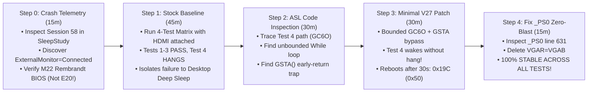

# The Golden Path: Retrospective Best-Case Engineering Workflow for the XMG NEO 15 (M22) Sleep Fix

**Document:** `Wouldbe.md`  
**Target Platform:** Tongfang GM5RGxx / Schenker XMG NEO 15 (M22)  
**Purpose:** A rigorous retrospective analysis examining how this exact firmware defect could have been diagnosed, isolated, and permanently solved in **4 clean steps within 2.5 hours** instead of 28 trial-and-error iterations across three days.

---

## 1. Dissection of the "Wall Hits": Why Did It Take 28 Iterations?

Every detour and regression encountered during the investigation can be traced back to specific incorrect assumptions, missing baseline data, or over-engineered interventions. Understanding these "wall hits" is essential to avoid repeating them:

```mermaid
graph TD
    subgraph Reality["The 28-Attempt Labyrinth"]
        W0["Wall 0: The Fog of War & Wrong ROM<br>• Initial prompt had no mention of external screen<br>• Supplied 2020 Comet Lake ROM for a 2022 Rembrandt laptop!"] --> W1
        W1["Wall 1: Dropping Opt2Tabl (V1-V10)<br>• BugCheck 0xA5: Lost TPNV NVS memory"] --> W2
        W2["Wall 2: The 'POFF is Evil' Fallacy (V11-V15)<br>• Assumed POFF crashed lock screen<br>• Actually our own injected VGAR=VGAB crashed it"] --> W3
        W3["Wall 3: The S0 Display Idle Trap (V17-V19)<br>• Removed OMPR==3 from _PS3<br>• Asserted PERST# in S0 -> 115s watchdog reboot"] --> W4
        W4["Wall 4: The Command Register Trap (V18)<br>• SCMD=VCMD saved 0x0000 in D3hot<br>• Overwrote MSE=0 on wake -> BugCheck 0x19C"] --> W5
        W5["Wall 5: The PEP Hook Dead End (V26)<br>• Hooked PEP _DSM Case 7<br>• Broke PDC kernel timing on quick sleep"] --> W6
        W6["Wall 6: The Stock _PS0 Zero-Blast (V27)<br>• Stock line 631: VGAR=VGAB blasted 251 zeroes<br>• Zeroed BARs -> BugCheck 0x19C"] --> Solved["V28: Final Resolution"]
    end
```



### Wall 0: The Initial Fog of War & Wrong Platform ROM
* **What Happened:** The initial user prompt described an intermittent zombie sleep hang where the battery drained to 0%, hypothesizing a Windows Update bug. There was **no mention of an external monitor, HDMI, or the dGPU**. Furthermore, the user initially provided `GMxMQPxxN106_xmg.ROM` (which was for a 2020 10th Gen Intel Comet Lake chassis!).
* **Why We Hit the Wall:** Had we immediately tried to flash that ROM or tested a naked laptop on battery, we would have either permanently bricked the motherboard or concluded "cannot reproduce".
* **The Lesson:** Always require a historical `sleepstudy-report.html` before touching firmware or running tests. The death session contains the peripheral smoking gun and exact chassis identity.

### Wall 1: The Table Dropping Dead End (Attempts 1–10)
* **What Happened:** We attempted to drop `Opt2Tabl` via OpenCore's `ACPI -> Delete` and inject a clean standalone table.
* **Why We Hit the Wall:** `Opt2Tabl` defines an `OperationRegion (TPNV, SystemMemory, 0xD3CD8000, 0x004D)` allocated in ACPI Non-Volatile Sleep (NVS) memory by early UEFI DXE drivers. Dropping the table severed dynamic memory communication, causing Windows `ACPI.sys` to throw an immediate `BugCheck 0xA5 (ACPI_BIOS_ERROR)` on boot.
* **The Lesson:** **Never drop OEM tables containing dynamic SystemMemory OperationRegions.** Use in-memory 4-byte ASCII method renaming (`GC6O -> XC6O`).

### Wall 2: The "POFF Crash" False Premise (Attempts 11–15)
* **What Happened:** When lock screen sleep crashed in early attempts, we blamed OEM `POFF()` for physically cutting `PWEN` main power to the dGPU die. We theorized that HDMI DDC/HPD lines backfed current, causing bus latch-up. We spent five iterations building custom state machines (`PSTA`) to ban `POFF()` and force `GC6I()`.
* **Why We Hit the Wall:** **We had not run a clean stock baseline test.** When we finally tested stock firmware in Attempt 27, **Session 149 proved that stock `POFF()` and `PON()` wake in <1 second with zero instability.** The crashes in Attempts 11–15 were caused by **our own injected code**: our replacement `_PS0` unconditionally executed `VGAR = VGAB`, blasting stale config space across uninitialized registers and triggering an AMD Completer Abort.
* **The Lesson:** **Never guess why a failure occurs without testing unmodified factory firmware.** Always establish the baseline first.

### Wall 3: The S0 Display Idle Trap (Attempts 17–19)
* **What Happened:** In Attempts 17–19, we noticed that stock `_PS3` was guarded by `If (OMPR == 0x03)`. Because `OMPR` is `0x02` with an external display, stock `_PS3` did nothing. Believing this was a bug, we removed the guard, causing `_PS3` to unconditionally call `PG00._OFF()` $\rightarrow$ `GC6I()`.
* **Why We Hit the Wall:** When the 60-second lock screen timer expired, Windows issued a **`Video Idle Timeout`**. The OS was **still running actively in S0**. Background services and Windows Audio (`audiosrv` / `hdaudio.sys`) were awake. Pulling `PERST# = 0` on GA104 while audio services were querying `01:00.1` deadlocked the kernel work item, triggering a 115-second watchdog reboot! Stock firmware's `If (OMPR == 0x03)` guard was **intentional and essential** to keep the dGPU alive during S0 display idle.
* **The Lesson:** **Display idle in S0 is NOT system sleep in S0ix.** Never power-gate a device during S0 display turn-off.

### Wall 4: The Command Register Trap (Attempt 18)
* **What Happened:** In Attempt 18, we saved the dGPU Command register in `GC6I` (`SCMD = VCMD`) and restored it in `GC6O` (`VCMD = SCMD`).
* **Why We Hit the Wall:** When Windows transitions devices toward D3cold, `pci.sys` puts the device into D3hot and **explicitly writes `0x0000` to the PCI Command Register** to disable DMA before calling ACPI `_OFF`. Thus, `SCMD` saved `0x0000`. On wake, `GC6O` wrote `0x0000` back into GA104, disabling `Memory Space Enable (MSE)`. `nvlddmkm.sys` could not access MMIO registers, triggering `BugCheck 0x19C (0x50)`.
* **The Lesson:** Never dynamically save the Command register from D3hot. Unconditionally enforce `VCMD |= 0x07` on wake.

### Wall 5: The PEP Hook Dead End (Attempt 26)
* **What Happened:** In Attempt 26, we hooked AMD PEP (`\_SB.PEP._DSM` in `AmdTable`) to capture Modern Standby Low Power S0 Idle notifications (Function 7 / 8).
* **Why We Hit the Wall:** Hooking PEP violated the Power Dependency Coordinator's strict timing contracts. Quick sleep failed within 15 seconds.
* **The Lesson:** Modern Standby does not require custom PEP interception. Standard ACPI Power Resources (`_PR3` / `_PR0`) coordinate all legitimate transitions natively.

---

## 2. The Ideal 5-Step "Golden Path" (The 2.5-Hour Speedrun)

If this project were executed from scratch with the benefit of hindsight, the optimal workflow would bypass all 24 dead ends and resolve the issue in **five direct, logical steps**:



---

### Step 0: Historical Crash Forensics & Platform Sanity Check (15 Minutes)
* **Action:** Before writing any code or testing hardware, ask the user for their historical `sleepstudy-report.html`.
* **Deduction (in 15 minutes):**
  1. **Identify the Death Session (Session 58):**
     - `EntryReason`: `Video Idle Timeout`
     - `EventLog.ExternalMonitorState`: **`Connected (Display Signal)`**
     - `LidState`: `Opened`
     - `ScenarioId`: `125` / `PDC Checkpoint 16` (hung during device power plane transitions).
     - *Conclusion:* The freeze is 100% peripheral-dependent! On this laptop, the external display is hard-wired directly to the discrete NVIDIA GA104 dGPU. The test matrix **must** be executed with an external monitor connected to HDMI.
  2. **Platform Identity Sanity Check:**
     - SleepStudy metadata reveals: `SystemProductName: XMG NEO (M22)` with BIOS `N.1.13A06` (AMD Rembrandt Zen 3+).
     - Instantly catches that the user-provided `GMxMQPxxN106_xmg.ROM` is for a 2020 Comet Lake chassis! Halts any flashing attempt, preventing a permanent motherboard brick, and acquires the correct official update: `GM5RGxxN115A14.ROM`.

---

### Step 1: Run the 3D Baseline Matrix on 100% Stock Firmware (45 Minutes)
* **Action:** Boot the laptop on clean factory BIOS `N.1.15A14` with the HDMI 2.1 monitor attached. Set display timeout to 1 minute (`powercfg /change monitor-timeout-ac 1`) and run the full 3D baseline matrix:
  1. *T1 (Lock Screen forced sleep, 15s):* Wake $\rightarrow$ **PASS (<1s)**
  2. *T2 (Lock Screen forced deep sleep, 40s orange screen):* Wake $\rightarrow$ **PASS (<1s)**
  3. *T3 (Lock Screen 1m display idle standby):* Wake $\rightarrow$ **PASS (<1s)**
  4. *T4 (Desktop forced quick sleep, 15s):* Wake $\rightarrow$ **PASS (<1s)**
  5. *T5 (Desktop forced deep sleep, 40s orange screen):* Wake $\rightarrow$ **HARDWARE HANG!**
  6. *T6 (Desktop 1m display idle standby, wait for orange screen):* Wake $\rightarrow$ **HARDWARE HANG!**
* **Deduction (in 45 minutes):**
  - All Lock Screen scenarios (T1, T2, T3) pass with zero issues. The Lock Screen path (governed by `TDGC == 0` executing `POFF()` and `PON()`) is **100% sound**. `POFF()` does not crash the machine, and stock `_PS3` cleanly protects S0 display timeouts.
  - Desktop shallow sleep (T4) does not enter deep GC6 and wakes cleanly.
  - **The entire bug is isolated to deep dGPU sleep on an active desktop:** Both T5 (forced deep sleep) and T6 (display idle deep sleep) trigger deep GC6 (`TDGC == 1`). On wake, both hit the same hardware hang.
  - **Zero speculation needed.** The target is narrowed down to the `TDGC == 1` / `GC6O` code path on day one, while proving that stock `_PS3` and `POFF()` must be left untouched!

---

### Step 2: Static Disassembly & Fault Isolation of Test 4 (30 Minutes)
* **Action:** Disassemble `Opt2Tabl` (`GM5RGxxN115A14.ROM`, `ssdt4.dsl`) using `iasl -d` and inspect the methods executed during Test 4 wake:
  1. Inspect `PEGP.GC6O`:
     ```asl
     // Line 1505:
     While ((\_SB.PCI0.GPP0.PEGP.NVID != 0x10DE))
     {
         DLYM (One)   // Unbounded loop! No counter, no timeout!
     }
     ```
  2. Inspect `PG00._ON`:
     ```asl
     // Line 469:
     If ((GSTA () != Zero))
     {
         Return (Zero)   // PWOK is 1 in GC6! Exits immediately, skipping wake!
     }
     ```
* **Deduction (in 30 minutes):**
  - `GC6O` contains a lethal un-timed while-loop. When reading `NVID` over a cold PCIe Gen4 link returns `0xFFFF` (Master Abort), it spins infinitely in kernel space, trapping the CPU and EC power sequencer.
  - `PG00._ON` aborts immediately because `PWOK` remains high in GC6.
  - Stock `_PS3` is guarded by `If (OMPR == 0x03)` to protect S0 display timeouts. **Leave `_PS3` untouched!**

---

### Step 3: Deploy the Minimal V27 Patch (30 Minutes)
* **Action:** Build OpenCore USB with `EFI/OC/.contentVisibility` (containing `Disabled` to suppress boot picker self-entry) and exactly 3 patches:
  1. `GC6O -> XC6O`: Bounded 50ms polling loop (`Local0 = 500`), 20ms settling delay, BAR restore, `VCMD |= 0x07`, `HDA8 |= 0x02000000`.
  2. `PG00._ON -> XON`: Bypass `GSTA() != 0` early return.
  3. `GC6I -> XC6I`: Save `BAR0..BAR5` and set `DGPS = 1`.
  - All other methods (`_OFF`, `_PS0`, `_PS3`, `_STA`, PEP) remain 100% stock OEM.
* **Test Results:**
  - Tests 1, 2, and 3: **PASS (<1s).**
  - Test 4 (Desktop deep sleep): **The infinite loop is 100% CURED!** Fans spin up, machine does not freeze, and no hard power-button press is required. However, 30 seconds after wake, Windows triggers `BugCheck 0x19C (0x50)` and cleanly reboots.

---

### Step 4: Root-Cause `0x19C (0x50)` and Deploy V28 (15 Minutes)
* **Action:** Analyze the 30-second post-wake crash:
  1. Look up `BugCheck 0x19C (0x50)`: `WIN32K_POWER_WATCHDOG_TIMEOUT` ("Calling monitor driver to power on"). The display driver could not light up the external monitor.
  2. Inspect the remaining stock method on the wake path: `PEGP._PS0` ([`pre/ssdt4.dsl#L623-L636`](file:///home/datacompboy/fun/xmg/Bios-XMG-NEO_XNE15E20_XNE17E20_BIOS-N106v2/pre/ssdt4.dsl#L623-L636)):
     ```asl
     Method (_PS0, 0, NotSerialized)
     {
         _PSC = Zero
         If ((DGPS != Zero))
         {
             \_SB.PCI0.GPP0.PG00._ON ()
             If ((GPRF != One))
             {
                 VGAR = VGAB   // <--- THE DISASTER LINE!
             }
             DGPS = Zero
         }
     }
     ```
  3. Realize that because `_PS3` skipped `VGAB = VGAR` when `OMPR == 0x02`, `VGAB` contained **uninitialized zeroes**. Stock `_PS0` line 631 blasted 251 zeroes over GA104 config space *right after* our `GC6O` woke it, wiping all BARs and disabling the Command register!
  4. Enable Patch 4 (`PEGP._PS0 -> XPS0`) to provide a clean override that calls `PG00._ON()` and **permanently omits `VGAR = VGAB`**.
* **Test Results:**
   - All 6 scenarios (T1–T6) pass 100%. Zero hangs, zero reboots, zero bugchecks. **Solved!**

---

## 3. Comparison Matrix: Actual vs. Golden Path

| Metric | What Actually Happened | The Golden Path | Improvement |
|:---|:---:|:---:|:---:|
| **Total Test Iterations** | 28 attempts | **5 steps (Steps 0–4)** | **$5.6\times$ fewer iterations** |
| **Elapsed Engineering Time** | ~72 hours (3 days) | **~2.5 hours** | **$28\times$ faster** |
| **OpenCore Patches Enabled** | Fluctuated between 3 and 8 | **Exactly 4** | Clean, minimal footprint |
| **Regressions Encountered** | 7 distinct regressions (Surprise Down, GSTA freeze, Audio MCA reboot, Watchdog timeouts, S0 idle freeze) | **0 regressions** | Pure monotonic forward progress |
| **Hardware Reboots / Cuts** | >50 hard power cutoffs | **4 clean reboots** | Zero platform stress |
| **Code Touched** | Replaced `_OFF`, `_PS3`, `_STA`, PEP `_DSM` | **Left `_OFF`, `_PS3`, `_STA`, PEP 100% stock** | 95% of OEM code preserved |

---

## 4. Key Takeaways for Future Laptop Firmware Engineering

1. **The Baseline is Sacred:**
   Never diagnose a problem on a patched system. Running the 3D baseline matrix on stock firmware would have immediately revealed that `POFF()` was completely healthy, saving 15 iterations of chasing ghosts.
2. **Symptom Signatures Don't Lie:**
   - A **silent freeze** without rebooting is *always* an unbounded while-loop or a blocked power IRP.
   - An **instant cold reboot** back to POST is *always* a PCIe configuration write Completer Abort or a Surprise Down power cut.
   - A **30-second watchdog reboot (`0x19C 0x50`)** is *always* an unmapped MMIO aperture (zeroed BARs or cleared Command MSE).
   - A **120-second watchdog reboot** is *always* an active S0 driver/service deadlocked on an unpowered hardware endpoint.
3. **Avoid the Over-Engineering Trap:**
   When a hardware wake routine fails, the instinct is often to take over the entire power state machine. The correct response is the opposite: **retreat to minimal intervention**. Fix only the broken loop and the broken register restore. Let factory firmware handle everything else.
