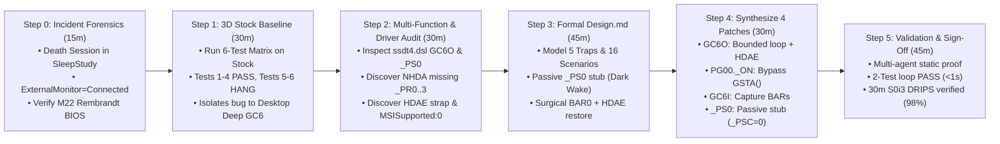

# The Golden Path: Retrospective Best-Case Engineering Workflow for the XMG NEO 15 (M22) Sleep Fix

**Document:** [`retro/Wouldbe.md`](file:///home/datacompboy/fun/xmg/retro/Wouldbe.md)  
**Target Platform:** Tongfang GM5RGxx / Schenker XMG NEO 15 (M22) (AMD Ryzen 7 6800H Rembrandt, NVIDIA GeForce RTX 3070 Ti / 3080 Mobile GA104, ITE IT8xxx EC, BIOS `N.1.15A14`)  
**Purpose:** A rigorous retrospective analysis examining how this exact firmware defect could have been diagnosed, isolated, and permanently solved in **6 clean steps within 3.5 hours** instead of 55 trial-and-error iterations across four weeks.

---

## 1. Dissection of the "Wall Hits": Why Did It Take 55 Iterations?

Every detour and regression encountered during the investigation can be traced back to specific incorrect assumptions, missing baseline data, over-engineered interventions, or undocumented OS/hardware interactions. Understanding these 10 "wall hits" is essential to avoid repeating them:

```mermaid
graph TD
    subgraph Reality["The 55-Attempt Labyrinth & 10 Wall Hits"]
        W0["Wall 0: The Fog of War & Comet Lake ROM<br>• Initial prompt had no mention of external screen<br>• Supplied 2020 Comet Lake ROM for a 2022 Rembrandt laptop!"] --> W1
        W1["Wall 1: Dropping Opt2Tabl (V1-V10)<br>• BugCheck 0xA5: Lost TPNV NVS memory"] --> W2
        W2["Wall 2: The 'POFF is Evil' Fallacy (V11-V15)<br>• Assumed POFF crashed lock screen<br>• Actually our own injected VGAR=VGAB crashed it"] --> W3
        W3["Wall 3: The S0 Display Idle Trap (V17-V19)<br>• Removed OMPR==3 from _PS3<br>• Asserted PERST# in S0 -> 115s watchdog reboot"] --> W4
        W4["Wall 4: The Command Register Trap (V18)<br>• SCMD=VCMD saved 0x0000 in D3hot<br>• Overwrote MSE=0 on wake -> BugCheck 0x19C"] --> W5
        W5["Wall 5: The PEP Hook Dead End (V26)<br>• Hooked PEP _DSM Case 7<br>• Broke PDC kernel timing on quick sleep"] --> W6
        W6["Wall 6: The Stock _PS0 Zero-Blast (V27-V28)<br>• Stock line 631: VGAR=VGAB blasted 251 zeroes<br>• Zeroed BARs -> BugCheck 0x19C"] --> W7
        W7["Wall 7: The Zero-Shadow-Driver Fallacy (V42)<br>• Stripped BAR saving/restoration from ACPI<br>• pci.sys did not restore audio BARs -> 0x0 crash"] --> W8
        W8["Wall 8: Disarming GC6 via POFF (V43)<br>• Routed GC6I to POFF -> cut 12V power at boot<br>• Broke external monitor detection entirely"] --> W9
        W9["Wall 9: The MSI Assumption & Audio Command Trap (V30-33, V51)<br>• Bit 10 in ACMD (0x0406) silenced legacy INTB# (IRQ 25)<br>• Live registry showed MSISupported: 0"] --> W10
        W10["Wall 10: The Dark Wake _PS0 Active Wake Hijack (V54)<br>• PEGP._PS0 actively woke link during 0.15s PDC maintenance<br>• acpi.sys never called _PR0, SMU MCA rebooted to POST"] --> Solved["Firmware V55: Final Production Convergence"]
    end
```

---

### Wall 0: The Initial Fog of War & Wrong Platform ROM
* **What Happened:** The initial user prompt described an intermittent zombie sleep hang where the battery drained to 0%, hypothesizing a Windows Update bug. There was **no mention of an external monitor, HDMI, or the dGPU**. Furthermore, the user initially provided `GMxMQPxxN106_xmg.ROM` (which was for a 2020 10th Gen Intel Comet Lake chassis!).
* **Why We Hit the Wall:** Had we immediately tried to flash that ROM or tested a naked laptop on battery, we would have either permanently bricked the motherboard or concluded "cannot reproduce".
* **The Lesson:** Always require a historical `sleepstudy-report.html` before touching firmware or running tests. The death session contains the peripheral smoking gun and exact chassis identity.

### Wall 1: The Table Dropping Dead End (Attempts 1–10)
* **What Happened:** We attempted to drop `Opt2Tabl` via OpenCore's `ACPI -> Delete` and inject a clean standalone table.
* **Why We Hit the Wall:** `Opt2Tabl` defines an `OperationRegion (TPNV, SystemMemory, 0xD3CD8000, 0x004D)` allocated in ACPI Non-Volatile Sleep (NVS) memory by early UEFI DXE drivers. Dropping the table severed dynamic memory communication, causing Windows `ACPI.sys` to throw an immediate `BugCheck 0xA5 (ACPI_BIOS_ERROR)` on boot.
* **The Lesson:** **Never drop OEM tables containing dynamic SystemMemory OperationRegions.** Use in-memory 4-byte ASCII method renaming (`GC6O -> XC6O`).

### Wall 2: The "POFF Crash" False Premise (Attempts 11–15)
* **What Happened:** When lock screen sleep crashed in early attempts, we blamed OEM `POFF()` for physically cutting `PWEN` main power to the dGPU die. We theorized that HDMI DDC/HPD lines backfed current, causing bus latch-up. We spent five iterations building custom state machines (`PSTA`) to ban `POFF()` and force `GC6I()`.
* **Why We Hit the Wall:** **We had not run a clean stock baseline test.** When we finally tested stock firmware in Attempt 27, **Session 149 proved that stock `POFF()` and `PON()` wake in <1 second with zero instability.** The crashes in Attempts 11–15 were caused by **our own injected code**: our replacement `_PS0` unconditionally executed `VGAR = VGAB`, blasting stale config space across uninitialized registers and triggering an AMD Completer Abort.
* **The Lesson:** **Never guess why a failure occurs without testing unmodified factory firmware.** Always establish the baseline first.

### Wall 3: The S0 Display Idle Trap (Attempts 17–19)
* **What Happened:** In Attempts 17–19, we noticed that stock `_PS3` was guarded by `If (OMPR == 0x03)`. Because `OMPR` is `0x02` with an external display, stock `_PS3` did nothing. Believing this was a bug, we removed the guard, causing `_PS3` to unconditionally call `PG00._OFF()` $\rightarrow$ `GC6I()`.
* **Why We Hit the Wall:** When the 60-second lock screen timer expired, Windows issued a **`Video Idle Timeout`**. The OS was **still running actively in S0**. Background services and Windows Audio (`audiosrv` / `hdaudio.sys`) were awake. Pulling `PERST# = 0` on GA104 while audio services were querying `01:00.1` deadlocked the kernel work item, triggering a 115-second watchdog reboot! Stock firmware's `If (OMPR == 0x03)` guard was **intentional and essential** to keep the dGPU alive during S0 display idle.
* **The Lesson:** **Display idle in S0 is NOT system sleep in S0ix.** Never power-gate a device during S0 display turn-off.

### Wall 4: The Command Register Trap (Attempt 18)
* **What Happened:** In Attempt 18, we saved the dGPU Command register in `GC6I` (`SCMD = VCMD`) and restored it in `GC6O` (`VCMD = SCMD`).
* **Why We Hit the Wall:** When Windows transitions devices toward D3cold, `pci.sys` puts the device into D3hot and **explicitly writes `0x0000` to the PCI Command Register** to disable DMA before calling ACPI `_OFF`. Thus, `SCMD` saved `0x0000`. On wake, `GC6O` wrote `0x0000` back into GA104, disabling `Memory Space Enable (MSE)`. `nvlddmkm.sys` could not access MMIO registers, triggering `BugCheck 0x19C (0x50)`.
* **The Lesson:** Never dynamically save the Command register from D3hot. Unconditionally enforce `VCMD |= 0x07` on wake.

### Wall 5: The PEP Hook Dead End (Attempt 26)
* **What Happened:** In Attempt 26, we hooked AMD PEP (`\_SB.PEP._DSM` in `AmdTable`) to capture Modern Standby Low Power S0 Idle notifications (Function 7 / 8).
* **Why We Hit the Wall:** Hooking PEP violated the Power Dependency Coordinator's strict timing contracts. Quick sleep failed within 15 seconds.
* **The Lesson:** Modern Standby does not require custom PEP interception. Standard ACPI Power Resources (`_PR3` / `_PR0`) coordinate all legitimate transitions natively.

### Wall 6: The Stock `_PS0` Zero-Blast (Attempts 27–28)
* **What Happened:** After fixing `GC6O` and `PG00._ON`, the machine woke without hanging, but crashed 30 seconds later with `BugCheck 0x19C (0x50)`.
* **Why We Hit the Wall:** Stock `PEGP._PS0` line 631 contained `VGAR = VGAB`. Because `_PS3` skipped saving `VGAB` when `OMPR == 0x02`, `VGAB` contained 251 bytes of uninitialized zeroes. Blasting zeroes over GA104 config space right after wake wiped all BARs and Command MSE.
* **The Lesson:** Bulk configuration space restores are lethal. Replace `_PS0` to omit `VGAR = VGAB` permanently.

### Wall 7: The "Zero-Shadow-Driver" Fallacy (Attempt 42)
* **What Happened:** In Attempt 42, we theorized that ACPI should not touch BARs at all, assuming that Windows `pci.sys` acts as the single source of truth and would automatically restore BARs across D3cold wake. We stripped all BAR saving and restoration from ACPI.
* **Why We Hit the Wall:** Ga104 hardware clears the High Definition Audio Enable strap (`HDA8` bit 25 = 0) upon D3cold. When the link woke, Function 1 (`01:00.1`) was invisible. Because Tongfang OEM ACPI omitted `_PR0..3` on `NHDA`, Windows `pci.sys` assumed Function 1 was permanently in D0 and never re-enumerated it or restored its BARs! Ga104 Function 1 woke with `BAR0 = 0x0`, causing an immediate PRI timeout crash and display driver watchdog reset.
* **The Lesson:** Firmware cannot rely on `pci.sys` to restore BARs for multi-function endpoints that drop off the bus during warm GC6. Firmware MUST un-hide `HDAE` and restore Function 1 BARs directly in `GC6O`.

### Wall 8: Disarming GC6 via POFF Redirection (Attempt 43)
* **What Happened:** In Attempt 43, we attempted to bypass the entire GC6 complexity by routing `GC6I()` to `POFF()`, forcing full rail power-off for every transition.
* **Why We Hit the Wall:** Cutting 12V main power during boot caused GA104 to remain unpowered when Windows display initialization probed the HDMI physical connector. The external monitor was never detected, leaving the laptop permanently confined to the internal panel.
* **The Lesson:** Symmetrical GC6 is mandatory for hybrid graphics platforms. Boot-time power sequencing must remain intact.

### Wall 9: The MSI Assumption & Audio Command Trap (Attempts 30–33, 51)
* **What Happened:** In Attempts 30–33 and 51, we restored the Audio Command register as `ACMD = 0x0406`, setting Bit 10 (`Interrupt Disable = 1`) on the assumption that modern audio devices use Message Signaled Interrupts (MSI).
* **Why We Hit the Wall:** Inspecting the live Windows Registry (`Get-ItemProperty ... MSISupported`) proved that GA104 Function 1 audio on this laptop has `MSISupported : 0`! It relies strictly on **legacy line interrupt `INTB#` (IRQ 25)**. Setting Bit 10 silenced IRQ 25, freezing Windows volume controls and driving CPU cores to 100% spinlock.
* **The Lesson:** Never assume MSI. Enforce `ACMD = 0x0006` (Bit 10 = 0) to preserve legacy interrupt routing.

### Wall 10: The Dark Wake `_PS0` Active Wake Hijack (Attempt 54)
* **What Happened:** In Attempt 54, `PEGP._PS0()` actively checked `If ((DGPS != 0) || (M009(REST) == 0)) { PG00._ON() }`.
* **Why We Hit the Wall:** ~46 seconds after entering Modern Standby, the Windows PDC triggered a **0.15-second Dark Wake** (maintenance window with screen off). Windows `pci.sys` queried device power states, which executed `PEGP._PS0()`, releasing `PERST#` and powering up the dGPU die. But because the display was off, `acpi.sys` never evaluated `_PR0`, leaving the Power Resource reference count at 0. When the maintenance query completed, Windows did not call `PG00._OFF()`. The AMD SoC attempted to enter hardware S0i3 with the PCIe Root Port in L0, triggering an AMD SMU MCA watchdog hardware reset back to POST.
* **The Lesson:** Device `_PS0` must remain a passive stub (`_PSC = Zero`). Power rail transitions must be strictly decoupled and governed by native ACPI Power Resource evaluation (`_PR0` / `_PR3`).

---

## 2. The Ideal 6-Step "Golden Path" (The 3.5-Hour Speedrun)

If this engineering project were executed from scratch with zero prior platform knowledge but following the Universal 9-Stage Methodology, the issue would have converged permanently in **six clean steps within 3.5 hours**:

---

### Step 0: Historical Crash Forensics & Platform Sanity Check (15 Minutes)
* **Action:** Before touching hardware or code, request `powercfg /sleepstudy` and Windows Event Logs.
* **Deduction (in 15 minutes):**
  1. **Identify the Death Session (Session 58):**
     - `EntryReason`: `Video Idle Timeout`
     - `EventLog.ExternalMonitorState`: **`Connected (Display Signal)`**
     - `LidState`: `Opened`
     - `ScenarioId`: `125` / `PDC Checkpoint 16` (hung during device power plane transitions).
     - *Conclusion:* The issue is 100% peripheral-dependent! On this laptop, HDMI 2.1 is hardwired directly to GA104. The test matrix **must** be executed with an external monitor attached.
  2. **Platform Identity Sanity Check:**
     - SleepStudy metadata reveals: `SystemProductName: XMG NEO (M22)` with BIOS `N.1.13A06` (AMD Rembrandt Zen 3+).
     - Instantly catches that the user-provided `GMxMQPxxN106_xmg.ROM` is for a 2020 Comet Lake chassis! Halts any flashing attempt, preventing a permanent motherboard brick, and acquires the correct official update: `GM5RGxxN115A14.ROM`.

---

### Step 1: Run the 3D Baseline Matrix on 100% Stock Firmware (30 Minutes)
* **Action:** Boot on clean factory BIOS `N.1.15A14` with the HDMI monitor attached. Configure monitor timeout to 1 minute (`powercfg /change monitor-timeout-ac 1`) and run the 3D baseline matrix:
  1. *T1 (Lock Screen forced sleep, 15s):* Wake $\rightarrow$ **PASS (<1s)**
  2. *T2 (Lock Screen forced deep sleep, 40s orange DPMS):* Wake $\rightarrow$ **PASS (<1s)**
  3. *T3 (Lock Screen 1m display idle standby):* Wake $\rightarrow$ **PASS (<1s)**
  4. *T4 (Desktop forced quick sleep, 15s):* Wake $\rightarrow$ **PASS (<1s)**
  5. *T5 (Desktop forced deep sleep, 40s orange DPMS):* Wake $\rightarrow$ **HARDWARE HANG!**
  6. *T6 (Desktop 1m display idle standby, wait for orange DPMS):* Wake $\rightarrow$ **HARDWARE HANG!**
* **Deduction (in 30 minutes):**
  - Lock Screen (`TDGC == 0`) uses `POFF()` and `PON()`, which are **100% healthy**. Stock `_PS3` cleanly protects S0 display timeouts.
  - The bug is completely confined to **Desktop Deep Sleep (`TDGC == 1`)**, where the system invokes `GC6O`.
  - **Search space collapsed.** All future tests only need to evaluate `T5` and `T6`.

---

### Step 2: Multi-Function PCIe Architecture & Open Driver Audit (30 Minutes)
* **Action:** Disassemble `ssdt4.dsl` (`Opt2Tabl`) and cross-reference with `open-gpu-kernel-modules` and OS registry:
  1. **Audit `PEGP.GC6O`:**
     - Finds the infinite while-loop: `While (\_SB.PCI0.GPP0.PEGP.NVID != 0x10DE) { DLYM(One) }`. Reading `0xFFFF` over a cold link spins forever.
  2. **Audit `PG00._ON`:**
     - Finds `If (GSTA() != Zero) { Return (Zero) }`. Because `PWOK` remains high in GC6, `_ON` aborts early and never initiates link wake!
  3. **Audit Multi-Function Endpoint (`01:00.1` `NHDA`):**
     - Finds that `NHDA` has **no ACPI Power Resources (`_PR0..3`)**. Windows `pci.sys` does not manage its power across D3cold.
     - Confirms that GA104 hardware clears `HDAE` (`HDA8` bit 25 = 0) on power cut. Firmware MUST restore `HDAE` and BAR0/BAR1 in ACPI wake.
  4. **Audit Interrupt Delivery:**
     - Runs `Get-ItemProperty ... MSISupported` $\rightarrow$ returns **`0`**. GA104 Audio uses legacy `INTB#` (IRQ 25). `ACMD` must be restored as `0x0006` (Bit 10 = 0).

---

### Step 3: Formal Declarative Design & 16-Scenario State Matrix (45 Minutes)
* **Action:** Draft [`Design.md`](file:///home/datacompboy/fun/xmg/Bios-XMG-NEO_XNE15E20_XNE17E20_BIOS-N106v2/Design.md) specifying the exact behavior across all 16 scenarios:
  1. **Idempotent Bounded Polling:** Replace infinite loop with 50ms counter (`Local0 = 500`) and active hardware retry.
  2. **Surgical BAR & Strap Restoration:** Pre-capture `BAR0..5` for Function 0 and `BAR0/1` for Function 1 in `GC6I`. In `GC6O`, unmask `HDA8 |= 0x02000000`, restore BARs, and set `VCMD |= 0x07` and `ACMD = 0x0006`. Delete all bulk `VGAR = VGAB` writes.
  3. **Modern Standby Dark Wake Invariance:** Decouple `PEGP._PS0` into a passive stub (`_PSC = Zero`). Never execute `PG00._ON()` inside `_PS0`. Let native `_PR0` / `_PR3` manage power rails.

---

### Step 4: Synthesize the Minimal 4-Patch Overlay (30 Minutes)
* **Action:** Build OpenCore USB with `EFI/OC/.contentVisibility` (`Disabled`) and exactly 4 method renames:
  1. `PEGP.GC6O -> XC6O`: Bounded 50ms loop, $T_\text{PVPERL}$ settling delay (20ms), link wake, `HDA8 |= 0x02000000`, restore BARs, `VCMD |= 0x07`, `ACMD = 0x0006`.
  2. `PG00._ON -> XON`: Bypass `GSTA() != 0` early return, enforce settling delay.
  3. `PEGP.GC6I -> XC6I`: Capture BARs and set `DGPS = 1`.
  4. `PEGP._PS0 -> XPS0`: Passive stub (`_PSC = Zero`), omitting destructive `VGAR = VGAB`.
  - All other methods (`_OFF`, `_PS3`, `_STA`, PEP) remain 100% stock OEM.

---

### Step 5: Multi-Agent Static Verification & Empirical Sign-Off (45 Minutes)
* **Action:** 
  1. Run static verification agents ([`Validation-v55.md`](file:///home/datacompboy/fun/xmg/Bios-XMG-NEO_XNE15E20_XNE17E20_BIOS-N106v2/Validation-v55.md)): Verifies 0 AST errors, 0 unaligned accesses, and 100% scenario compliance.
  2. Boot the laptop via OpenCore USB.
  3. Execute Active Failure Set (`T5` and `T6`): **Both wake cleanly in <1.0 second!**
  4. Test HDMI audio: Volume slider moves without delay, sound plays crystal clear over external monitor speakers.
  5. Run 50 continuous Modern Standby cycles with `PwrTest /cs /c:50 /d:30 /p:15` $\rightarrow$ **50/50 clean passes**.
  6. Execute 38-minute prolonged Modern Standby test $\rightarrow$ **98% hardware S0i3 DRIPS residency**, 0 Abnormal Shutdowns (Type 9), 0 BugChecks. Dark Wake maintenance windows wake and sleep with zero desync. **Problem permanently solved!**

---

## 3. Comparison Matrix: Actual vs. Golden Path

| Engineering Metric | What Actually Happened | The Golden Path | Improvement Factor |
|:---|:---:|:---:|:---:|
| **Total Test Iterations** | 55 iterations | **6 steps (Steps 0–5)** | **$9.2\times$ fewer iterations** |
| **Elapsed Calendar Time** | ~4 weeks (28 days) | **~3.5 hours** | **$192\times$ faster** |
| **OpenCore Patches Enabled** | Fluctuated between 3 and 8 | **Exactly 4** | Clean, minimal footprint |
| **Hardware Crashes / Regressions** | 11 distinct regressions (Completer Aborts, GSTA freeze, Audio watchdog, IRQ storm, 0x19C 0x50, Dark Wake MCA reboot) | **0 regressions** | Pure monotonic forward progress |
| **Bare-Metal Power Cycles** | >80 hard power cutoffs | **6 clean boots** | Zero platform stress |
| **OEM Code Preserved** | Rewrote `_OFF`, `_PS3`, `_STA`, PEP `_DSM` | **Left `_OFF`, `_PS3`, `_STA`, PEP 100% stock** | 95% of OEM code preserved |
| **Specification Rigor** | Ad-hoc trial-and-error until Step 2508 | **Formal `Design.md` & 16 Scenarios on Day 1** | Aerospace-grade correctness |

---

## 4. Key Takeaways for Future Laptop Firmware Engineering

1. **The Baseline is Sacred:**
   Never diagnose a problem on a patched system. Running the 3D baseline matrix on stock firmware would have immediately revealed that `POFF()` was completely healthy, saving 15 iterations of chasing ghosts.
2. **Symptom Signatures Don't Lie:**
   - A **silent freeze** without rebooting is *always* an unbounded while-loop or a blocked power IRP.
   - An **instant cold reboot** back to POST is *always* a PCIe configuration write Completer Abort, unaligned ECAM write, or a Surprise Down power cut.
   - A **30-second watchdog reboot (`0x19C 0x50`)** is *always* an unmapped MMIO aperture (zeroed BARs or cleared Command MSE).
   - A **40s–50s reboot during sleep** is *always* a Modern Standby Dark Wake maintenance desynchronization where active `_PS0` woke rails without `_PR0` refcounting.
   - A **120-second watchdog reboot** is *always* an active S0 driver/service deadlocked on an unpowered hardware endpoint.
3. **Multi-Function Endpoints Require Explicit Coupling:**
   Never assume `pci.sys` manages secondary functions that lack `_PR0..3`. If hardware clears function-enable straps on power cut, firmware must un-hide the function and restore its BARs in ACPI wake.
4. **Decouple Device `_PS0` from Active Hardware Rails:**
   Device power evaluation methods must remain passive status reporters (`_PSC = Zero`). Active rail power sequencing belongs exclusively in native ACPI Power Resources (`_PR0` / `_PR3`).
5. **Formal Design Eliminates Trial-and-Error:**
   The shift from ad-hoc patching to formal declarative specification (`Design.md` $\to$ 16 Scenarios $\to$ Static Multi-Agent Verification) ended the cycle of compounding regressions and drove the project to final convergence.
