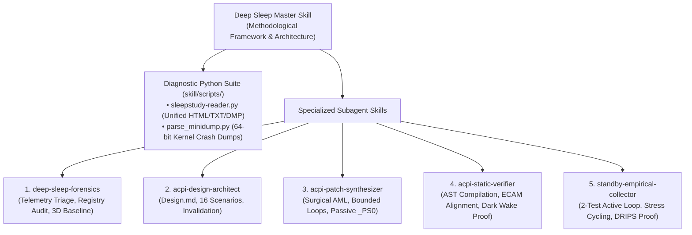
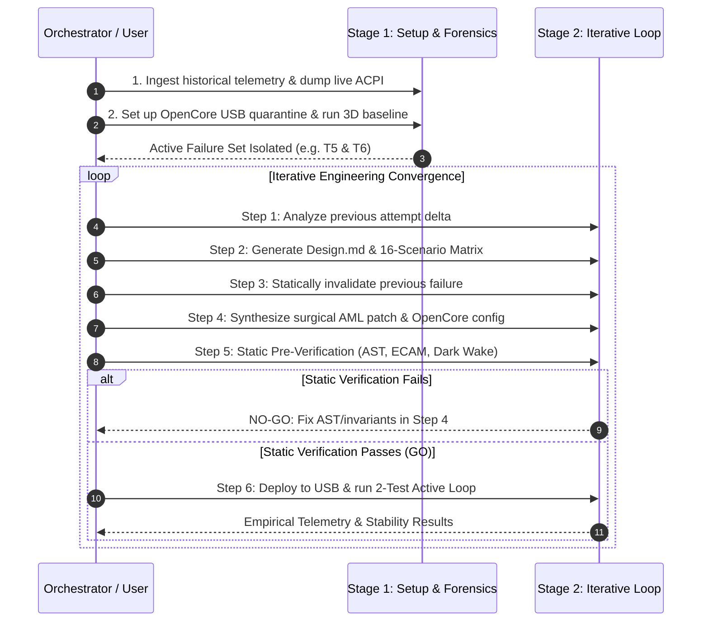

# Deep Sleep & Modern Standby (S0ix) Master Investigation Skill

## Overview

This skill provides an aerospace-grade, disciplined engineering methodology for diagnosing, reverse-engineering, and permanently fixing laptop sleep, wake, and standby failures—including Modern Standby (S0ix / Low Power S0 Idle), discrete GPU power gating (Optimus / SmartAccess Graphics), multi-function PCIe devices, and ACPI bytecode defects.

It replaces ad-hoc bare-metal trial-and-error with a **two-stage architecture**:
1. **Stage 1: Setup & Initial Forensics** (Target contract discovery, live ACPI extraction, USB quarantine, and 3D baseline characterization).
2. **Stage 2: The Iterative Engineering Loop** (Telemetry analysis $\to$ Formal design modeling $\to$ Old design invalidation $\to$ Surgical AML synthesis $\to$ Static pre-verification $\to$ Empirical data collection).



---

## The 7 Engineering Invariants

Before touching firmware bytecode, internalize these seven core principles:

1. **Empirical Baseline First:** Never patch without establishing the unmodified factory behavior across the full operational matrix. (Prevents chasing non-existent bugs like the POFF fallacy).
2. **Respect the Fundamental S0 vs S0ix Boundary:**
   * **`Video Idle Timeout`:** The OS is **running actively in S0**. User services and Windows Audio are in D0. Never power-gate devices or assert `PERST#` here.
   * **`Screen Off Request / System Sleep`:** The OS coordinates **system-wide S0ix quiescence**. Devices transition together via ACPI Power Resources (`_PR3`).
3. **ACPI Separation of Concerns (`_PRx` vs `_PSx`):**
   * **Power Resources (`_PR0..3`):** Manage physical shared hardware power rails, clock gates, reset lines (`PERST#`), and OSPM reference counting.
   * **Device States (`_PS0..3`):** Must remain **passive status stubs** (`_PSC = Zero`). Putting active rail wake logic in `_PS0` causes 0.15s Modern Standby Dark Wake maintenance queries to wake rails without `_PR0`, crashing the machine upon re-sleep.
4. **Target Contract Discovery ("Know Your Target"):** Never treat endpoints as generic black boxes. Always audit multi-function couplings (Function 0 GPU vs Function 1 Audio), hardware strap persistence across power cuts (`HDAE`), and OS driver configuration (`MSISupported : 0` vs MSI).
5. **The PCIe Error Model:**
   * Configuration *Reads* (`0xFFFF`) over dead/training links do not throw exceptions $\rightarrow$ cause **silent infinite loops** if polled unbounded.
   * Configuration *Writes* to dead/unaligned links generate Completer Aborts $\rightarrow$ trigger **instant cold reboots (MCA reset)**.
6. **The Principle of Minimal Blast Radius:** Fix only the broken loop or register restore. Never replace 8 ACPI methods when fixing 2 is sufficient. Permanently delete bulk copy operations (`VGAR = VGAB`).
7. **The Specification-Driven Invariant (The Meta-Law):**
   * **Never patch via trial-and-error on bare metal.** Every iteration must produce a formal design specification ([`Design.md`](file:///home/datacompboy/fun/xmg/Bios-XMG-NEO_XNE15E20_XNE17E20_BIOS-N106v2/Design.md)), an exhaustive operational state matrix, and a static pre-verification proof *before* booting or flashing bytecode.

---

## Specialized Subagent Skills & Runbooks

This master skill coordinates five focused subskills:

| Subskill | Location | Core Responsibilities |
|:---|:---|:---|
| **[`deep-sleep-forensics`](file:///home/datacompboy/fun/xmg/skill/deep-sleep-forensics/SKILL.md)** | `skill/deep-sleep-forensics/SKILL.md` | Ingests SleepStudy, WinEvents, and Minidumps; audits OS registry (`MSISupported`); dumps live ACPI tables via `acpidump -b`; runs 3D baseline sweep to isolate the Active Failure Set. |
| **[`acpi-design-architect`](file:///home/datacompboy/fun/xmg/skill/acpi-design-architect/SKILL.md)** | `skill/acpi-design-architect/SKILL.md` | Systems Architect: Maps failure telemetry to hardware primitives; formally invalidates old designs; authors declarative `Design.md` and the N-scenario operational state matrix. |
| **[`acpi-patch-synthesizer`](file:///home/datacompboy/fun/xmg/skill/acpi-patch-synthesizer/SKILL.md)** | `skill/acpi-patch-synthesizer/SKILL.md` | Firmware Engineer: Translates `Design.md` into surgical ASL/AML bytecode complying with bounded loops, $T_\text{PVPERL}$ delays, passive `_PS0`, and 32-bit ECAM alignment; generates OpenCore renames. |
| **[`acpi-static-verifier`](file:///home/datacompboy/fun/xmg/skill/acpi-static-verifier/SKILL.md)** | `skill/acpi-static-verifier/SKILL.md` | Safety Auditor: Strict pre-boot compiler and linter; verifies 0 AST errors, 32-bit DWORD ECAM alignment, $T_\text{PVPERL}$ settling delays, and proves Dark Wake passivity before hardware deployment. |
| **[`standby-empirical-collector`](file:///home/datacompboy/fun/xmg/skill/standby-empirical-collector/SKILL.md)** | `skill/standby-empirical-collector/SKILL.md` | Test Suite: Executes the fast 2-test active loop (`T5` and `T6`); audits audio/volume flyout responsiveness; runs 50-cycle `PwrTest` automated stress; verifies >90% hardware S0i3 DRIPS residency. |

---

## Tooling Suite: `skill/scripts/`

The diagnostic tools are centralized in [`skill/scripts/`](file:///home/datacompboy/fun/xmg/skill/scripts/):

### 1. Unified Forensic Reader ([`sleepstudy-reader.py`](file:///home/datacompboy/fun/xmg/skill/scripts/sleepstudy-reader.py))
Universal entry point for all power telemetry and crash artifacts. Automatically detects file types:
* **SleepStudy HTML:** Parses modern SPA JSON (`LocalSprData`) and legacy HTML tables; extracts Death Sessions, blocker devices, and energy drain.
* **WinEvents TXT:** Auto-detects UTF-16LE and UTF-8 PowerShell exports; filters Event IDs `41, 42, 107, 109, 506, 507, 1001, 6006, 6008`.
* **Kernel Crash Dumps:** Dissects Windows minidumps and triage dumps (`*.dmp`).
* **Directory Scan Mode:** Point to any folder (e.g., `reports/`) to scan and summarize all artifacts in one sweep.

```bash
# Examples:
python3 skill/scripts/sleepstudy-reader.py sleepstudy-report.html
python3 skill/scripts/sleepstudy-reader.py winevents.txt
python3 skill/scripts/sleepstudy-reader.py crash.dmp
python3 skill/scripts/sleepstudy-reader.py reports/
```

### 2. Deep Minidump Parser ([`parse_minidump.py`](file:///home/datacompboy/fun/xmg/skill/scripts/parse_minidump.py))
Specialized Windows 64-bit crash dump analyzer:
* Extracts BugCheck codes (`0x19C`, `0x9F`, `0xA0`, `0x15F`, `0x133`, `0x50`, `0x7E`).
* Deep subcode analysis for `0x19C (0x50)` (display driver wake timeout) and `0x9F (0x3)` (pending power IRP).
* Scans memory for triage components (`DxkW`, `DxgK`, `HDAudBus`, `pci.sys`, `nvlddmkm`).
* Lists all loaded `.sys` kernel driver modules.

```bash
python3 skill/scripts/parse_minidump.py minidump.dmp
```

---

## The 2-Stage Engineering Workflow Summary



For installation and deployment to internal NVMe storage once verified, consult [`skill/Install.md`](file:///home/datacompboy/fun/xmg/skill/Install.md).
