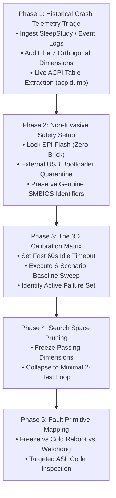
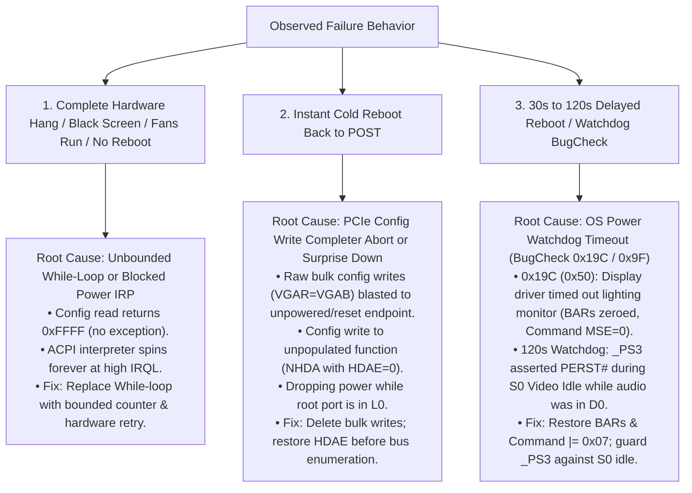

# Deep Sleep & Modern Standby (S0ix) Investigation Skill

## Overview
This skill provides a structured, platform-agnostic protocol for the **initial investigation and triage** of laptop sleep, wake, and standby failures. 

Modern Standby (S0ix / Low Power S0 Idle) issues are notorious for being non-deterministic, peripheral-dependent, and difficult to reproduce. This skill guides the engineer through extracting historical crash telemetry, setting up a zero-brick testbed, executing a calibrated 3D baseline matrix, and pruning the search space—while explicitly avoiding the common traps that lead to false positives or compounding regressions.

> [!NOTE]
> This skill is intentionally focused on **triage, fault isolation, and root-cause characterization**. It does not attempt to be an automated patch generator, as final ACPI/firmware fixes vary widely based on hardware topology (e.g., PCIe link training, EC sequencing, audio controller gates, or NVMe storage vetoes).

---

## When to Use This Skill
Activate this protocol whenever a laptop exhibits any of the following symptoms:
* **The "Zombie State":** Laptop enters sleep and becomes completely unresponsive (screen black, power LED lit or slowly blinking, fans spinning or off, power button unresponsive, requiring complete battery drain or emergency hardware reset).
* **Sleep-to-Reboot Crashes:** Laptop spontaneously reboots back to POST upon entering sleep or upon pressing a key to wake.
* **Delayed Watchdog Reboots:** Laptop hangs for 30–120 seconds after wake or display turn-off before triggering a blue screen (`BugCheck 0x19C` or `BugCheck 0x9F`) and restarting.
* **Excessive Sleep Battery Drain:** Laptop loses 10–30% battery overnight during modern standby (failing to enter hardware DRIPS).
* **Peripheral-Induced Sleep Lockup:** Sleep/wake works fine on battery, but fails when connected to an external monitor, Thunderbolt dock, or USB-C charger.

---

## Core Principles (The 5 Firmware Laws)
Before running tests or modifying files, enforce these five non-negotiable rules:

1. **Never Patch Before Baseline Characterization:** Do not touch ACPI code until you have a byte-verified empirical baseline of unmodified factory firmware across a calibrated test matrix.
2. **Respect the S0 vs S0ix Dichotomy:**
   - `Video Idle Timeout`: The OS is **running actively in S0**. User apps and Windows Audio (`audiosrv`) are in D0. Never power-gate devices or assert `PERST#` here.
   - `Screen Off Request / System Sleep`: The OS coordinates **system-wide S0ix quiescence**. All devices transition together via ACPI Power Resources (`_PR3`).
3. **The "Forced Sleep False Positive" Rule:** Forced sleep (closing lid or clicking Sleep) suspends user apps and forces audio into D3hot, completely masking bugs in partial sleep depth. **You must test both Forced Sleep and Idle Standby.**
4. **The PCIe Error Model:**
   - Configuration *Reads* (`0xFFFF`) over dead/training links do not throw exceptions $\rightarrow$ cause **silent infinite loops** if polled unbounded.
   - Configuration *Writes* to dead/unpopulated links generate Completer Aborts $\rightarrow$ trigger **instant cold reboots (MCA reset)**.
5. **The Principle of Minimal Blast Radius:** Fix only the broken loop or register restore. Never replace 8 ACPI methods when fixing 2 is sufficient.

---

## The 5-Phase Diagnostic Workflow



---

### Phase 1: Historical Crash Telemetry Triage (The "Death Session")
**Goal:** Extract the exact environmental setup, peripheral state, and failing milestone from the historical failure before touching hardware.

1. **Extract Telemetry Reports (The Dual-Stream Model):**
   *SleepStudy provides the macro session timeline, energy drain, and PDC blockers. The unified PowerShell event query extracts the micro kernel power transitions, unexpected shutdowns, and exact crash timestamps in a single command:*
   ```powershell
   # 1. Macro: Generate modern System Power Report (or SleepStudy):
   powercfg /systempowerreport
   powercfg /sleepstudy

   # 2. Micro: Single unified query for all sleep transitions, shutdowns, and crashes:
   Get-WinEvent -FilterHashtable @{LogName='System'; Id=@(41, 42, 107, 109, 506, 507, 1001, 6006, 6008)} -MaxEvents 50 | Format-Table TimeCreated, Id, Message -Wrap | Out-File -Encoding utf8 winevents.txt
   ```
2. **Locate the "Death Session":**
   Open the report (or use `sleepstudy-reader.py.txt`) and find the session directly preceding a `Type 9 Abnormal Shutdown`, `BugCheck`, or `0 mWh` battery depletion.
3. **Audit the 7 Orthogonal Telemetry Dimensions:**
   - **1. Peripheral State (`EventLog.ExternalMonitorState`):** Was an external monitor connected (`Connected`)? If yes, discrete GPU display engine power gating is immediately implicated.
   - **2. Power Source (`OnAc`):** `True` (wall charger) vs `False` (battery). On battery, aggressive PCIe ASPM and 5s RTD3 timers apply. If `OnAc == True`, prune battery testing from early reproduction.
   - **3. Trigger Mechanism (`EntryReason`):** Was it `Screen Off Request` (forced sleep) or `Video Idle Timeout` (display idle)?
   - **4. User Session Context (`UserLogonState`):** Was the user actively logged in (`TDGC == 1`, user-mode driver daemons running) or at the pre-logon lock screen (`TDGC == 0`)?
   - **5. Standby Latency Milestone (`Duration` / `PdcCheckpoint`):**
     * $0\text{--}5\text{s}$: Failure during initial display blanking / shallow D3hot.
     * $30\text{--}45\text{s}$: Failure during DPMS orange standby / deep D3cold / PCIe link L23 parking.
     * $\approx 115\text{--}120\text{s}$: OS Power Watchdog timeout (driver deadlocked on a pending power IRP).
     * $> 3\text{h}$: S0ix $\rightarrow$ S4 Adaptive Hibernate transition failure.
   - **6. Physical Lid State (`EventLog.LidState`):** `Opened` vs `Closed`. Closed lid turns off internal eDP, throttles thermal limits, and ignores internal I2C/PS2 keyboard/trackpad interrupts.
   - **7. Subsystem Blockers (`BlockerGroups`):** Check `Audio Activity`, `FX Devices`, and `PEP Pre-Vetoes`. If a specific device hardware ID is vetoing sleep, target that driver directly.
4. **Platform Identity Sanity Check (`SystemInformation`):**
   - Check `SystemManufacturer`, `SystemProductName`, and current `BIOSVersion`.
   - **Safety Gate:** If vendor firmware update files are ever consulted, strictly verify the exact motherboard SKU before use.
5. **Live ACPI Table Extraction (No Firmware ROM Required):**
   - Obtaining an official factory firmware ROM or unpacking capsule installers is **not required**.
   - Dumping tables directly from the live, running system via `acpidump` is faster, safer, and technically superior:
     * **Runtime Fidelity:** Firmware ROM images frequently contain conditional/alternative SSDTs for other board configurations, display panels, or GPU models. A live dump extracts *only* the exact tables registered in the `XSDT` for this specific running machine.
     * **No Capsule/Decompression Hurdles:** Sidesteps proprietary vendor packaging, Insyde/AMI capsule encryption, and multi-stage extractor tooling.
     * **Works Universally:** Captures the full table set even on systems running unreleased, beta, or OEM factory-installed revisions where no public ROM download exists.
   - **Dump Commands:**
     * **Windows:** Run ACPICA `acpidump.exe -b` to dump binary `.dat` tables directly.
     * **Linux:** Run `acpidump -b` or copy directly from sysfs: `cp /sys/firmware/acpi/tables/* .`

---

### Phase 2: Non-Invasive Safety Setup
**Goal:** Guarantee a zero-brick test environment where experimental changes can be ejected instantly.

1. **Motherboard SPI Flash Quarantine:**
   - Do **not** flash unverified or modified ROMs directly to the motherboard SPI flash chip.
   - Keep the clean factory BIOS on the SPI flash at all times.
2. **External USB Bootloader Quarantine:**
   - Deploy an external USB thumb drive with [OpenCorePkg](https://github.com/acidanthera/OpenCorePkg).
   - Place OpenCore on the USB's EFI partition (`EFI/BOOT/BOOTX64.EFI` and `EFI/OC/`).
   - **Suppress Bootloader Self-Entry:** Include an `EFI/OC/.contentVisibility` file containing the text `Disabled`. This native OpenCore directive tells `BootEntryManagement` to omit OpenCore from its own boot picker, preventing "NO NAME" self-entries and recursive boot loops.
   - Configure `config.plist`:
     * `PlatformInfo -> Automatic = false`: Preserves genuine SMBIOS, Windows activation, BitLocker PCRs, and OEM control center software.
     * `ACPI -> Delete`: Do **not** drop tables with dynamic ACPI NVS memory (`OperationRegion TPNV`).
     * `ACPI -> Patch`: Use in-memory 4-byte ASCII method renames (e.g. `_ON -> XON`).
     * `Misc -> Debug -> Target = 0`: Disables writing debug logs to disk.
     * `Misc -> Boot -> Timeout = 2`: Displays the menu briefly to confirm the loader is active.
3. **Emergency Ejection:**
   - If an experimental patch hangs or fails, simply unplug the USB drive. The laptop boots 100% factory Windows on the next startup.

---

### Phase 3: The 3D Calibration Matrix (The Baseline Sweep)
**Goal:** Map the full $2 \times 2 \times 2$ factorial power space on clean factory firmware in under 15 minutes.

1. **Accelerate Idle Testing:**
   Avoid waiting 10–15 minutes for default idle timeouts by setting the display timer to 60 seconds:
   ```cmd
   powercfg /change monitor-timeout-ac 1
   ```
2. **Execute the 6-Scenario Calibration Matrix:**

| Test ID | Trigger Mode | Logon Context | Hold Duration | Hardware Depth | What it Tests |
|:---:|:---:|:---:|:---:|:---:|:---|
| **T1** | Forced Sleep | Lock Screen | 10–15 s | Shallow (D3hot) | Pre-logon shallow D3hot $\rightarrow$ D0 wake. |
| **T2** | Forced Sleep | Lock Screen | 40–60 s | Deep (D3cold / POFF) | Pre-logon full rail power-off / power-on (`POFF`/`PON`). |
| **T3** | Idle Standby | Lock Screen | 70 s (1m timer) | S0 Display Idle | Pre-logon S0 display idle (verifies `_PS3` doesn't assert `PERST#`). |
| **T4** | Forced Sleep | Active Desktop | 10–15 s | Shallow (D3hot) | Active session shallow D3hot $\rightarrow$ D0 wake. |
| **T5** | Forced Sleep | Active Desktop | 40–60 s | Deep (D3cold / GC6) | **The Acid Test:** Active session deep GC6 wake (`GC6O` loop test). |
| **T6** | Idle Standby | Active Desktop | 70 s (1m timer) | S0 Display Idle | Active session S0 display idle with peripherals attached. |

---

### Phase 4: Search Space Pruning (The Invariant Freezing Rule)
**Goal:** Collapse the 6-test calibration sweep down to a 2-test re-testing loop for iterative patching.

1. **Freeze Passing Dimensions:**
   - As soon as a dimension produces 100% clean passes across all tests on stock firmware, **freeze that dimension out of active testing**:
     * If all Lock Screen tests (T1, T2, T3) pass $\rightarrow$ **Freeze Lock Screen.** Do not re-test pre-logon states on every patch.
     * If shallow sleep (T4) passes $\rightarrow$ **Freeze Shallow Sleep.** Do not re-test short sleeps.
2. **Define the Active Failure Set:**
   - Isolate the tests that consistently fail on stock firmware (e.g., `T5` Desktop Deep Forced Sleep and `T6` Desktop Deep Idle Standby).
3. **The 2-Test Iteration Loop:**
   - For all subsequent patch iterations, test **only the failing subset** (`T5` and `T6`). Iteration turnaround drops to **under 3 minutes per patch**.
4. **Final Regression Sweep:**
   - Only when the active failure set achieves 100% passes do you re-run the full 6-scenario matrix once for final sign-off.

---

### Phase 5: Hardware Primitive & Symptom Matching
**Goal:** Map observed failure behavior directly to root-cause hardware primitives.



---

## Common Firmware Traps & Anti-Patterns to Avoid

| Anti-Pattern | Fatal Consequence | Correct Engineering Practice |
|:---|:---|:---|
| **Dropping OEM ACPI Tables** | Erases ACPI NVS (`TPNV`) memory regions allocated in DXE, causing immediate `BugCheck 0xA5`. | Use surgical in-memory 4-byte ASCII method renames (`GC6O -> XC6O`). |
| **Forced-Sleep-Only Validation** | Misses deadlocks in partial sleep depth (system in S0, audio in D0, display off). | Always validate against both forced sleep and 1-minute configured idle timeouts. |
| **Unconditional `_PS3` Power Gating** | Cuts dGPU power and asserts `PERST#` during S0 display idle, deadlocking active audio drivers. | Guard `_PS3` so it only powers off during true S0ix system sleep (`_PR3`). |
| **Bulk Configuration Restores (`VGAR = VGAB`)** | Overwrites read-only registers, MSI-X tables, and BARs with uninitialized zeroes. | Save and restore only `BAR0..BAR5`, `VCMD |= 0x07`, and `HDAE`. |
| **Saving Command Registers in D3hot (`SCMD = VCMD`)** | `pci.sys` clears Command to `0x0000` in D3hot. Saving it restores zeroes on wake, disabling MMIO (`0x19C`). | Never dynamically save Command from D3hot; unconditionally enforce `VCMD |= 0x07` on wake. |
| **Hooking Platform PEP (`_DSM`)** | Breaks kernel Power Dependency Coordinator timing contracts on quick sleep. | Rely on native ACPI Power Resource evaluation (`_PR3` / `_PR0`) for system sleep coordination. |

---

## Diagnostic Cheat Sheet & Useful Commands

### Fast Windows Power Commands
```cmd
:: 1. Fast Display Timeout Configuration (for Rapid Idle Testing)
powercfg /change monitor-timeout-ac 1
powercfg /change monitor-timeout-dc 1

:: 2. Restore Default Display Timeout (10 minutes)
powercfg /change monitor-timeout-ac 10

:: 3. Generate Diagnostic Reports
powercfg /systempowerreport
powercfg /sleepstudy
powercfg /energy

:: 4. Query Available Sleep States
powercfg /a

:: 5. Dump Active System ACPI Tables (ACPICA)
acpidump.exe -b
```

### Windows Event Log Telemetry (The Single Unified Command)
```powershell
# Extracts all Modern Standby transitions, wake vectors, Hibernate drops, and crash/reboot events:
Get-WinEvent -FilterHashtable @{LogName='System'; Id=@(41, 42, 107, 109, 506, 507, 1001, 6006, 6008)} -MaxEvents 50 | Format-Table TimeCreated, Id, Message -Wrap

# Or export directly to winevents.txt for offline analysis:
Get-WinEvent -FilterHashtable @{LogName='System'; Id=@(41, 42, 107, 109, 506, 507, 1001, 6006, 6008)} -MaxEvents 50 | Format-Table TimeCreated, Id, Message -Wrap | Out-File -Encoding utf8 winevents.txt
```

### Automated Stress Testing (Windows Driver Kit)
```cmd
:: Execute 50 automated modern standby cycles (30s sleep, 15s wake pause):
PwrTest /cs /c:50 /d:30 /p:15
```

### Linux ACPI Extraction, Compilation & Validation
```bash
# Dump live ACPI tables from memory / sysfs:
acpidump -b
# Or copy directly from sysfs:
cp /sys/firmware/acpi/tables/* .

# Disassemble OEM tables resolving external cross-references:
iasl -da -dl DSDT.dat SSDT*.dat
# (or if files are named .aml):
iasl -da -dl DSDT.aml SSDT*.aml

# Compile replacement SSDT enforcing strict syntax:
iasl -tc SSDT-SLEEPFIX.dsl

# Validate OpenCore configuration schema:
ocvalidate.linux config.plist
```
