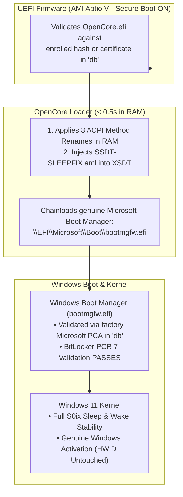
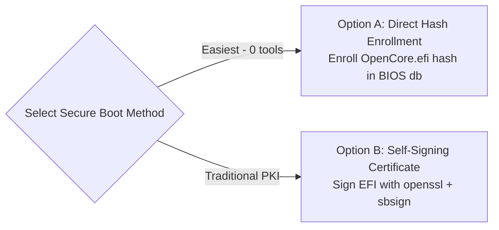
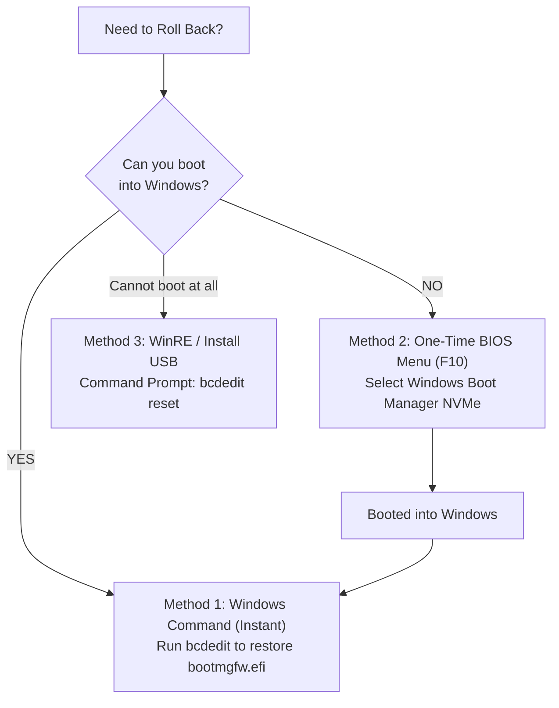

# OpenCore ACPI Fix: Permanent Installation & Rollback Guide

**Platform:** Schenker XMG NEO 15 (M22) / Tongfang GM5RGxx  
**Operating System:** Windows 11 64-bit (with BitLocker & Secure Boot)  
**Target Firmware:** AMI Aptio V, BIOS `N.1.15A14`  
**Components:** Acidanthera OpenCore (Headless ACPI Patcher) + [`SSDT-SLEEPFIX.aml`](file:///home/datacompboy/fun/xmg/Bios-XMG-NEO_XNE15E20_XNE17E20_BIOS-N106v2/EFI/OC/ACPI/SSDT-SLEEPFIX.aml)  
**Date:** September 27, 2026  

---

## 1. Overview & Architecture

This guide explains how to install the verified OpenCore Modern Standby ACPI fix permanently onto your internal NVMe SSD as the default Windows bootloader, configure Secure Boot so BitLocker unlocks seamlessly, and **completely and cleanly roll back to factory stock Windows boot** at any time.

### How the Chain of Trust Works


1. **Non-Invasive Execution:** OpenCore acts solely as an in-memory ACPI pre-boot patcher. It does **not** modify your Windows system files, BCD kernel options, or drive partitions.
2. **Transparent Handoff:** OpenCore executes in the UEFI DXE phase for less than half a second, modifies the ACPI tables in RAM, and immediately chainloads genuine Microsoft Windows Boot Manager (`bootmgfw.efi`).
3. **Hardware ID Integrity:** `PlatformInfo -> Automatic` is set to `false` and `UpdateSMBIOS` is `false`. Your system serial number, UUID, motherboard identity, and Windows Digital License (Activation) remain 100% genuine and untouched.

---

## 2. Critical Pre-Flight Checklist (Do Before Installing)

> [!IMPORTANT]
> Complete these precautionary steps before modifying any boot configurations on your internal drive.

### Step 1: Back Up Your 48-Digit BitLocker Recovery Key
Whenever you adjust the bootloader path (`{bootmgr}`), the Trusted Platform Module (TPM 2.0) may detect the boot path transition. Having your recovery key ensures zero risk of data lockout:
1. Open **PowerShell as Administrator** and check your key:
   ```powershell
   manage-bde -protectors -get C:
   ```
2. Note the **48-digit Numerical Password**.
3. Alternatively, verify your key online in your Microsoft Account:  
   👉 **[account.microsoft.com/devices/recoverykey](https://account.microsoft.com/devices/recoverykey)**

### Step 2: Keep Your Test USB Drive Handy
Keep the USB thumb drive you used during initial testing (or any standard Windows 10/11 installation USB) accessible. If you ever need to boot outside the internal drive, you can plug it in and tap `F10` at startup.

---

## 3. Secure Boot Configuration (Two Methods)

Secure Boot validates bootloaders by checking their cryptographic signature or binary hash against the motherboard's **Authorized Signature Database (`db`)**. Because OpenCore is open-source, Microsoft does not sign it by default. 

On AMI Aptio V firmware (Tongfang GM5RGxx), you have two clean ways to authorize it:



---

### Option A: Direct Hash Enrollment in BIOS (Recommended — 0 Tools Needed)

AMI Aptio V has a built-in feature to whitelist any EFI executable by its cryptographic SHA-256 hash without requiring any external signing utilities:

1. **Reboot and Enter BIOS:** Turn on the laptop and tap **`F2`** (or `Del`).
2. **Navigate to Secure Boot:**
   * Go to **Security** $\rightarrow$ **Secure Boot**.
   * Set **Secure Boot Mode** to **`Custom`** (if currently set to `Standard`).
3. **Open Key Management:**
   * Select **Key Management** $\rightarrow$ **Authorized Signatures (`db`)**.
   * Select **Enroll Hash** (or **Enroll Efi Image** / **Append from file**).
4. **Select the OpenCore Binary:**
   * A file browser will appear displaying detected volumes:
     * Select your internal NVMe drive (usually **`FS0:`** or **`FS1:`**).
     * Navigate to: `\EFI\OC\OpenCore.efi` and press Enter.
     * Confirm: **Yes** to commit the hash to the secure NVRAM `db` keystore.
     * *(Optional)* If you keep a USB emergency drive, repeat for `\EFI\BOOT\BOOTx64.efi` on the USB drive.
5. **Enable Secure Boot:**
   * Return to the main Secure Boot menu.
   * Set **Secure Boot** to **`Enabled`**.
6. **Save & Exit:** Press **`F10`** and confirm.

---

### Option B: Self-Signing with Custom Keys (Standard PKI)

If you prefer traditional certificate-based signing (useful if you rebuild `OpenCore.efi` frequently):

1. **Generate Key Pair & Certificate (in Linux):**
   ```bash
   # Generate 2048-bit RSA private key and self-signed X.509 certificate (valid 10 years)
   openssl req -new -x509 -newkey rsa:2048 -sha256 -nodes -days 3650 \
       -subj "/CN=XMG OpenCore Key/" -keyout mykey.key -out mykey.crt

   # Convert certificate to DER format for UEFI BIOS enrollment
   openssl x509 -in mykey.crt -outform DER -out mykey.cer
   ```

2. **Sign the OpenCore Binary:**
   ```bash
   # Install signing tool
   sudo apt-get install -y sbsigntool

   # Sign OpenCore.efi
   sbsign --key mykey.key --cert mykey.crt --output OpenCore.efi OpenCore.efi
   ```

3. **Enroll Certificate in BIOS Setup:**
   * Copy `mykey.cer` to your EFI partition or a FAT32 USB thumb drive.
   * Reboot into BIOS Setup (**`F2`**) $\rightarrow$ **Security** $\rightarrow$ **Secure Boot** $\rightarrow$ **Key Management**.
   * Select **Authorized Signatures (`db`)** $\rightarrow$ **Append Key** (or **Enroll Signature**).
   * Browse to `mykey.cer` and confirm.
   * > [!IMPORTANT]
     > Ensure you **Append** rather than replace! Keep Microsoft's factory keys (*Microsoft Corporation UEFI CA 2011*, *Windows Production PCA 2011*) intact so genuine Windows binaries, BitLocker, and firmware updates continue to pass validation.
   * Set **Secure Boot** to **`Enabled`**, then press **`F10`** to Save & Exit.

---

## 4. Permanent Installation to Internal SSD (Step-by-Step)

Follow these steps from inside your running Windows 11 installation:

### Step 1: Open Terminal as Administrator
Press **`Win + X`** and select **Terminal (Admin)** or **PowerShell (Administrator)**.

### Step 2: Mount the Internal EFI System Partition (ESP)
Assign drive letter `S:` to your internal EFI partition:
```powershell
mountvol S: /s
```

### Step 3: Copy OpenCore to the Internal ESP
Assuming your workspace or USB drive containing the `EFI` folder is at `D:\fun\xmg\Bios-XMG-NEO...` (adjust source path as needed):
```powershell
# Create the OC directory on your internal ESP
mkdir S:\EFI\OC

# Copy OpenCore files into S:\EFI\OC
xcopy /E /I /Y "path\to\workspace\EFI\OC\*" "S:\EFI\OC\"
```

#### Verify the destination file structure on `S:`:
```text
S:\EFI\OC\
├── .contentVisibility
├── OpenCore.efi
├── config.plist
├── ACPI\
│   └── SSDT-SLEEPFIX.aml
└── Drivers\
    └── OpenRuntime.efi
```

> [!NOTE]
> `.contentVisibility` contains the text `Disabled`. This is an OpenCore native directive that prevents OpenCore from discovering and displaying its own EFI binary in NVRAM `BootOrder` as an entry named `"NO NAME"`, ensuring it directly and automatically chainloads Windows.

---

### Step 4: Register OpenCore in UEFI NVRAM ({fwbootmgr})
To tell your motherboard's UEFI BIOS to boot OpenCore first, register OpenCore in the **Firmware Boot Manager (`{fwbootmgr}`)**:
```powershell
# 1. Create the OpenCore UEFI boot entry in NVRAM
$output = bcdedit /create /d "OpenCore" /application bootapp
$guid = [regex]::Match($output, '\{[a-fA-F0-9-]+\}').Value

# 2. Point the entry to OpenCore.efi on drive S:
bcdedit /set $guid device partition=S:
bcdedit /set $guid path \EFI\OC\OpenCore.efi

# 3. Set OpenCore as the #1 boot priority in UEFI NVRAM
bcdedit /set "{fwbootmgr}" displayorder $guid /addfirst
```

---

### Step 5: Setting Windows as the Default Boot Entry in OpenCore

When OpenCore scans your drives, it may display two entries:
* **Entry 1: "NO NAME"** — This is `S:\EFI\Boot\bootx64.efi` (Windows generic fallback booter on an unlabelled FAT32 partition).
* **Entry 2: "Windows"** — This is `S:\EFI\Microsoft\Boot\bootmgfw.efi` (genuine Windows Boot Manager).

You have two clean ways to make OpenCore boot Windows automatically:

#### Method A: Set Default via Shortcut (Ctrl + Enter)
We have enabled `AllowSetDefault = true` and `WriteFlash = true` in `config.plist`.
1. When OpenCore's boot menu appears, use the arrow keys to highlight **Windows** (Entry 2).
2. Press **`Ctrl + Enter`** (or press **`Ctrl + 2`**).
3. OpenCore saves Windows as the permanent default in NVRAM. From now on, Windows is highlighted automatically!

#### Method B: Remove the Redundant "NO NAME" Entry (Cleanest)
Since OpenCore natively boots `\EFI\Microsoft\Boot\bootmgfw.efi`, having the fallback `\EFI\Boot\bootx64.efi` on the exact same drive is redundant.
In Administrator PowerShell:
```powershell
# Rename or delete the redundant fallback file so OpenCore only sees "Windows"
Move-Item "S:\EFI\Boot\bootx64.efi" "S:\EFI\Boot\bootx64.efi.bak"
```
Once removed, OpenCore will only discover one single OS entry: **"Windows"**. It becomes Entry #1 by default!

---

### Step 6: Configure Silent Autoboot (Zero-Delay Boot)

Once Windows is default or the only entry:
In `S:\EFI\OC\config.plist` under `<key>Misc</key>` $\rightarrow$ `<key>Boot</key>`:
* Set `<key>ShowPicker</key><false/>`
* Set `<key>Timeout</key><integer>0</integer>`

With these settings, OpenCore executes invisibly in < 0.5s, patches ACPI, and chains directly into Windows without displaying any menu!  
*(To reveal the menu in an emergency, hold or tap **Spacebar** on startup).*

---

### Step 7: Temporarily Suspend BitLocker and Reboot
```powershell
# Suspend BitLocker for 1 reboot so TPM re-seals cleanly
Suspend-BitLocker -MountPoint "C:" -RebootCount 1

# Unmount drive S:
mountvol S: /d

# Reboot the laptop
shutdown /r /t 0
```

---

## 5. Post-Installation Verification

Once the system restarts into Windows 11:

1. **Check BitLocker Status:**
   Open PowerShell as Administrator:
   ```powershell
   manage-bde -status C:
   ```
   *Expected:* `Protection Status: Protection On` (BitLocker automatically resumed and re-sealed to PCR 7).

2. **Check Secure Boot Status:**
   In PowerShell:
   ```powershell
   Confirm-SecureBootUEFI
   ```
   *Expected:* `True`.

3. **Check Sleep & Wake Functionality:**
   * Plug in your external monitor via HDMI 2.1 or USB-C DP.
   * Lock Windows (`Win + L`) or let the display idle timeout until the monitor enters orange DPMS standby.
   * Wake the laptop using an external keyboard or mouse.
   * *Expected:* System wakes cleanly and immediately. No black-screen lockups, no fan spin zombies, and no instant reboots!

---

## 6. How to Roll Back (Uninstall / Recovery Procedures)

If you ever encounter an issue, need to flash an official BIOS update from Schenker, or want to return to 100% factory configuration, choose the recovery procedure matching your situation:



---

### Method 1: Rollback from Inside Windows (Standard & Instant)

If Windows is running and you want to remove OpenCore:

1. Open **Terminal / PowerShell as Administrator**.
2. Restore the original Windows Boot Manager path:
   ```powershell
   bcdedit /set "{bootmgr}" path \EFI\Microsoft\Boot\bootmgfw.efi
   ```
3. *(Optional)* Remove the OpenCore files from your EFI partition:
   ```powershell
   mountvol S: /s
   rmdir /s /q S:\EFI\OC
   mountvol S: /d
   ```
4. Reboot the laptop. Your system is now **100% back to stock factory booting**.

---

### Method 2: One-Time Bypass via Boot Menu (If OpenCore Glitches)

If a configuration change causes OpenCore to stall before loading Windows:

1. Turn on or restart the laptop and immediately tap **`F10`** (or **`F2`** $\rightarrow$ *Boot Menu*).
2. The AMI Aptio V UEFI Boot Menu will appear.
3. Locate the entry for your internal drive:
   * **`Windows Boot Manager (Samsung / Micron NVMe...)`**
4. Select it and press **Enter**.
5. Your laptop will boot straight into Windows, **completely bypassing OpenCore**.
6. Once inside Windows, execute **Method 1** above to reset `{bootmgr}` permanently.

---

### Method 3: Emergency Rollback via Windows Recovery USB (WinRE)

If the laptop does not reach the desktop and you need to reset the boot path externally:

1. Plug in any **Windows 10/11 Installation USB** or **Recovery Drive**.
2. Power on and tap **`F10`**, then select the USB drive.
3. On the Windows Setup screen, click **Next** $\rightarrow$ **Repair your computer** (bottom-left).
4. Navigate to: **Troubleshoot** $\rightarrow$ **Advanced options** $\rightarrow$ **Command Prompt**.
5. If BitLocker prompts you to unlock the drive, enter your 48-digit Recovery Key.
6. Reset `{bootmgr}` back to the Microsoft factory loader:
   ```cmd
   bcdedit /set {bootmgr} path \EFI\Microsoft\Boot\bootmgfw.efi
   ```
7. Close the Command Prompt and click **Continue to Windows 11**.

---

### Method 4: Rollback via UEFI Shell

If you have a UEFI Shell USB:
1. Boot into the UEFI Shell (`fs0:`).
2. View existing boot entries:
   ```text
   bcfg boot dump
   ```
3. Set the default boot target back to Microsoft's native loader:
   ```text
   bcfg boot add 0 fs0:\EFI\Microsoft\Boot\bootmgfw.efi "Windows Boot Manager"
   ```
4. Type `exit` and reboot.

---

## 7. How to Update `SSDT-SLEEPFIX.aml` in the Future

When we make improvements or tune ACPI methods in `SSDT-SLEEPFIX.dsl`:
1. Recompile the updated DSL to AML:
   ```bash
   iasl -tc SSDT-SLEEPFIX.dsl
   ```
2. Mount the internal ESP in Windows:
   ```powershell
   mountvol S: /s
   ```
3. Copy the newly compiled AML directly over the existing file:
   ```powershell
   copy /y "path\to\SSDT-SLEEPFIX.aml" "S:\EFI\OC\ACPI\SSDT-SLEEPFIX.aml"
   ```
4. Unmount:
   ```powershell
   mountvol S: /d
   ```
5. *No `bcdedit` or BitLocker changes are required!* The updated table is loaded automatically on the next boot.

---

## 8. Troubleshooting & FAQ

| Symptom | Cause | Solution |
| :--- | :--- | :--- |
| **"Invalid signature detected. Check Secure Boot Policy in Setup"** | OpenCore's hash is not enrolled in BIOS `db`. | Enter BIOS (`F2`) $\rightarrow$ Security $\rightarrow$ Secure Boot $\rightarrow$ Key Management $\rightarrow$ Enroll `OpenCore.efi` hash into `db` (Section 3). |
| **BitLocker asks for 48-digit Recovery Key on first boot** | The bootloader path `{bootmgr}` changed without suspending BitLocker. | Enter your 48-digit key once. Windows will boot and automatically re-seal the TPM to the OpenCore boot path. |
| **System boots directly into Windows without patching** | `{bootmgr}` still points to `bootmgfw.efi`. | Re-run `bcdedit /set "{bootmgr}" path \EFI\OC\OpenCore.efi` from Administrator PowerShell. |
| **Need to flash official OEM BIOS (`N.1.15A14.ROM` / `N.1.16.ROM`)** | Flashing scripts expect stock UEFI boot environment. | Perform **Method 1 Rollback** prior to running `F.nsh` or `AfuEfi.efi`. |
