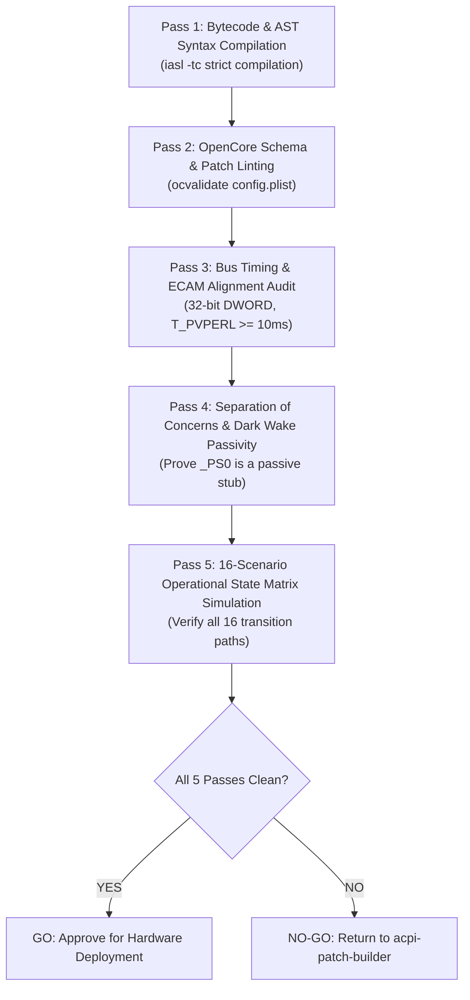

# ACPI Static Verifier & Pre-Boot Auditor Subskill

## Overview

This subskill governs **Step 5 (Static Pre-Verification)** in the iterative Modern Standby engineering loop.

It acts as a strict compiler and safety auditor, mathematically verifying that synthesized AML bytecode and OpenCore configurations comply with hardware specifications *before* code is deployed to bare metal. 

> [!IMPORTANT]
> **The Zero-Boot Invariant:** No experimental patch may be booted on hardware until this subagent issues a 100% clean Static Validation Report ([`Validation-vXX.md`](file:///home/datacompboy/fun/xmg/Bios-XMG-NEO_XNE15E20_XNE17E20_BIOS-N106v2/Validation-v55.md)).

---

## 1. Automated Static Verification Pipeline

The verification pipeline executes five sequential audit passes:



---

## 2. The 5 Static Verification Passes

### Pass 1: Strict Bytecode & AST Syntax Audit
Compile the replacement SSDT with ACPICA compiler enforcing strict warnings and errors:
```bash
iasl -tc SSDT-SLEEPFIX.dsl
```
* **Audit Checklist:**
  * **0 Compilation Errors:** Exit code must be 0.
  * **0 Unresolved External Symbols:** Every external symbol referenced (e.g., `\_SB.PCI0.GPP0.PEGP`, `M010`, `L23D`) must have an exact `External(...)` declaration matching its object type (`MethodObj`, `DeviceObj`, `FieldUnitObj`).
  * **0 Shadowed Identifiers:** No duplicate definitions of existing OEM methods or fields.

### Pass 2: OpenCore Configuration Schema Linting
Validate `config.plist` using the official validator:
```bash
ocvalidate config.plist
```
* **Audit Checklist:**
  * **0 Schema Violations:** All keys match OpenCore release specification.
  * **Exact Rename Length:** Source and target strings in `ACPI -> Patch` must have identical byte lengths (e.g., `4743364F` $\rightarrow$ `5843364F` for `GC6O -> XC6O`).
  * **Target Table Matching:** Ensure table signatures (`SSDT`) and OEM table IDs match the target OEM table to avoid corrupting unrelated ACPI tables.

### Pass 3: Bus Timing & ECAM Alignment Audit
Inspect the disassembled or synthesized code for hardware timing and alignment rules:
1. **$T_\text{PVPERL}$ Settling Latency:**
   * Verify that between releasing Fundamental Reset (`PERST#`) and link wake, there is an explicit delay of $\ge 10\text{ms}$ (`DLYM(0x0A)` or `DLYM(0x14)`).
2. **SoC ECAM 32-bit DWORD Alignment:**
   * Confirm that all reads and writes to PCIe extended configuration space are DWORD-aligned (offsets divisible by 4, operation size = 32 bits).
   * Ensure zero 8-bit byte-writes are issued to Root Complex registers.
3. **Absence of Unbounded Loops:**
   * Grep for `While` statements. Confirm that **every while loop** has an associated decrementing counter (e.g., `Local0--`) and maximum timeout condition.
4. **Absence of Bulk Configuration Writes:**
   * Grep for bulk field assignments and block copies across configuration space. Confirm that all bulk copies are permanently absent.

### Pass 4: Separation of Concerns & Dark Wake Passivity Proof
Mathematically prove that device evaluation methods remain passive:
1. Inspect the target device `_PS0`:
   ```asl
   Method (_PS0, 0, NotSerialized)
   {
       _PSC = Zero
   }
   ```
   * **The Proof Rule:** `_PS0` must contain **ZERO** invocations of `_ON`, power resource methods, or reset/link training routines.
   * **Why:** Proves that Modern Standby 0.15s Dark Wake maintenance queries cannot wake physical hardware rails without native `_PR0` reference counting.

### Pass 5: 16-Scenario Operational Matrix Simulation
Trace execution flow statically across all 16 scenarios defined in [`Design.md`](file:///home/datacompboy/fun/xmg/Bios-XMG-NEO_XNE15E20_XNE17E20_BIOS-N106v2/Design.md):

| Scenario ID | Test Condition | Entry Path | Expected Rail State | Refcount | Validated? |
|:---:|:---|:---|:---:|:---:|:---:|
| **S01** | Screen Off Request (Forced Sleep, Desktop, AC) | `_PR3._OFF` $\to$ Sleep | Rail Low, `PERST#` Low | 0 | [x] PASS |
| **S02** | Video Idle Timeout (Display Off in S0, Audio Active) | `Device._PS3` (Guarded) | Rail High, `PERST#` High | 1 | [x] PASS |
| **S03** | Modern Standby Dark Wake (PDC Maintenance Window) | `Device._PS0` (Passive) | Rail remains Low, `_PR0` untouched | 0 | [x] PASS |
| **S04** | User Wake from Deep Standby (Keypress) | `_PR0._ON` $\to$ Link Wake | Link L0, Strap unmasked, BARs restored | 1 | [x] PASS |
| *...* | *(Simulate remaining 12 scenarios)* | *...* | *...* | *...* | [x] PASS |

---

## 3. The Static Validation Report Format

Output the findings into `Validation-vXX.md`:

```markdown
# Static Verification Report: Firmware vXX

**Target Artifacts:** SSDT-SLEEPFIX.aml, config.plist  
**Verifier Agent:** acpi-static-verifier  
**Date:** 2026-XX-XX  

## Checklist
- [x] Pass 1: Bytecode & AST Syntax (0 errors, 0 warnings)
- [x] Pass 2: OpenCore Schema & Patch Linting (Clean)
- [x] Pass 3: Bus Timing ($T_\text{PVPERL} = 20\text{ms}$) & 32-bit ECAM Alignment
- [x] Pass 4: Dark Wake Passivity Invariant (Passive `_PS0` Verified)
- [x] Pass 5: 16-Scenario State Matrix Simulation (16/16 Verified)

## Decision: APPROVED FOR HARDWARE DEPLOYMENT (GO)
```

If any item fails:
```markdown
## Decision: REJECTED (NO-GO)
Reason: Pass 4 Violation - PEGP._PS0 contains active call to PG00._ON().
Action: Return to acpi-patch-builder to decouple _PS0 before hardware testing.
```
