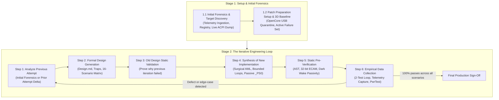
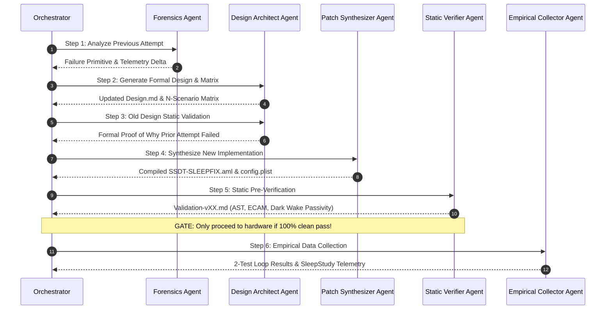

# Modern Standby (S0ix) Debugging Orchestrator

## Overview

This superskill governs the complete lifecycle of diagnosing, modeling, synthesizing, and validating Modern Standby (S0ix / Low Power S0 Idle) and ACPI power-state fixes on modern laptop architectures.

It replaces ad-hoc, trial-and-error bare-metal patching with a **rigorous two-stage engineering methodology**:
* **Stage 1:** Initial Incident Forensics, Target Discovery & Safety Setup
* **Stage 2:** The Iterative Engineering Loop (Analyze $\to$ Formal Design $\to$ Static Invalidation $\to$ Synthesis $\to$ Static Pre-Verification $\to$ Empirical Collection)



---

## The 3 Core Architectural Invariants

Before coordinating subagents or writing code, the orchestrator enforces three fundamental rules:

1. **Know Your Target Contract:** Never treat endpoints or OS drivers as generic black boxes. Check multi-function couplings (Function 0 GPU vs Function 1 Audio), hardware strap persistence across power cuts (`HDAE`), and OS driver configuration (`MSISupported : 0` vs MSI).
2. **ACPI Separation of Concerns (`_PRx` vs `_PSx`):**
   * **Power Resources (`_PR0..3`):** Own physical shared hardware rails, clocks, reset lines (`PERST#`), and OSPM reference counting.
   * **Device States (`_PS0..3`):** Own internal operational reporting (`_PSC = Zero`). They must remain **passive status stubs**. `_PS0` must never turn on physical power rails directly (violating this causes Modern Standby Dark Wake reboots).
3. **The Specification-Driven Invariant (The Meta-Law):**
   * **Never patch via trial-and-error on bare metal.** Every iteration must produce a formal design specification, an operational state matrix, and a static pre-verification proof *before* booting or flashing bytecode.

---

## Stage 1: Setup & Initial Forensics

### 1.1 Initial Incident Forensics & Target Discovery
* **Role / Subskill:** [`deep-sleep-forensics`](file:///home/datacompboy/fun/xmg/skill/deep-sleep-forensics/SKILL.md)
* **Actions:**
  1. Ingest historical crash artifacts using the unified diagnostic tool:
     ```bash
     python3 skill/scripts/sleepstudy-reader.py <sleepstudy.html | winevents.txt | minidump.dmp | reports_dir>
     ```
  2. Identify the **Death Session** and audit the 7 orthogonal telemetry dimensions (External Monitor State, AC/DC, Entry Reason, Logon Context, Standby Latency Milestone, Lid State, BlockerGroups).
  3. Query OS Registry for driver contracts:
     ```powershell
     Get-ItemProperty -Path "HKLM:\SYSTEM\CurrentControlSet\Enum\PCI\*\*\Device Parameters\Interrupt Management\MessageSignaledInterruptProperties" -Name MSISupported
     ```
  4. Perform **Live ACPI Table Extraction** (via `acpidump -b`). Do not unpack or reverse unverified ROMs when live tables from the running machine are available.
* **Exit Gate:** Target topology, interrupt mode, and death session triggers are documented.

### 1.2 Initial Patch Preparation Setup & Baseline Sweep
* **Role / Subskill:** [`deep-sleep-forensics`](file:///home/datacompboy/fun/xmg/skill/deep-sleep-forensics/SKILL.md)
* **Actions:**
  1. Establish zero-brick testbed using OpenCore on an external FAT32 USB drive:
     * Include `EFI/OC/.contentVisibility` with `Disabled` (suppresses bootloader self-entry).
     * Set `PlatformInfo -> Automatic = false` (preserves genuine SMBIOS, Windows activation, BitLocker PCRs).
     * Keep `ACPI -> Delete` empty (never drop OEM tables with dynamic NVS memory).
  2. Configure 60s fast display timeout on clean factory firmware:
     ```cmd
     powercfg /change monitor-timeout-ac 1
     ```
  3. Execute the 6-Scenario Baseline Sweep (T1–T6).
  4. Freeze passing dimensions and isolate the **Active Failure Set** (e.g., `T5` Desktop Deep Sleep and `T6` Desktop Idle Standby).
* **Exit Gate:** Active Failure Set isolated on unmodified factory firmware.

---

## Stage 2: The Iterative Engineering Loop

Whenever a test fails or a new patch iteration is required, execute this 6-step loop sequentially:



### Step 1: Analyze Previous Attempt
* **Role / Subskill:** [`deep-sleep-forensics`](file:///home/datacompboy/fun/xmg/skill/deep-sleep-forensics/SKILL.md)
* Extract telemetry from the previous attempt (or initial forensics if first run):
  * Was the failure a **Silent Hang** (unbounded bus polling / blocked IRP)?
  * An **Instant Cold Reboot** (Completer Abort / unaligned ECAM write / MCA)?
  * A **30s Watchdog BugCheck (`0x19C 0x50`)** (unmapped MMIO aperture / zeroed BARs / cleared MSE)?
  * A **Standby Maintenance Reboot** (active `_PS0` waking rails without OSPM `_PR0` refcount)?
  * An **Interrupt/Audio Failure** (Bit 10 masking legacy line interrupts / cleared capability strap)?

### Step 2: Design Generation
* **Role / Subskill:** [`acpi-design-architect`](file:///home/datacompboy/fun/xmg/skill/acpi-design-architect/SKILL.md)
* Author or update the declarative specification (`Design.md`).
* Model the exhaustive **N-Scenario Operational Matrix** (display on/off, audio idle/active, logon desktop/lock, power AC/DC, depth shallow/deep/dark wake).
* *(Optional Review Gate)* Request review from human pair-programmer or dedicated design reviewer subagent before synthesizing code.

### Step 3: Old Design Static Validation
* **Role / Subskill:** [`acpi-design-architect`](file:///home/datacompboy/fun/xmg/skill/acpi-design-architect/SKILL.md)
* Statically trace the previous attempt against the newly identified scenario.
* Formally document why the prior implementation broke (e.g., coupling rail wake to device `_PS0` evaluation).

### Step 4: Synthesis of New Implementation
* **Role / Subskill:** [`acpi-patch-synthesizer`](file:///home/datacompboy/fun/xmg/skill/acpi-patch-synthesizer/SKILL.md)
* Synthesize minimal replacement ASL:
  * Bounded while-loops with decrementing counter (`Local0 = 500`) and active retry.
  * Settling delays complying with PCI Express Base Spec $T_\text{PVPERL}$ ($\ge 10\text{ms}$).
  * Surgical register restoration (restore specific BARs, Command, unmask secondary straps).
  * Enforce passive `_PS0` stub (`_PSC = Zero`); physical rails left strictly to native `_PR0`/`_PR3`.
  * Zero bulk configuration space block copies.
  * 32-bit DWORD ECAM operations for SoC Host Bridges.
* Compile bytecode with `iasl -tc` and generate OpenCore in-memory 4-byte ASCII method renames.

### Step 5: Static Pre-Verification
* **Role / Subskill:** [`acpi-static-verifier`](file:///home/datacompboy/fun/xmg/skill/acpi-static-verifier/SKILL.md)
* Perform comprehensive pre-boot static analysis:
  * AST syntax & external scope resolution (0 errors, 0 unresolved symbols).
  * 32-bit ECAM DWORD alignment check.
  * $T_\text{PVPERL}$ settling timing audit.
  * Dark Wake Passivity Invariant proof.
  * Operational scenario simulation across all N matrix paths.
* Generate `Validation-vXX.md`.
* **The Hard Gate:** If any static invariant fails, **halt immediately**. Do not touch hardware or reboot. Return to Step 4.

### Step 6: Empirical Data Collection
* **Role / Subskill:** [`standby-empirical-collector`](file:///home/datacompboy/fun/xmg/skill/standby-empirical-collector/SKILL.md)
* Deploy verified bytecode to the USB testbed.
* Run the focused 2-test active loop (`T5` and `T6`).
* Collect telemetry (`sleepstudy-reader.py`).
* Verify audio playback and volume control responsiveness.
* If all tests pass cleanly:
  * Run 50 continuous Modern Standby cycles (`PwrTest /cs /c:50 /d:30 /p:15`).
  * Verify long-duration (>30m) hardware S0i3 DRIPS residency (>90%).
* If an edge-case or regression is discovered $\rightarrow$ feed artifacts back into **Step 1** to begin the next iteration.

---

## Subagent Dispatch Table

Use the `invoke_subagent` tool with the appropriate subagent role:

| Subagent Role | TypeName | Subskill Instruction Reference |
|:---|:---|:---|
| `Incident Forensics Engineer` | `research` or `self` | [`skill/deep-sleep-forensics/SKILL.md`](file:///home/datacompboy/fun/xmg/skill/deep-sleep-forensics/SKILL.md) |
| `Power Systems Architect` | `self` | [`skill/acpi-design-architect/SKILL.md`](file:///home/datacompboy/fun/xmg/skill/acpi-design-architect/SKILL.md) |
| `Firmware Synthesis Engineer` | `self` | [`skill/acpi-patch-synthesizer/SKILL.md`](file:///home/datacompboy/fun/xmg/skill/acpi-patch-synthesizer/SKILL.md) |
| `Static Verification Auditor` | `research` or `self` | [`skill/acpi-static-verifier/SKILL.md`](file:///home/datacompboy/fun/xmg/skill/acpi-static-verifier/SKILL.md) |
| `Empirical Test Engineer` | `self` | [`skill/standby-empirical-collector/SKILL.md`](file:///home/datacompboy/fun/xmg/skill/standby-empirical-collector/SKILL.md) |
