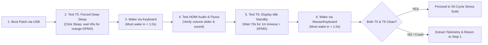

# Standby Empirical Collector & Stress Suite Subskill

## Overview

This subskill governs **Step 6 (Empirical Data Collection)** in the iterative Modern Standby engineering loop.

Once an experimental patch receives a 100% clean Static Validation Report from [`acpi-static-verifier`](file:///home/datacompboy/fun/xmg/skill/acpi-static-verifier/SKILL.md), this subskill executes the empirical testing protocol on bare metal, captures telemetry, and audits hardware stability.

---

## 1. Testbed Deployment & Safety Protocol

1. **Deploy Verified Files to USB Drive:**
   * Copy compiled `SSDT-SLEEPFIX.aml` to `EFI/OC/ACPI/SSDT-SLEEPFIX.aml`.
   * Copy verified `config.plist` to `EFI/OC/config.plist`.
   * Verify that `EFI/OC/.contentVisibility` exists and contains `Disabled` (suppresses OpenCore from enumerating itself in its boot menu).
2. **Boot via OpenCore USB:**
   * Tap `F10` at startup and select the USB drive.
   * Boot Windows 11. Confirm genuine activation and BitLocker state remain normal.

---

## 2. The Rapid 2-Test Iteration Loop

Do not run exhaustive 15-minute matrices on every test patch. Run **only the Active Failure Set** (`T5` and `T6`):



### Test T5 Protocol (Forced Deep Sleep):
1. Connect external HDMI 2.1 display.
2. Click **Start $\rightarrow$ Power $\rightarrow$ Sleep** (or press Sleep key).
3. Wait **45 seconds** until the external monitor LED turns orange (DPMS standby / link parked in L23).
4. Tap any keyboard key.
   * **Pass Criterion:** Internal and external displays light up in $< 1.0$ second with zero black screen, zero fan runaway, and zero delay.

### Multi-Function Audio Verification:
1. Immediately after waking from `T5`, open YouTube or play a local sound file routed to the HDMI monitor speakers.
2. Click the Windows taskbar speaker icon and slide the volume back and forth.
   * **Pass Criterion:** Volume slider moves smoothly without lag; sound plays with zero distortion or stuttering; zero high CPU spinlock.

### Test T6 Protocol (Display Idle Standby):
1. Configure 60s display timeout: `powercfg /change monitor-timeout-ac 1`.
2. Leave mouse and keyboard untouched for **70 seconds**.
3. Observe display turning off, followed by the external monitor entering DPMS orange standby.
4. Move the mouse to wake.
   * **Pass Criterion:** Clean wake in $< 1.0$ second.

---

## 3. Telemetry Extraction Following Test Runs

Immediately after waking (or after recovering from a hang/reboot), run the telemetry commands:

```cmd
:: 1. Generate SleepStudy:
powercfg /sleepstudy

:: 2. Export Micro Event Log:
powershell -Command "Get-WinEvent -FilterHashtable @{LogName='System'; Id=@(41, 42, 107, 109, 506, 507, 1001, 6006, 6008)} -MaxEvents 50 | Format-Table TimeCreated, Id, Message -Wrap | Out-File -Encoding utf8 winevents.txt"

:: 3. Parse Telemetry Immediately:
python3 skill/scripts/sleepstudy-reader.py sleepstudy-report.html winevents.txt
```

If a blue screen or crash occurred:
```bash
# Parse the generated minidump:
python3 skill/scripts/parse_minidump.py C:\Windows\Minidump\*.dmp
```

---

## 4. Production Sign-Off Stress Suite

Once the 2-test active loop passes cleanly, execute the two final stress tests before declaring convergence:

### 4.1 Automated 50-Cycle Modern Standby Stress (`PwrTest`)
Using the Windows Driver Kit `PwrTest` utility:
```cmd
:: Run 50 continuous modern standby cycles (30s sleep, 15s wake pause):
PwrTest /cs /c:50 /d:30 /p:15
```
* **Pass Criterion:** 50/50 cycles complete successfully with **0 Abnormal Shutdowns (Type 9)** and **0 BugChecks (Type 10)**.

### 4.2 Prolonged Modern Standby DRIPS S0i3 Residency Audit
1. Let the system enter Modern Standby and remain asleep for **$\ge 30$ minutes** on AC and DC.
2. Wake the system and inspect `sleepstudy-report.html`:
   * **Pass Criterion:** Hardware S0i3 DRIPS residency must exceed **90%** (e.g. 89%–98%).
   * **Dark Wake Resilience:** Verify that any periodic PDC background maintenance windows (typically occurring at ~46 seconds and ~15 minutes) entered and exited cleanly without resetting the machine back to POST.
